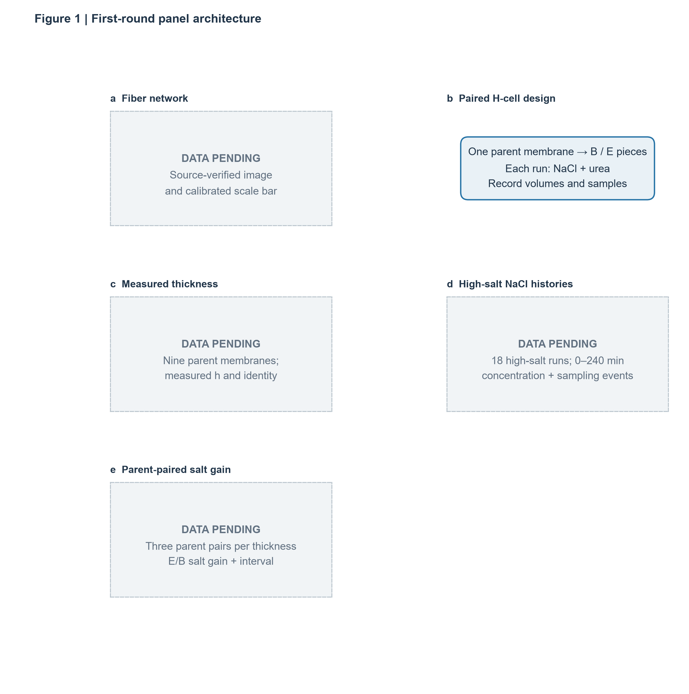

# 超薄 PE 纤维膜：界面状态、离子选择性与盐输运

本仓库研究一个反常的传质问题：为什么历史实验中，名义厚度更小的超薄 UHMWPE 纤维膜，盐迁移反而可能显著低于厚膜？项目不预设“荷电必然排盐”，而是把共同传质能力、界面荷电、离子额外响应、装置外阻和实验状态放入同一套可核验框架。

> 当前阶段（2026-11-03）：第一轮中文论文初稿和五张主图布局已完成，可供导师修改。现有数值结论来自历史盐数据的条件性计算；同批盐/尿素双探针、外阻控制和留出验证尚未完成。



图中 `DATA PENDING` 是主动保留的实测位置，不是零值，也不是模拟数据。

## 一眼看懂项目

### 科学问题

历史 B/R 盐曲线提示，65 nm 组的盐迁移可远低于 2600 nm 组，乙醇预湿后又可能出现强响应。单纯的“膜越薄、路径越短”关系无法解释这一组合现象。

本项目因此追问：

1. 盐和中性小分子共同经历的有效传质限制贡献多少？
2. 盐相对于中性探针是否还有稳定的离子额外响应？
3. 厚度、预湿状态和盐度变化能否由同一组受约束参数解释？
4. 模型能否预测未参与校准的留出条件，而不是逐曲线自由拟合？

### 理论框架

总传递阻力分为装置外阻、孔口阻力和膜内阻力。膜内迁移同时考虑扩散、分配和带电孔中的离子电迁移。组合能力

```text
b = εf / τ
```

表示可达面积、连通性和曲折度等共同作用。`b` 不是实测湿孔数、润湿率或单一微观机制。

中性尿素用于独立约束共同传质能力，再以盐数据检验剩余的离子响应。ζ 电位和 KPFM 只作为辅助电性背景，不能直接替代高盐孔内表面电荷密度。

### 关键术语

| 术语 | 含义 |
|---|---|
| 历史 B/R | 历史基线组与乙醇预湿组；未认证为同母膜配对 |
| 新批 B/E | 新实验设计中的基线裁片与乙醇预湿裁片；以同一母膜为配对单位 |
| C1/C2 | 将历史电导读数换算为盐转移量的两种条件情景，不是两张独立母膜 |
| W2 | 历史曲线的 60–100 min 分析窗口，不是新实验的 100 min 取样点 |
| G1 | 归档带电孔迁移算子族；G0 为零电荷参照，G2 为小孔/短孔压力情景 |
| `δ = 0.20` | 历史区间等效速率使用的 20% 操作性容差，不是统计误差条 |
| E1 | 同组曲线共享非负装置外阻的条件；逐曲线自由外阻属于另一取消分支 |
| `Γ` | 允许的厚薄几何尺度比；`Γ = 10` 是试探情景，不是实测值 |
| T12 | 10 mM 高盐算子中的未决数值子集，尚未达到原定误差门槛 |

### 当前最重要的结果

在已声明的双池、共享外阻和归档模型范围内，历史 W2 盐数据要求很大的厚薄有效能力差异：

- G1、`δ = 0.20`、E1 条件下，`b(B2600)/b(B65)` 的 C1/C2 必要下界为 **1358.48/1369.88**。
- 即使允许试探几何比 `Γ = 10`，相应下界仍为 **135.85/136.99**。
- 这些值是模型域内的必要条件，不是新膜的实测 `b`，也不是对所有荷电机制的排除。
- 若允许每条曲线拥有独立自由外阻，单窗口正下界可以被取消。这说明外阻实测是机制识别的必要条件。

当前最稳健的论文价值不是宣布某个唯一微观机制，而是把历史反常现象转化为强数量级约束，并提出可由中性探针和留出预测直接检验的路径。

## 当前证据边界

| 已完成并可复核 | 尚缺、不能写成实测结论 |
|---|---|
| 历史盐数据整理与身份审查 | 新批次同母膜 B/E 配对结果 |
| 串联阻力与有效能力模型 | 每次运行同测 NaCl/尿素的完整时程 |
| A：历史盐曲线的必要能力界 | 无 PE 外阻、库存、净流和质量回收闭合 |
| B：固定状态速率范围诊断 | 九张母膜的实测厚度与身份闭合 |
| D：旧盐条件下的尿素响应范围预测 | 2 个校准条件和 8 个留出条件的实测检验 |
| 第一轮中英文稿、五图20面板布局及图件 QA | T12 高盐数值误差的最终裁定 |

历史 B/R 未认证为同母膜配对；逐运行池体积、取样补液和净流也未完全恢复。因此历史曲线用于提出问题和约束模型，不作为新批次机制验证。

## 从哪里开始读

| 读者目标 | 首选入口 |
|---|---|
| 快速了解论文要讲什么 | [第一轮逻辑、图组与数据缺口](paper/20261102_论文第一轮_逻辑图组与缺口.md) |
| 阅读当前中文论文初稿 | [PE 超薄膜论文中文初稿](paper/20261102_PE超薄膜论文中文初稿_第一轮.md) |
| 阅读英文讨论稿 | [English first-round draft](paper/20261102_PE_ultrathin_membrane_first_round_draft.md) |
| 查看当前正式状态 | [项目进展计划与任务看板](项目进展计划与任务看板.md) |
| 理解研究背景和长期边界 | [项目说明与行动清单](项目说明与行动清单.md) |
| 复现导师 v5 主模型 | [effective network model](src/effective_network_model/README.md) |
| 核查结果如何进入论文主张 | [paper/review-traces](paper/review-traces/) |
| 查看阶段性科研结论 | [阶段总结](阶段总结/) |

## 五张主图各自证明什么

| 主图 | 论证任务 | 当前状态 |
|---|---|---|
| Fig. 1 | 建立本批材料、H 池设计、厚度和盐迁移现象 | 设计示意已完成；材料身份和本批盐曲线待测 |
| Fig. 2 | 排查装置外阻、尿素扰动、等待时间和层数等替代解释 | 四组控制均待实测 |
| Fig. 3 | 用同次盐/尿素测量拆分共同响应与离子额外响应 | 三个核心数据面板待实测 |
| Fig. 4 | 将历史盐现象转化为有效能力必要界，并与中性探针约束比较 | 模型、解析参照和历史界已完成；尿素约束待测 |
| Fig. 5 | 用 2 个校准和 8 个留出条件检验跨厚度、跨盐度预测 | 条件矩阵已冻结；预测、残差和判别待实测 |

完整 PNG/SVG 和图件审计位于 `data/processed/salt_transport/20261102_first_round_Fig*`。五张图的 alignment 和 collision 审计均为 `PASS`。

## 仓库结构

```text
.
├─ paper/                         论文草稿、图组说明和审阅轨迹
├─ src/                           模型、数据接入、机制核验和绘图代码
│  ├─ effective_network_model/   导师 v5 主模型及后续诊断
│  ├─ data_ingest/               Origin 只读解码、长表整理和质量检查
│  ├─ surface_pb/                纤维外水域 PB 与荷电调节
│  ├─ finite_pnp/                有限二维 PNP 与多排纤维计算
│  ├─ long_tube_diagnostic/      长管 PB-NP 受限诊断
│  └─ mechanism_*.py             当前论文范围的解析与数值核验
├─ data/processed/               可追溯的轻量 CSV/JSON/PNG/SVG 结果
├─ WP1/ ... WP6/                 问题、求解、拟合、留出和写作工作包
├─ 阶段总结/                     各阶段的正式科研结论
├─ .planning/                    跨会话任务检查点
├─ 复现记录_*.md                 环境、命令和验证证据
├─ 项目进展计划与任务看板.md     唯一正式任务状态来源
├─ 项目说明与行动清单.md         背景、边界和长期行动入口
└─ AGENTS.md                     双设备协作与科研文件规范
```

`原始资料/` 保存原始交付、实验快照、文献和历史版本。该目录受 `.gitignore` 保护，不上传 GitHub，也不应被处理结果覆盖。

## 环境与复现

项目当前在 Windows、Python 3.14.7 下维护。已验证依赖：

```text
numpy==2.5.4
scipy==1.18.1
matplotlib==3.11.2
```

创建环境：

```powershell
py -3.14 -m venv .venv
.\.venv\Scripts\python.exe -m pip install -r requirements.txt
```

### 推荐复现入口

| 目标 | 入口 | GitHub 克隆版状态 | 说明 |
|---|---|---|---|
| 导师 v5 主模型 | `src/effective_network_model/run_reproduction.ps1` | **公开可跑** | 必要轻量输入已跟踪；输出到仓库外的新目录 |
| 第一轮论文组图 | `src/render_first_round_manuscript_figures.py` | **仅代码和结果公开** | 脚本启动时会导入本机固定路径下的 `nature-figure` 对齐审计工具；没有该工具会直接失败，不能按普通 Matplotlib 脚本独立运行 |
| A 主条件解析核对 | `src/mechanism_paper_a_main_certificates.py` | **本地输入必需** | 依赖受 Git 忽略的原始任务包；用于项目内部复核 |
| D 中性探针条件范围 | `src/mechanism_paper_d_neutral_projection.py` | **本地输入必需** | 依赖受 Git 忽略的原始任务包；输出条件预测，不是实测结果 |
| 旧数据接入与质量检查 | `src/data_ingest/` | **本地输入和 Origin 必需** | 原始 OPJU 只读处理；部分脚本还需要 Windows Origin COM |

主模型最小复现示例：

```powershell
powershell -NoProfile -ExecutionPolicy Bypass `
  -File .\src\effective_network_model\run_reproduction.ps1 `
  -OutputDirectory 'D:\CodexWorkspaces\pe-v5-run-001'
```

只复现标准库 core 时，在命令末尾添加 `-CoreOnly`。每次使用新的仓库外输出目录。

部分当前论文脚本需要 `原始资料/` 中的受限输入。GitHub 克隆版保留代码、轻量结果和审查轨迹，但不包含全部原始输入，因此不能把“脚本可读”误解为“所有内部计算可由公开克隆独立重跑”。

## 数据与结论规范

- 不编造缺失实验值、误差条、文献或参数。
- 区分实验事实、理论预测、模型假设和待验证推测。
- `model envelope` 是条件参数范围，不等于统计置信区间。
- 低于检测限的数据以区间处理，不代入 0 或半检测限。
- 同一盐曲线不能同时自由拟合机制参数并充当独立验证。
- 图中的连线、示意和空白位置不构成新增观测。
- 原始资料、历史记录和不同实验版本不删除、不覆盖、不擅自移动。

## 分支与协作

本项目由同一研究者通过两台设备维护：

- `main`：受保护的权威共享分支。
- `dev-zhao`、`dev-yi`：设备开发分支，不代表不同研究者。
- 不得直接修改受保护的 `main`，不得强推、擅自合并、变基、重写历史或覆盖另一设备工作。

切换设备前，先更新正式看板和当前 `.planning/` 检查点，再提交并推送设备分支。详细规则见 [AGENTS.md](AGENTS.md)。

## 当前下一步

1. 由导师审阅核心叙事、五图顺序和旧计算进入正文的程度。
2. 按既定 WP5 质量门完成检测限、探针扰动、外阻、质量回收、净流和库存核验。
3. 取得同母膜 B/E 的 NaCl/尿素双探针数据及实测厚度。
4. 先用尿素约束共同能力，再运行预定的 2 校准/8 留出盐条件检验。
5. 依据真实结果收缩或确认论文主张，不为填图增加虚构数据或自由参数。

当前稿件已具备第一轮导师讨论条件，尚不具备结果完整的投稿条件。
