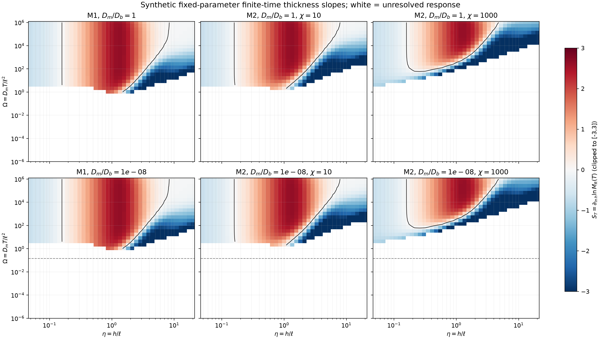
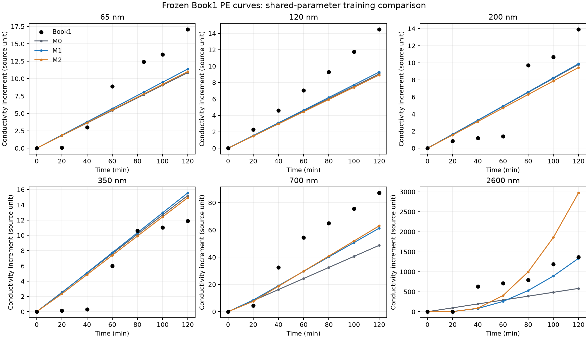
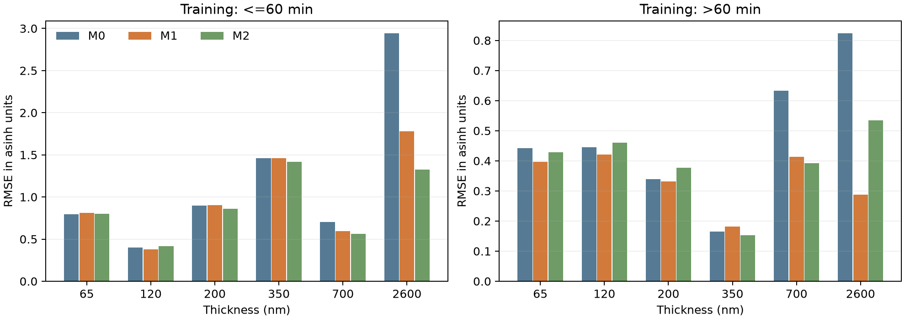
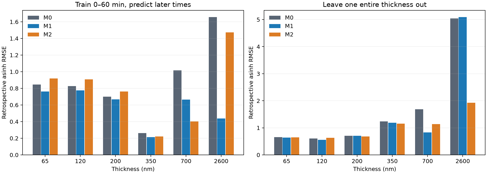
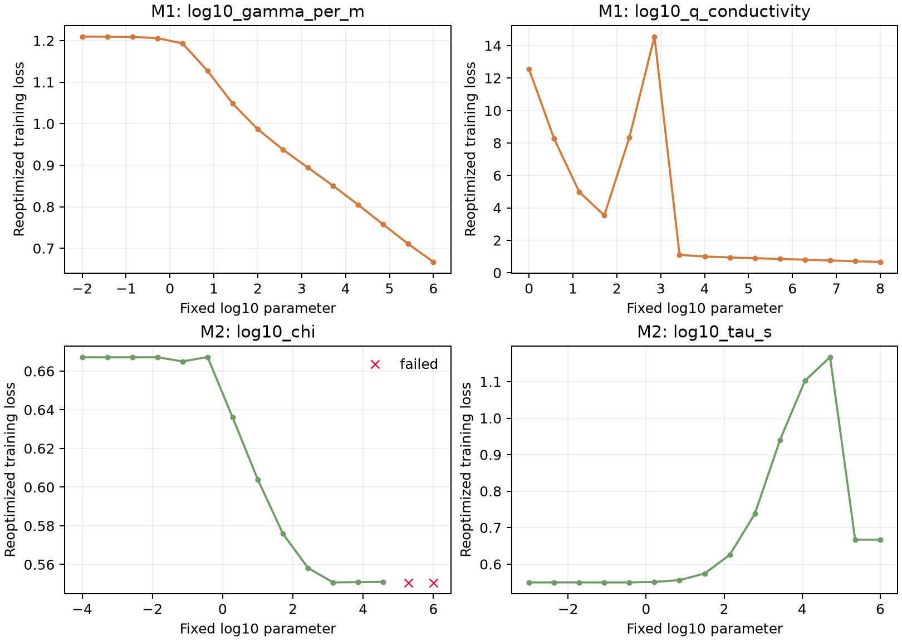
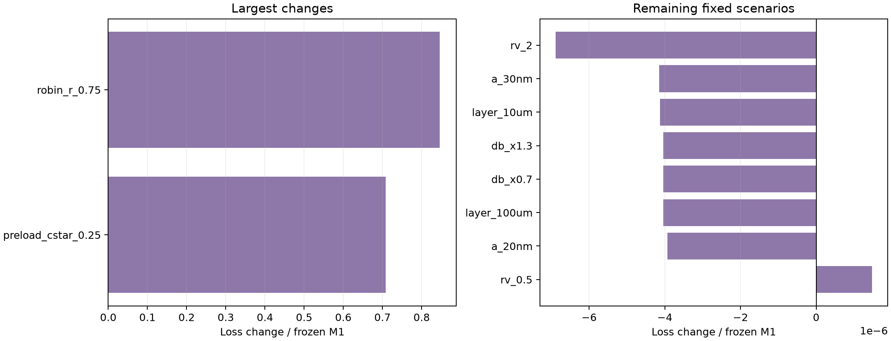

# 超薄 PE 纤维膜旧电导曲线的共享有效场与瞬态输运检验：条件规律及统一解释的边界

**稿件状态：** WP6 学生端工作初稿，2026-10-22；尚不具备投稿条件，待学生核读、导师第三次审阅。本文的“膜厚”沿用旧表标签，电导读数没有转成绝对盐通量。全部真实数据来自旧记录，没有新增实验。

## 摘要

超薄聚乙烯（PE）纤维膜的旧电导曲线在六个厚度标签上同时呈现非单调终点排序与强烈时间形状差异。我们按预先冻结的共同参数协议比较准稳态两池模型 M0、含膜内移动盐瞬态的 M1，以及增加可逆慢储量的 M2。以 Book1 六膜、36 个非零时间点为输入，在统一电导尺度 Q 下，三模型的训练内损失分别为 1.209716、0.667126、0.552434。0–60 min 训练预测后段的宏平均误差为 0.884752、0.586806、0.780691；六折整膜留出的误差为 1.655928、1.501394、1.028292。M1 对 M0 的时间预测改进满足预设相对门槛，但 2600 nm 完整留出终点错 40.52 倍。M2 对该终点的误差为 1.881 倍，却增加总体时间误差，且留出参数要求未经实测支持的极大容量。三模型都预测错 200/350 nm 的 120 min 排序。局部灵敏度显示 γ 与 Q 近不可分，边界和初态假设显著影响拟合。由此，本轮确认的是既定模型在旧同源曲线上的条件改进和失败边界；不能从训练损失推断 PE 新机理、统一输运规律或投稿准备度。

**关键词：** 超薄 PE 膜；有限池；膜内瞬态；厚度留出；参数辨识；电导曲线。

## 1. 问题与已有工作

已有 PE 工作报告薄膜盐转移、形貌和界面表征，并讨论表面电势与 Donnan 方向 [1,2]。入口阻力、相互作用势、有限储液池扩散、吸附储量、湿润门控及带电孔理论均有先前研究 [3–9]；本稿不把这些方程或机制当作首次提出。这里的窄问题是：同一组有效参数、同一观察标度，能否同时解释六膜的厚度排序和时间曲线？旧数据尤其要求面对 200 nm 的 120 min 增量 13.92 大于 350 nm 的 11.89、2600 nm 的强时变，以及历史模型在最厚膜留出的巨大失配。读数的原表单位未获校准，已发表通量和 Book1 曲线也未证实为同一膜/条件，所以本稿只作条件电导比较。[1] 原文浓差 `0.27 m` 与导师概述 `0.27 M` 的记法差异仍待核读，未用于反算。

## 2. 数据与冻结方法

输入为 Book1 六个 PE 厚度标签 65、120、200、350、700、2600 nm 各七点，其中 0 min 用于同曲线背景扣除，36 个非零点进入目标函数。65 nm 的第五时点是 85 min，其余为 80 min。Book2 同源序列、PC、滤纸和其他曲线未当作独立重复并入主拟合。数据身份、列映射、原值和单位状态详见 `WP1/03_数据与参数清单.csv`。六膜以等权重进入 `asinh(y/1)` 平方损失，观测方程为 `y=Q C_R/C_0`，Q 全膜共享，不对每膜按自身终点再标定。

导师 v6 冻结的有效场为 `w(x)=w_s(a_ref/a)[exp(-x/ℓ)+exp(-(h-x)/ℓ)]/[1+r exp(-h/ℓ)]`。M0 对应准稳态阻力 `R=∫exp(w)/D_m dx+πa/(2D_b)` 与两个有限池。M1 解 `j=-D_m exp(-w)∂_x[exp(w)c]`、`∂_t c=-∂_xj`，两侧入口阻力与池盐量守恒同时施加。M2 再设 `∂_t s=(χc-s)/τ_x`，移动盐与慢储量之间的交换相互抵消于总盐量。主情景 `r=0`、`a=25 nm`、池比 1、固定参考 `D_b`；五个共享拟合坐标为 `w_s,ℓ,D_m/D_b,γ,Q`，M2 另有 χ、τ_x。`γ=Aε/V_R` 与 Q 都不能直接认作已测物性。详细推导、边界、初态和有限体积离散见 `WP2/01_方程与边界推导.md` 及本稿补充材料。

每模型按相同冻结搜索盒及 12 个固定初值拟合。M2 仅在预设的 M1 时间结构失配超过数值误差、且容量未被先验排除时启用。模型评价分开报告：完整数据训练残差，0–60 min 训练后段预测，六折整膜厚度留出；每折重新拟合，未把全数据参数固定为留出答案。比较百分比为预先规定的研究决策阈值，不是显著性检验。所有留出都是已见旧数据的回顾性内部检验。

## 3. 数值有效性与条件尺度规律

求解器在合成工况完成 N1–N9 的 46 项通过、4 项辨识观察、0 项失败；包括解析极限、非负性、守恒和网格/时间容差。该技术验收不验证 PE 机理。固定场的模型恒等式 `S_T=S_ss+dlnB/dlnh` 将有限时刻的累计接收盐量厚度斜率分解为稳态斜率与建立因子 B 的厚度导数；它不是新定律。在 `η=h/ℓ=1, Ω=D_mT/ℓ²=1, D_m/D_b=10⁻⁸` 的合成示例，`S_ss≈2.516`、M1 `S_T≈1.728`，说明同参数模型内瞬态可以改变斜率。图 1 给出规定场和时间区域；白色为近零响应未解析区域，不能把该图称为实测 PE 相图。

## 4. 六膜完整曲线的描述能力

在同一 36 点目标下，M0/M1/M2 的 BDF 核算训练损失依次为 1.209716/0.667126/0.552434。M1 相对 M0 下降 44.85%，M2 相对 M1 再下降 17.19%。M1 的 γ、Q 贴诊断盒上界；仅把 γ 上界外扩一次，其训练损失还可降至 0.605988，因此额外训练下降不能独自证明慢库存在。M2 主五十格最佳点在 2600 nm 早期的 50→200 格差 2.198%；百格局部精化后的 100→200 格差 0.448%，主表与数值补充结果分别保存。所有模型在训练点给出的 200/350 nm 120 min 比值约 0.644/0.635/0.632，方向均与旧表 1.17073 相反。2600 nm 的 M1 训练终点接近旧表，但 40 min 预测约 80.19，原表为 633.25。图 2 展示六膜曲线，图 4 展示逐膜早晚残差。

## 5. 内部预测和参数可辨识

预设后段 E_time 为 M0 0.884752、M1 0.586806、M2 0.780691；六折 E_h 为 1.655928、1.501394、1.028292。M1 对 M0 的后段误差降 33.68%，六厚度均改善，厚度误差降 9.33%，所以通过相对比较门槛。M1 在 2600 nm 整膜留出终点错 40.52 倍，未达到定量外推的 2 倍目标。M2 的该单一终点错 1.881 倍，但相对于 M1 后段误差增加 33.04%、仅一膜改善，故不能据厚端单点选作统一推荐模型。M2 最厚留出折的 χ 接近 `10⁶`，若作为等浓度死端水须 `ε≲10⁻⁶`、`A/V_R≳10¹² m⁻¹`；现有记录无独立几何和孔隙实测来认证。图 3 按膜列出两类留出。

M1 五参数各做 15 点剖面重优化；M2 对 χ、τ_x 各做 15 点尝试。M1 局部灵敏度最小奇异值约 `4.63×10⁻⁵`，γ 与 Q 的列相关约 `0.9999999994`，因此单独的 γ 或 Q 值不能被当前数据唯一决定。M2 的 χ、τ_x 条件剖面存在较宽的接近低损失区域；χ 两个极高值点发生数值失败，故不能凭局部剖面断言全盒可辨识或不可辨识。图 5 展示关键剖面；图中局部优化的尖点须结合逐点状态表阅读，不是置信区间。

## 6. 固定扰动、讨论与结论

M1 候选按预定矩阵重拟合 10 个单因素情景、两档读数预算各 16 个固定种子，以及 200 nm 定向扰动。r=0.75 和守恒预载 `C*=0.25` 是按完整数据参数漂移/训练损失变化选出的最不利两情景。重复留出的 E_time 为 0.80835/0.85317，2600 nm 终点误差倍数为 20.33/38.68；边界和初态对结论的影响不能省略。固定外层 100 μm 扩散层仅是准稳态阻力情景，不等于实测搅拌。两档读数扰动是设计预算，不是仪器误差。对 120 min 的 200/350 nm **原表端点排序**，最大 ±0.25 原读数盒下两膜增量差仍至少 1.03，因而模型反向预测不能归因于该盒内排序符号不定；该解析界不证明完整曲线稳健。图 6 展示固定情景的训练损失变化。

本轮提供了守恒模型、条件尺度图、全曲线比较与如实失败的内部预测证据。M1 相对 M0 有受限的后段预测改善；M2 的单一厚端终点改善未通过总体时间和物理量级门槛。现有旧同源曲线不能支撑“共享机制解释所有膜厚/时间响应”“识别真实 PE 吸附或湿润机制”或“厚端可定量外推”的主张。比较文献显示两池、入口、有效场和储量理论已有先例，当前未建立清晰而稳健的 PE 特有理论或材料增量。因此本稿是完整研究的忠实交接初稿，尚不应作为投稿稿件；是否通过第三次审阅由导师据原始证据决定。

## 参考文献与核读范围

以下仅列 WP1 比较表已记录的来源；正文未声称本轮重新取得所有全文。每篇可读层级、DOI 与限制详见 `WP1/02_原始文献比较表.csv`。

1. Sun et al. *Advanced Materials* **34**, 2107941 (2022), DOI: 10.1002/adma.202107941。
2. Wang et al. *Polymer* **285**, 126393 (2023), DOI: 10.1016/j.polymer.2023.126393。
3. Sahu and Zwolak, *PCCP* **20**, 4646–4651 (2018), DOI: 10.1039/C7CP07924A。
4. Rankin, Bocquet and Huang, *JCP* **151**, 044705 (2019), DOI: 10.1063/1.5108700；并见 2023 勘误 DOI: 10.1063/5.0167179。
5. Yaroshchuk, Glaus and Van Loon, *Journal of Membrane Science* **319**, 133–140 (2008), DOI: 10.1016/j.memsci.2008.03.027。
6. Yaroshchuk, Glaus and Van Loon, *Journal of Colloid and Interface Science* **337**, 508–512 (2009), DOI: 10.1016/j.jcis.2009.05.049。
7. Polster et al., *JACS* **144**, 11693–11705 (2022), DOI: 10.1021/jacs.2c03436。
8. Apel et al., *Langmuir* **37**, 14089–14095 (2021), DOI: 10.1021/acs.langmuir.1c02267。

**图源与数值入口：** 图 1 来自 `WP3/`；图 2、4 来自 `WP4/`；图 3、5、6 来自 `WP5/`。生成程序和结果列于 `WP6/reproduction/` 的交接清单。具体逐点读数、失败起点与数值容差见补充材料及原工作包，不得从图直接反算材料物性。
