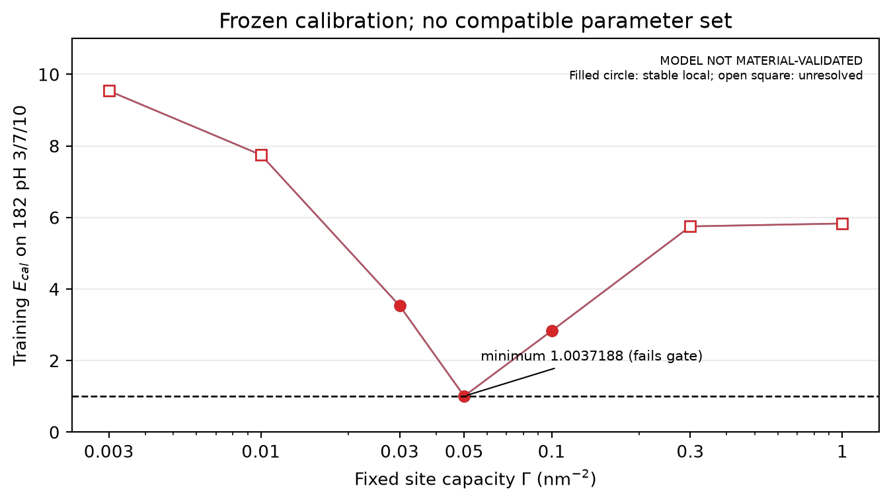
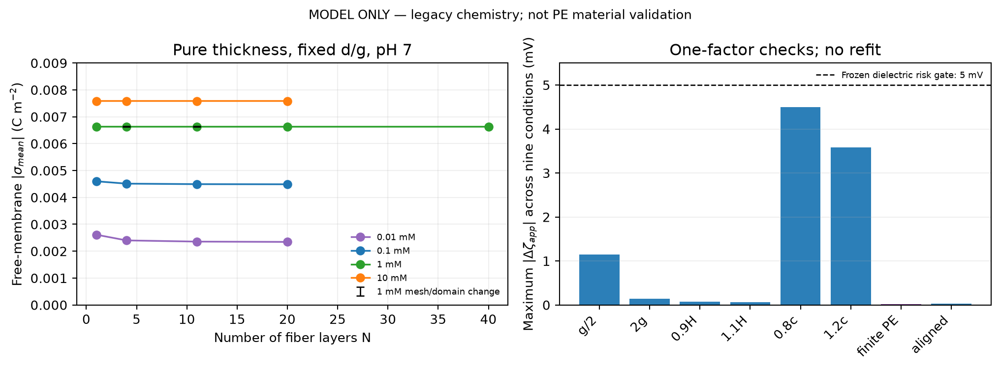

# 有限纤维层荷电调节能否解释超薄PE膜的电动差异？

**研究稿；内部审阅版，未投稿。** 预定材料机制主张未通过。图与参数中的旧示例仅标`MODEL_ONLY`。

## 摘要

超薄聚乙烯（PE）纤维膜的流动电位随结构和pH变化，但表观ζ不能直接代表真实表面电荷。我们按冻结v9任务书建立四物种Poisson–Boltzmann（PB）和竞争H⁺/OH⁻荷电调节模型，显式区分纤维湿界面平均荷电σ_mean、投影荷电Q_proj与压流加权ζ_app。模型通过十项技术检查。仅用182结构的三个pH组校准七档位点容量与共同化学参数，最小标准化误差E_cal=1.0037188，严格高于预定相容门槛1；八个起点优化未决。因此没有锁定可用于357/604材料预测的化学参数。按预定失败分支，旧示例化学的N4/N11纯厚度比较给出|σ_mean|差3.08×10⁻⁷ C/m²，低于10%操作门槛及五倍数值误差。九个既有条件的固定敏感性和十二代表状态复核均完成；有限PE介电场未触发预定风险界，但该变化小于网格误差。这些结果限定了模型可说的范围，未建立真实PE荷电起源或独立薄化增荷机制。

**关键词：** 聚乙烯纤维膜；界面荷电；荷电调节；Poisson–Boltzmann；流动电位；可辨识性

## 1 引言

本组已有数据同时改变膜结构、pH与条件电解液。电动测得的ζ是带电液体随压流运动后的观察量；真实纤维表面σ还受局部势、化学状态和湿界面面积影响。仅凭较负的ζ或较薄的膜，不能断言单个纤维表面荷电增加。本文检验一个共同化学、有限层几何和固定观察算子的预定模型，并明确其未通过的关口。研究只使用任务书已核对的九组、36条压力扫描；不追加实验，也不把旧盐输运分析并入本模型。

## 2 数据与模型

182结构的pH3/7/10三组用于训练。357和604的六组原定为回顾性跨结构检验，训练门槛未通过后不据此挑选参数，也不将旧示例输出称为材料预测。四条扫描属于同一条件下的Ramp，独立膜数未知。盐背景采用由电导换算的条件NaCl并补足H⁺/OH⁻及反离子；实际盐身份未认证。干投影g与假定完整缝高H是模型代理，湿态结构和安装方式尚未独立测量。

局部三态界面反应以共同Γ、pI、b表征H⁺/OH⁻竞争，σ由局部真实表面势自洽决定。水域求四物种PB，主计算使用忽略固体内部场的Gauss近似；预定敏感性另解ε_PE=2.3的固体Laplace场，并在同一表面施加位移跳跃。方形纤维单胞保留准确h/d/g、层数和湿周长。自由膜与背衬膜分开计算；背衬条件以近膜压力流和清水外区解析拼接，按移动离子电流与总流量比计算ζ_app。固定电荷不进入移动电流积分。详细方程、网格和目标函数见`WP6/v9_补充材料.md`。

Γ固定取0.003、0.01、0.03、0.05、0.1、0.3、1.0 nm⁻²，每档两固定起点，每起点不超过48次实际目标调用（含数值差分）。目标E_cal是三个训练ζ残差按各组预定尺度标准化后的均方根。相容门槛为E_cal≤1且不高于全局已得最小E加0.25；预定预测与敏感性分支不因结果改动。

## 3 结果

### 3.1 技术关口与训练结果

数据、三态导数、零荷电、Grahame极限、v3单纤维基准、致密介电板、有限纤维Gauss、压力观察、四代表状态细化和外域加倍十项技术检查全部通过。这仅证明计算接口在声明案例内工作。校准共556次实际目标调用、1668个PB场，六起点局部稳定、八起点达到预算仍未证实稳定。最佳Γ=0.05 nm⁻²的两起点稳定且一致，E_cal=1.0037188，严格高于1；其余档也无相容见证。图1展示全部档位与固定门槛。由于存在未收敛档位，整体判“优化未决且当前无相容见证”，不能说已排除所有可能化学。

### 3.2 预定失败分支的纯厚度与对照

无相容参数时，任务书指定旧示例Γ=0.05 nm⁻²、pI=4.372113695091497、b=−0.8682652885468274，只用于`MODEL_ONLY`机制边界。固定纤维宽度d、间隙g和化学，在pH7、四盐度计算N1/4/11/20自由与背衬32场，补N40两场；三盐度另做24场固定电荷对照。1 mM自由N4/N11的σ_mean分别为−0.006630190和−0.006629882 C/m²，|σ|差3.08×10⁻⁷ C/m²。五倍数值误差为1.12×10⁻⁴ C/m²，10%门槛为6.63×10⁻⁴ C/m²，故旧示例条件下薄化增荷不可分辨。N20/N40中心层在此模型中符合2%厚端标准，不能外推为真实PE饱和。图2同时展示纯厚度曲线和敏感性上界。

### 3.3 数值稳健性与观察量

十二预定代表状态的σ细化/双外域最大相对变化0.1789%、背衬ζ最大变化0.5841 mV，均通过冻结容差。九个已有条件各自的八项固定单因素敏感性连同基线共144行，全部数值有效。g×0.5使各结构族的层数N变化，说明干间隙代理与层数耦合；它在旧示例中使中性604−182的ζ差由+0.0354变为−0.1260 mV，但两值均小于1 mV数值容差。已有报告ζ差为−17.5833 mV，因此旧示例的微小符号改变不是跨结构解释。条件盐度×0.8对ζ的最大影响为4.493 mV，H±10%对ζ最大影响为0.078 mV。有限PE介电场相对主近似的最大ζ变化0.0146 mV、σ相对变化0.00527%；未触发预定5 mV/10%风险界，但差值小于网格变化，不能解释其精确符号或大小。

## 4 讨论与局限

三态反应说明：在假定的有效H⁺/OH⁻边界下，局部电势和竞争占据能够产生带符号表面荷电。该数学机制没有鉴定PE的分子位点、真实结合能或位点密度。致密对称板的零固体厚度效应与有限层的弱N4/N11变化共同限定了“减薄直接增荷”的解释，但只对预定旧示例成立。σ_mean、Q_proj和ζ_app的定义及观察权重不同，不能互换。独立膜数、真实盐、湿态g与夹具H未知；任务书02展示的HS负号与交付重建列约定不一致，仪器电流法向尚待核定。这些问题不能通过另加符号参数或按留出集挑化学来消除。

## 5 结论与投稿状态

本轮实现并验证了有限纤维层PB与电动观察接口，完成预定失败分支的机制边界计算。冻结182校准未形成相容参数，357/604材料预测关口因此未开启。旧示例中N4/N11真实荷电差低于数值分辨率，不能建立真实PE薄化增荷或荷电起源。当前证据不支持正面材料机制投稿；理论边界稿也尚无经真实PE数据检验的新增定量认识。下一版本需导师先明确新研究问题与外部证据，不自动增加位点种类、逐膜拟合或返回盐输运。

## 资料与图源

原始资料与预注册边界见18号任务书；图源与逐点数值见`WP6/v9_图源索引.csv`和`WP1`–`WP5`。先前文献条目沿用任务书05的来源清单，投稿前需逐篇核对正文与引用位置；本稿不把其他材料参数移植到PE。
