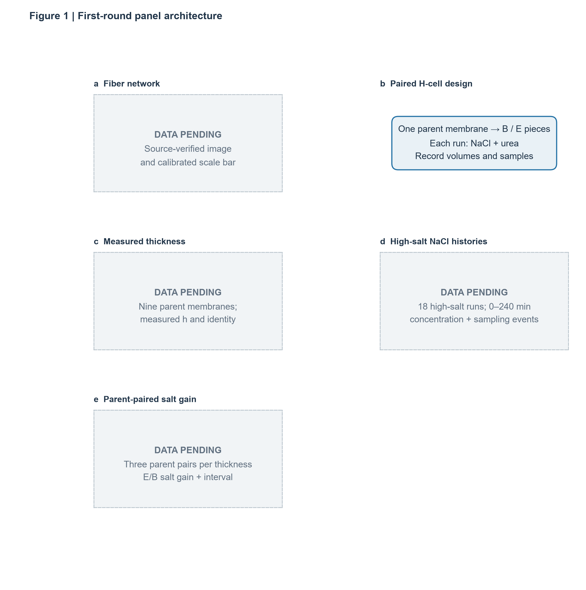
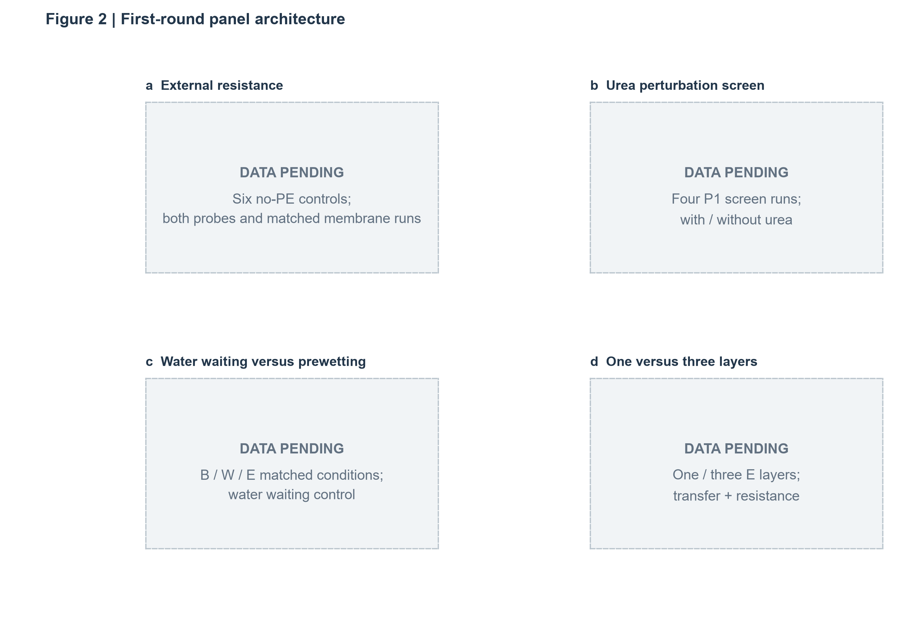
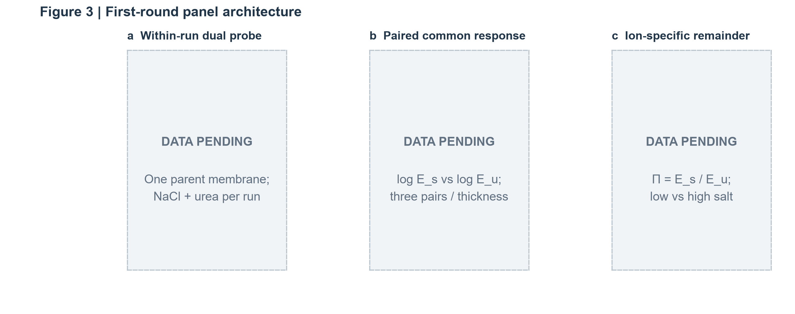
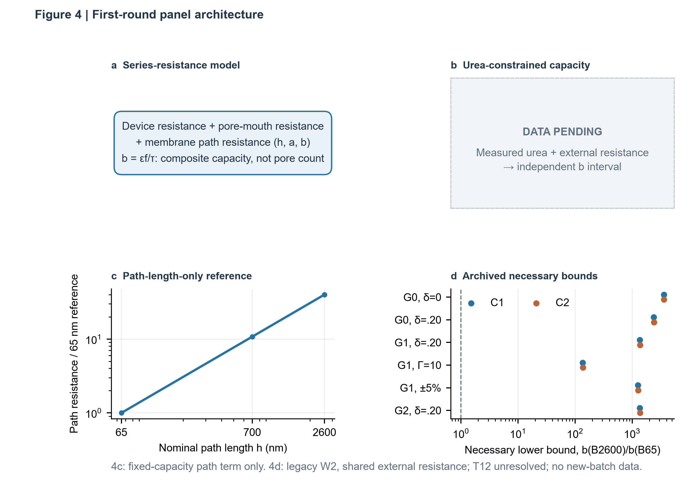
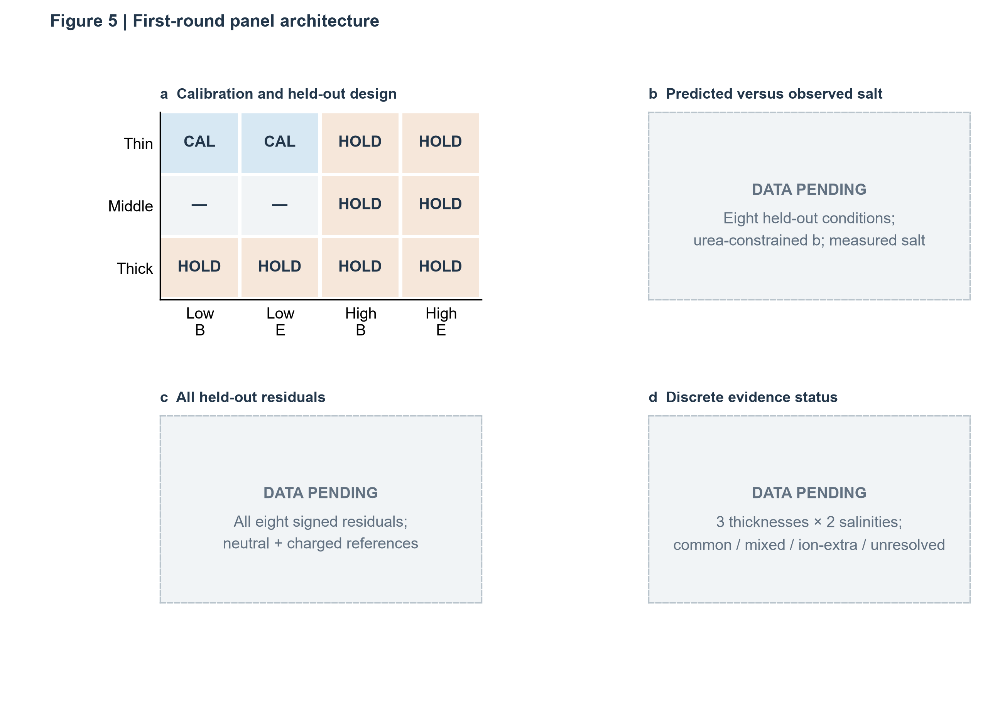

# Common and ion-specific contributions to salt transport in ultrathin polyethylene membranes

**First-round manuscript for supervisor discussion, 2 November 2026.** This is an evidence-bounded working draft, not a submission manuscript. Bracketed text marks missing experimental evidence or a citation that must be verified. Figures 1–5 refer to the companion panel layouts. Historical B/R conditions and future B/E conditions are distinct.

## Abstract

Salt transfer across an ultrathin membrane can be limited by transport pathways shared with neutral solutes and by additional ion-specific interactions. Historical measurements on polyethylene (PE) fiber membranes suggest unusually low salt migration in a nominally thin membrane group and a strong response to ethanol prewetting, yet salt data alone do not identify the relative contributions. We combine a series-resistance transport framework with archived charged-pore calculations to bound the effective transport capacity required by those legacy curves. Under a declared equal-volume, no-sampling and no-net-flow reference, and within the archived shared-external-resistance model family, the 60–100 min salt data imply a large necessary capacity contrast between nominal 2600 and 65 nm groups. This conditional bound does not identify a wet-pore population or an electrostatic contribution. The framework also predicts a neutral-urea response under a specified shared-resistance relation; sensitivity analysis does not guarantee enhancement in the thick group. [Evidence needed: paired salt and urea measurements, external-resistance controls and held-out salt predictions from the new membrane batch.] These independent tests will determine whether a common transport limitation accounts for the dominant response, whether an additional ion-specific contribution is resolved, or whether the mechanism remains underdetermined.

## 1. Introduction

Salt migration through a porous polymer membrane depends on both the pathways accessible to small molecules and interactions that act selectively on ions. A low salt signal therefore cannot, on its own, distinguish a small shared transport capacity from an additional ionic barrier. Charged-capillary-pore theory provides a conditional description of coupled electrolyte transport, with assumptions about pore geometry and transverse ion equilibrium [1]. Experiments on a different nanopore material also show that wetting and bubbles can alter electrical transport signals [2]; they do not establish the wetting state of the PE membranes studied here.

Published work on biaxially stretched submicron UHMWPE membranes reported fiber structure, thickness-associated surface potential and an ionic-rejection observation [3]. Related PE nanomembrane research demonstrated out-of-plane electrokinetics in a droplet device [4], while a later near-critical PE membrane-electrode study addressed water and electron transport in a different device setting [5]. These publications establish material and interfacial context; their reported measurements do not substitute for paired salt and neutral-probe H-cell data in this study. The archived B/R salt series shows a thickness-associated contrast and a response to ethanol prewetting. Its nominal thickness labels also represent different fabrication states, while the surviving run records do not certify all reservoir, sampling and flow conditions. These observations motivate a mechanistic test but cannot be treated as paired measurements from the new batch (Fig. 1).

Here we ask how much of the salt response can be shared with a neutral small solute and how much remains ion specific. The design pairs baseline (B) and ethanol-prewetted (E) specimens cut from the same parent membranes, measures NaCl and urea in each run, and records device resistance, volumes and inventory changes (Figs. 1–3). A neutral-probe constraint on effective capacity then precedes the test of salt predictions at prespecified held-out conditions (Figs. 4–5). The present first-round draft sets out this test and reports only the conditional calculations already available.

## 2. Theoretical model and methods

### 2.1 Evidence identity and transport reference

The legacy B/R curves and the planned B/E experiments have different specimen and handling identities. Analyses A, B and D of the legacy curves share a declared reference with an initial NaCl concentration difference of 600 mol m⁻³, equal reservoir volumes, no sampling or replenishment, and no net volumetric flow. Interval-equivalent rates λ were constructed from the archived C1/C2 conductivity conversions under that reference. The original run-level records do not certify all of these operating conditions. Accordingly, capacity bounds and receiver-urea concentrations derived from them are conditional model results. New experiments will use measured volumes, sampling events, flow and inventory in their mass balance.

### 2.2 Resistance and charged-pore representation

The measured transfer is represented by device resistance, pore-mouth resistance and intramembrane resistance in series. The nominal membrane thickness `h` enters the path length, while the effective capacity `b=εf/τ` combines accessible fraction and tortuosity. For the neutral probe, the specified model gives `P_m,u=bD_u/[h/H_u+πa/(2τ)]`, where `a` is the model pore radius and `H_u` is the neutral partition term. This expression does not allow `b` to be uniquely decomposed into wet pore number, wetted area and tortuosity. Charged-pore calculations use the archived G1 geometry and electrostatic range; G0 is an uncharged comparator, and G2 a short-pore pressure scenario. Zeta-potential and KPFM observations are auxiliary electrical context, not measurements of high-salt charge density inside wet pores.

The archived A bounds use an external-resistance relation shared within the specified groups. The relative operational tolerance δ=0.20, the trial geometry ratio Γ=10, and a ±5% mobility variation are scenario definitions, not measured uncertainties. Allowing an independent free external resistance for each legacy curve removes a nontrivial single-window capacity bound. The archived T12 high-salt numerical checks remain unresolved. These qualifications apply to the interpretation of every model plot.

### 2.3 Planned independent test and inference rules

The fixed WP5 plan contains 54 H-cell runs: 30 core runs and 24 controls, with nine intended parent membranes and 12 auxiliary electrical specimens. Each core run measures NaCl and urea together. B and E measurements use paired pieces of one parent membrane in separate runs. The planned controls address no-PE resistance, urea interference with salt measurement, water waiting, stacked membranes, seals, leaching and inventory closure. The parent membrane is the unit for paired inference; time points are not independent material replicates. Results below the urea limit of quantification will be interval censored, not replaced by zero or half the limit.

The planned analysis defines salt and urea E/B gains on the same time window and resistance boundary, followed by `Π=E_s/E_u`. When the membrane component cannot be separated from device resistance, only total-system measures may be compared and must retain that label. Urea and measured external resistance will constrain `b` without fitting it to the salt outcomes being predicted. Two thin-membrane, low-salt B/E conditions provide calibration; eight other specified conditions are held out. The ionic model family shares local parameters across thickness and concentration. A retrospective held-out comparison will not be called blind prediction without an actual prereveal record. All measured conditions and failures will be displayed.

## 3. Results and discussion

### 3.1 A thickness-associated salt-transport question (Fig. 1)

The historical B/R series motivates the paper because the nominally thinner group does not follow the direction expected from path length alone under an otherwise fixed transport capacity. This is a legacy observation, with its specific conductivity conversion and reservoir reference, rather than a replicate set from the forthcoming batch. Figure 1 therefore reserves the main quantitative panels for actual parent-membrane thicknesses, full 0–240 min NaCl histories and paired high-salt E/B gains. [Evidence needed: Fig. 1c–e, including membrane identity, raw time series, sampling and inventory records.] Until these measurements exist, the new-batch effect size and its variability cannot be stated.

### 3.2 Device and treatment controls define what may be assigned to the membrane (Fig. 2)

Separating membrane resistance from the total H-cell response is necessary before assigning a transport change to the PE layer. Figure 2 tests this boundary with no-PE runs for both probes, a four-run urea-interference screen on one parent membrane, water-waiting controls and a stacked-membrane comparison. [Evidence needed: Fig. 2a–d and the prespecified calibration and recovery gates.] A membrane-resistance interval spanning zero will be retained as a bound rather than truncated to a small positive estimate. A treatment-specific response would still not establish that ethanol acts only through wetting; stacking three thin films is not equivalent to fabricating a thick membrane.

### 3.3 Paired neutral and ionic responses test a common limitation (Fig. 3)

The central experiment asks whether the salt response is accompanied by a neutral-urea response measured in the same run. Figure 3a will show the within-run trajectories for one identified parent membrane and all curves in the supplement. Figure 3b will compare the paired high-salt gains `E_s` and `E_u` across all parent membranes, while Figure 3c will show the salt-to-urea gain ratio `Π` at the two prescribed salt concentrations. [Evidence needed: Fig. 3a–c, calibrated urea data, comparable external-resistance boundary and parent-level uncertainty.] `Π` describes an operational ion-specific remainder relative to urea; it is not automatically an electrostatic percentage. Its derived companion `F_common` uses the same two gains and cannot be counted as independent corroboration.

### 3.4 Archived bounds motivate an independently constrained capacity test (Fig. 4)

With all other path properties fixed, shortening the membrane path should lower its intramembrane resistance (Fig. 4c). The archived A analysis quantifies how far this simple reference falls short within its stated model family. For the legacy W2 interval (60–100 min), G1, δ=0.20 and shared external resistance, the necessary `b(B2600)/b(B65)` lower bounds are 1358.48 and 1369.88 for the C1 and C2 conversions, respectively. The Γ=10 trial lowers them to 135.85 and 136.99. Figure 4d presents the archived scenario comparison and must not be read as a measurement of `b` in the new batch. G0 and G1 differ in geometry as well as allowed charge range, so their plotted difference cannot be assigned wholly to charge. The old bound disappears under independent per-curve external resistance. [Evidence needed: Fig. 4b and the new-data part of 4d, using urea-derived capacity and measured external resistance.] This independent constraint, rather than a free salt fit, is the decisive test of whether common capacity can account for the observed amplitude.

The archived D calculation provides a related, explicitly conditional neutral-probe prediction. Under shared salt/urea geometry and diffusion-scaled external resistance, the G1 60 and 100 min legacy receiver-urea concentrations occupy finite ranges. In the C1 reference at 100 min, B65 is 0.001174–0.001945 mM and R65 is 0.167712–0.274866 mM. These are neither urea measurements nor unconditional targets for the planned 60/120/240 min sampling. Under the specified ±5% mobility variation, four thick-membrane response ranges include unity. Independent, unbounded urea external resistance removes a finite response discrimination. The existing historical D plot is retained as supporting computational context, not inserted as a false new-batch panel.

### 3.5 Held-out conditions determine the scope of explanation (Fig. 5)

Figure 5a displays the prespecified two calibration and eight held-out conditions, including the unmeasured medium-thickness, low-salt cells. Figure 5b will compare urea-constrained salt predictions with all held-out observations. Figure 5c will retain every signed residual, and Figure 5d will label the discrete combinations as common-dominant, mixed, ion-extra, unresolved or unmeasured according to the original decision rules. [Evidence needed: Fig. 5b–d, including quality gates, calibrated and held-out data, uncertainty and complete failures.] A model envelope wider than the original acceptance limit is not predictive success. Fitting a charge parameter separately for each held-out membrane would destroy the test. Consistency of a charged-pore model, even with a matching electrical trend, would not reveal the molecular origin of charge.

## 4. Conclusions

The present calculation establishes a bounded inference: under a declared legacy H-cell reference and archived shared-resistance parameter range, the historical salt response requires a large effective-capacity contrast that path length and the specified charged-pore range do not absorb on their own. This inference does not identify wet pathways or establish a charge mechanism. A neutral-urea prediction and its cancellation conditions define a useful independent test, but the test has not yet been performed on the new batch. The first-round figure set makes explicit which measured controls, paired dual-probe responses and held-out conditions must determine the final material claim. The eventual conclusion must follow those outcomes, including an unresolved or adverse result.

## Figure legends for this working draft

**Fig. 1 | Material identity and the salt-transport question.** (a) Reserved for source-verified fiber structure with scale calibration. (b) Fixed H-cell and parent-membrane pairing design; within each run NaCl and urea are measured together. (c–e) Reserved for new-batch thicknesses, complete high-salt NaCl trajectories and parent-paired E/B gains. No new-batch data are available in this draft.

**Fig. 2 | Controls needed for membrane attribution.** Reserved panels show no-PE external resistance (a), urea interference (b), B/W/E waiting and prewetting (c), and one- versus three-layer E specimens (d). All require the original WP5 control measurements.

**Fig. 3 | Paired salt and neutral-probe response.** Reserved panels will show within-run dual-probe histories (a), high-salt paired gains across parent membranes (b), and low/high-salt `Π` comparison (c). No neutral-probe experimental results are reported here.

**Fig. 4 | Series resistance and effective capacity.** (a) Model partition of external, pore-mouth and membrane resistance. (b) Reserved for capacity constrained by measured urea and external resistance. (c) Direction of a path-length-only reference at fixed capacity, shown without fitted material values. (d) Archived W2 necessary capacity-ratio bounds; symbols denote C1/C2 conductivity conversions, not independent material repeats. Legacy B/R data, δ and Γ scenarios, uncertain run states and unresolved T12 apply. New-batch compatibility remains untested.

**Fig. 5 | Prespecified cross-condition test.** (a) Design matrix for two calibration and eight held-out condition means, with unmeasured cells marked. (b–d) Reserved for observed versus predicted salt transport, all signed residuals and the discrete evidence-status map. No new-batch held-out prediction is claimed.

## Figure plates for supervisor markup

The existing full-size historical [A bound preview](../data/processed/salt_transport/25_论文裁剪A主图预览_20261031.png) and [D conditional-urea preview](../data/processed/salt_transport/25_论文裁剪D主图预览_20261031.png) remain separate computational review figures. They are not new-batch measurements.

## Author inputs and evidence gates

- Check final reference style and the authors' source-PDF interpretation against the cited publisher records before submission. References [1–5] support only the specific context stated above.
- Obtain actual WP5 measurements and controls before replacing the empty main panels; retain the original 54-run scope and mother-membrane identity.
- Resolve whether legacy run metadata and T12 numerical status permit stronger wording. Do not infer their resolution from this draft.
- Keep historical R and new E, experimental confidence intervals and model envelopes, and nominal labels and measured thickness separate throughout revisions.

## References for the first-round draft

1. Peters, P. B., van Roij, R., Bazant, M. Z. & Biesheuvel, P. M. [Analysis of electrolyte transport through charged nanopores](https://doi.org/10.1103/PhysRevE.93.053108). *Physical Review E* **93**, 053108 (2016).
2. Marion, S. *et al.* [Wetting of nanopores probed with pressure](https://doi.org/10.1039/D1CP00253H). *Physical Chemistry Chemical Physics* **23**, 4975–4987 (2021). Different nanopore material; cited for a general measurement caveat.
3. Wang, Z. *et al.* [Structure and properties of biaxial stretched submicron thin UHMWPE membranes](https://doi.org/10.1016/j.polymer.2023.126393). *Polymer* **285**, 126393 (2023).
4. Sun, W. *et al.* [Out-Of-Plane Electrokinetics via Pumping Potential Achieved by 100 nm-Thin Polyethylene Nanomembranes](https://doi.org/10.1002/admt.202300178). *Advanced Materials Technologies* **8**, 2300178 (2023).
5. Li, R. *et al.* [Thickness-Gated Water and Electron Transport in Near-Critical Ultrathin Polyethylene Membrane Electrodes](https://doi.org/10.1002/adma.74297). *Advanced Materials*, e74297 (2026). Device and sample identity must not be merged with the present H-cell series.
