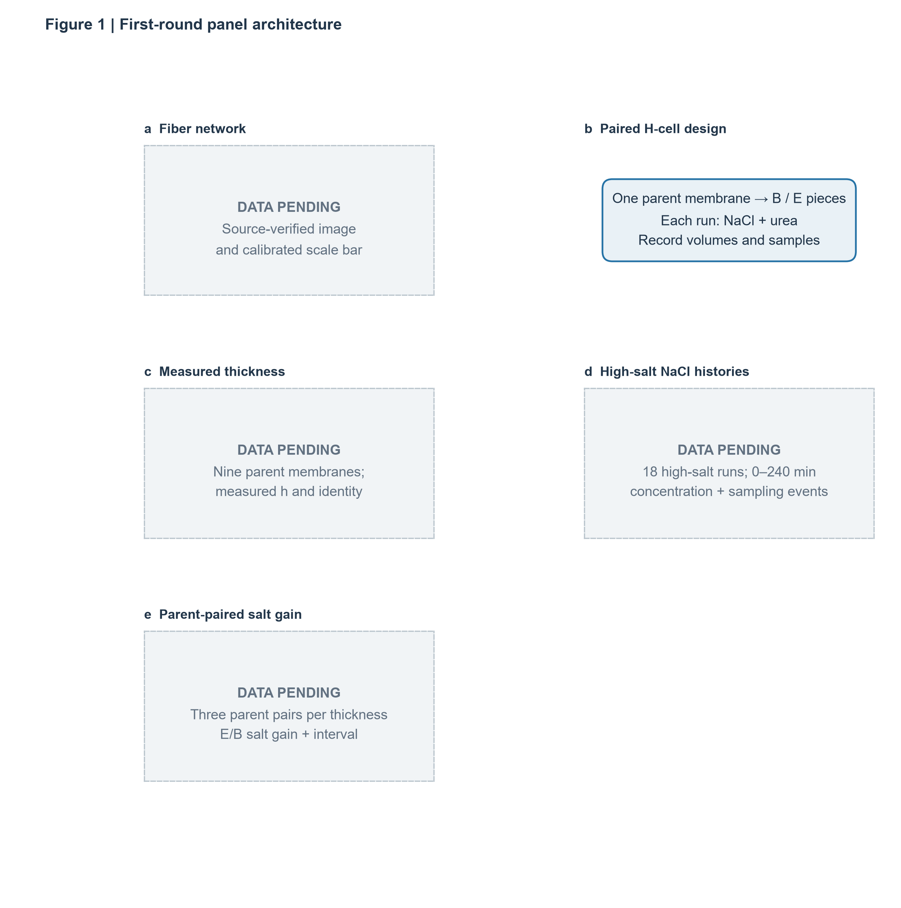
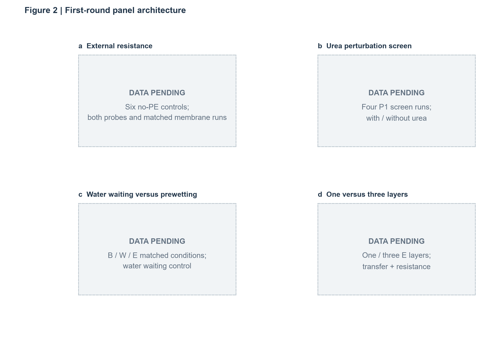
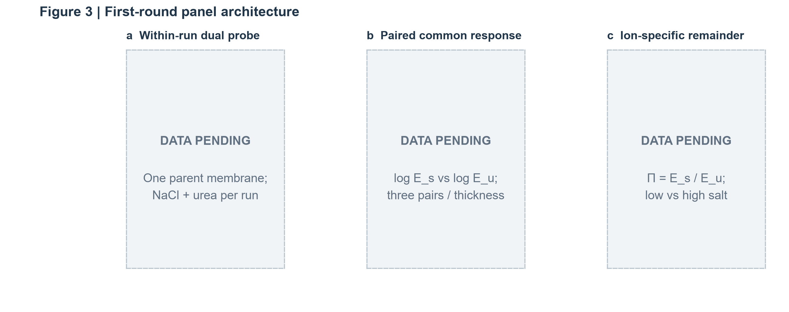
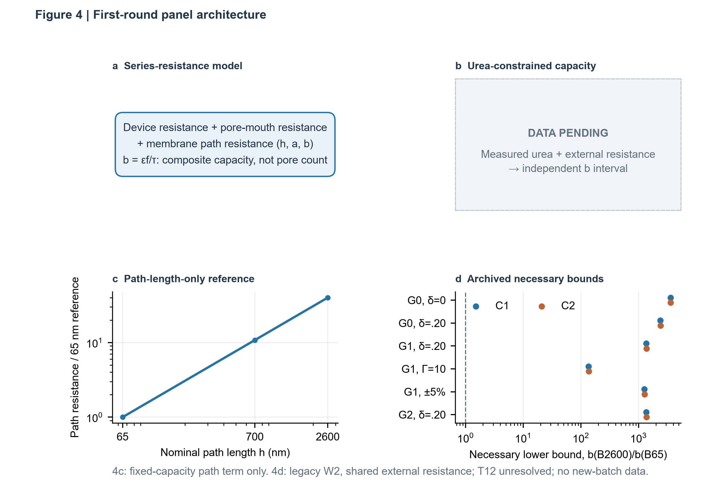
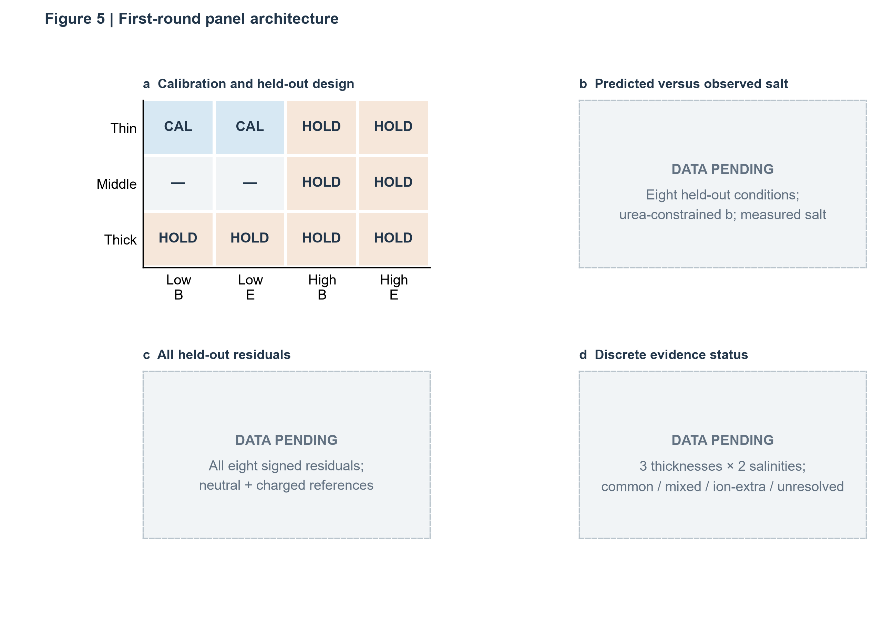

# 超薄聚乙烯膜盐迁移中的共同传质限制与离子特异响应

> 第一轮中文论文稿，供导师讨论。正文只陈述已有的历史观察、已完成计算和既定实验设计。方括号标出需要本批实测后填写的结果段；图1—5沿用现有20面板组图位置。历史B/R与新批B/E分别命名。

## 摘要

超薄多孔膜的路长缩短通常有利于扩散，但聚乙烯（PE）纤维膜的历史盐迁移记录呈现更值得解释的厚度关联：名义薄膜组的盐迁移受到强抑制，乙醇预湿后又出现明显响应。单一盐读数难以区分小分子共同经历的传质限制与盐离子受到的额外作用。本文以装置、孔口和膜内阻力串联为框架，在已声明的双池参照和归档参数范围内，分析历史盐曲线对有效传质能力的必要约束。旧数据60—100 min窗口的主条件要求名义2600 nm与65 nm组之间的有效能力比下界达到1358.48和1369.88（两种电导换算）；即使引入试探的十倍几何比，下界仍为135.85和136.99。模型进一步给出可由中性尿素检验的条件性响应范围。由此，论文将讨论焦点从“盐为何过不去”推进到“共同传质能力必须改变多少，以及盐是否还存在相对中性探针的额外响应”。[待补：本批同次盐／尿素配对效应、装置控制和留出盐条件检验；据此确定最终机制结论。]

## 1 引言

超薄膜的传质行为由几何路长、可达通路、界面分配及离子作用共同决定。缩短膜厚能够缩短膜内扩散距离，却未必保持其他传质因素不变。尤其当某一膜系列的薄端显示较弱盐迁移时，仅凭膜厚和盐通量，无法判定限制来自共同的小分子通路，还是来自离子特异的屏障。带电毛细孔理论为离子迁移提供了成熟的条件模型[1]；其他纳米孔体系的研究也表明，通路润湿状态可能改变电输运读数[2]。这些认识提示，本材料的关键问题应由独立测量来区分，而不宜单靠盐曲线拟合回答。

既有双向拉伸超薄UHMWPE研究报道了纤维结构、厚度关联的表面电势和离子排斥观察[3]。相关PE纳米膜工作分别展示了液滴装置中的面外电动学[4]，以及近临界厚度膜电极中的水与电子跨膜功能[5]。它们奠定了材料与界面研究基础。本文聚焦另一项可检验的问题：在浓差驱动的H池中，盐与中性小分子的传递怎样共同变化，剩余的盐响应又有多大。历史B/R盐曲线提供了这一问题的定量起点；新批次则需要同母膜、同次双探针和装置对照，才能把响应分解到相同的实验边界上。

本文采用两步论证。先利用历史盐曲线，在预先限定的孔口、荷电迁移和组内共享外阻范围内求有效传质能力的必要界，确定单纯路长参照需要补充多大的能力变化。再按既定方案，在同一H池运行中测NaCl和尿素，由中性读数独立约束共同能力，检验盐的处理增益、盐度依赖及预先划定的留出条件。这样的证据链使强盐响应既可转化为数量级约束，也可接受另一种分子的直接检验。

## 2 理论模型与方法

### 2.1 数据身份与双池参照

历史B为基线组，R为当时的乙醇预湿组；新实验的B/E采用明确的分裁、预湿、水置换和保湿装夹流程。旧B/R不作为新B/E的同母膜重复。历史A、B、D计算共同沿用初始NaCl浓差600 mol m⁻³、两池等体积、无取样补液且无净体积流的声明参照。20号C1/C2电导换算曲线据此给出区间等效速率λ。旧逐运行的池体积、取样补液与净流记录尚不足以认证上述条件，因此下文的能力界和尿素浓度均是该参照下的条件结果。新实验按实际体积、取样事件、净流和库存做物料衡算，不沿用旧池的简化处理。

### 2.2 串联阻力与有效能力

总传递阻力分为装置外阻、孔口阻力和膜内阻力。膜厚`h`进入膜内路长；局部几何、分配及电性范围进入对应的迁移算子。以`b=εf/τ`表示组合有效传质能力，其中`εf`与可达通路相关，`τ`为曲折度。对于中性尿素，既定模型写为

`P_m,u = b D_u / [h/H_u + πa/(2τ)]`，

其中`D_u`为尿素扩散系数，`H_u`为分配项，`a`为模型孔径。`b`是可由独立读数约束的组合量，不对应已经测得的充水孔数。带电孔参考族G1采用归档PB离散算子及原定几何和电荷范围；G0提供零电荷参照，G2只作为短孔压力情景。ζ电位与KPFM属于辅助电性信息，不能直接替代高盐湿孔内的电荷密度。

历史A界在组内共享、非负的外阻关系下计算。旧电阻率的相对操作性容差`δ`取0或0.20；试探几何比`Γ=10`和迁移系数整体±5%分别是情景与敏感性设定，不作为实测装置上限或模型误差认证。若每条旧盐曲线的外阻完全独立且自由，单窗口盐速率不再给出非平凡的能力比下界。因此，所有界均连同外阻关系一起解释。T12高盐算子的十项数值检查继续按未决状态处理。

### 2.3 同批双探针检验

既定WP5包含54次H池运行，其中30次为核心条件、24次为控制；九张拟定独立母膜用于厚度组和处理配对，另有12片辅助电性样品。同一核心运行同时读取NaCl与尿素；B/E来自同一母膜的配对裁片，但分别运行。无PE外阻、尿素对盐读数的扰动、水接触等待、单层与三层、密封、浸出、校准、回收和净流记录共同决定读数能否归于膜相关传质。母膜是配对统计单位，时点和裁片不作为额外独立母膜。低于尿素定量限的结果保留区间，不以零或半定量限替代。

同一窗口、同一阻力边界下定义盐和尿素的E/B增益`E_s`与`E_u`，并定义相对响应`Π=E_s/E_u`。外阻可分离时比较膜相关指标；不可分离时报告总体系指标。先由尿素、实测`h`和外阻约束`b`，再检验盐，避免用盐拟合`b`后回头解释同一盐读数。原WP6把薄膜低盐B/E的两个条件均值用于校准，其余八个指定条件留出检验；跨厚度和盐度共用局部参数，不为每个留出点单独调节电荷。若没有真实的先封存后揭示记录，结果称为预先划定的留出检验。

## 3 结果与讨论

### 3.1 历史盐现象提出的厚度关联问题（图1）

旧B/R系列中，名义65 nm组的盐迁移可以远弱于2600 nm组；乙醇预湿组还显示出明显处理响应。对相同有效能力而言，路长缩短应降低膜内阻力，因而这一方向要求同时考虑通路状态、孔口和离子作用。图1先交代材料与H池比较关系，并为新批次的母膜实测厚度、完整高盐时间曲线和母膜内E/B效应保留主图位置。[待补图1c—e：本批母膜身份与厚度、18次高盐曲线、配对效应及区间。] 旧曲线与新数据在图例中分别标识。

### 3.2 装置与处理对照给出可解释的测量边界（图2）

膜相关传质的讨论以装置外阻和库存质量衡算为基础。图2以无PE装置参照为首个定量对照，再依次比较尿素加入前后的盐读数、同等水接触等待与乙醇预湿、以及单层和三层E膜的串联方向。这四项各排查不同的替代来源，决定后续能否把两探针响应解释到膜层。[待补图2a—d：原24次控制中的对应读数、校准与质量状态。] 当膜阻区间跨零时，报告可识别的界；处理效应的解释保持在实际对照所覆盖的范围内。

### 3.3 中性探针使共同响应成为可独立检验的量（图3）

本文最关键的证据将来自每次运行中同时取得的盐和尿素时程。图3a展示同一母膜B/E裁片各自运行中的双探针轨迹；图3b以母膜为单位比较高盐条件下的`E_s`与`E_u`；图3c进一步考察薄、厚膜低盐与高盐下的`Π`。共同增益是否承担盐响应的主要幅度，由同一阻力边界下的配对区间和原WP6判据决定。[待补图3a—c：尿素实测、配对增益、母膜区间和盐度比较。] `Π`表达相对尿素的盐额外响应，不预先将其全部命名为电荷贡献；由同一对增益派生的`F_common`保留作判别量，不另当一份独立证据。

### 3.4 盐曲线对有效能力提出强数量级约束（图4）

图4首先给出串联阻力结构，并以固定能力、只改变路长的参照说明几何方向。旧盐W2窗口（60—100 min）的计算把这一方向变成可核的必要界：在G1、`δ=0.20`、E1组内共享外阻条件下，`b(B2600)/b(B65)`在C1/C2换算中的下界分别为1358.48和1369.88。允许`Γ=10`的试探几何比后，界降至135.85和136.99，仍要求远超单纯路长变化的组合能力差异。图4d同时列出G0、G1和G2的相关情景；G0与G1的几何及允许电荷范围都不同，因此组间差额不单独归因于电荷。这些值是模型域内的必要条件，不是新膜的实测`b`。

同一框架也给出中性探针的可检验范围。在共享盐／尿素几何、按扩散关系缩放外阻的主算子下，旧C1参照100 min的尿素接收池浓度，B65为0.001174—0.001945 mM，R65为0.167712—0.274866 mM；这是一组条件预测。预定的迁移系数±5%情景中，厚膜四个处理响应范围覆盖比值1，使“薄端强共同响应、厚端响应依条件而定”成为更具体的检验图景。图4b预留由本批尿素和实测外阻独立约束`b`的结果；图4d随后比较新盐必要界与该独立约束。[待补图4b及4d新数据部分：本批尿素、厚度、外阻和相容性区间。]

### 3.5 留出盐条件检验解释的跨条件效力（图5）

图5a固定校准与留出条件：薄膜低盐B/E两个均值用于限定局部离子参数；薄膜高盐、厚膜低／高盐及中膜高盐B/E共八个均值用于检验。中膜低盐未测，不填成连续相图。图5b将尿素约束下的盐预测与八个实测均值比较；图5c保留全部有方向的残差；图5d按既定规则呈现各离散条件的认识范围。[待补图5b—d：本批盐/尿素、质量门、预测包络和八条件完整残差。] 这项检验的价值在于共同能力不再随盐结果自由调整，而盐度与膜厚变化共同检验同一组局部参数。

## 4 综合讨论

现有计算提供的最清楚认识，是历史盐曲线在一组明确物理条件下需要很大的**组合传质能力**差异。它将厚度反常现象从定性争论推进为有数量级的模型约束。这里的`b`是盐和中性分子都可能感受到的传质能力；独立尿素读数把这一解释变成可以被检验的命题。若同批双探针结果显示共同增益承担主要盐响应，文章的重点将是溶剂处理历史与厚度关联的共同小分子传质；若盐相对尿素还呈稳定的盐度依赖，文章将进一步界定离子额外响应的条件范围。两种结果都使用同一套预先划定的比较与留出检验，不需要把所有差异强行压进单一微观原因。

这种论证也明确了“有效能力”与“分子起源”的层级。`b`不能拆成已测湿孔数、润湿面积和曲折度；乙醇处理并非只改变一种状态；辅助电性与孔内高盐电荷亦非同一测量。论文因而首先回答共同通路对盐响应能承担多少、哪些盐度还保留额外作用，再由后续证据决定是否能够更深入地指认电荷或润湿的微观来源。历史双池参照和共享外阻是现有数量界的适用条件；本批实验将用实测装置量检验该条件框架的可迁移性。

## 5 结论

超薄PE膜历史盐迁移记录提出了一个超越“膜越薄，路径越短”的传质问题。在声明的双池与共享外阻条件、归档孔口和荷电迁移范围内，薄厚组盐速率要求显著不同的有效传质能力；十倍试探几何比仍保留百倍量级的必要界。由中性尿素先独立限定共同能力、再用留出盐条件检验离子响应，是将这一数量界转化为材料机制认识的关键路径。本文的最终主张将由同批双探针和装置对照决定，而不是由旧盐拟合预设。

## 主图图注草案

**图1｜超薄PE膜与盐迁移问题。** a，来源可核的纤维网络及尺度尺位置；b，同母膜B/E裁片、H池浓差驱动和每次运行同测NaCl/尿素的设计；c—e，本批实测厚度、高盐完整时程和母膜配对盐增益的预留位置。历史B/R数据不作为本批重复。

**图2｜限制装置与处理替代解释的对照。** a，无PE外阻与有膜总阻力；b，尿素对盐读数的扰动筛查；c，B/W/E状态比较；d，单层与三层E膜的串联方向。四个面板待原WP5控制实测填入；C4扰动筛查只覆盖其预定P1条件。

**图3｜盐与中性探针的配对响应。** a，同母膜B/E裁片各次运行中的盐、尿素时间曲线；b，高盐下母膜配对的`E_s`和`E_u`；c，低、高盐下`Π=E_s/E_u`。实验区间与模型包络分别编码，母膜为配对统计单位。三个数据面板待本批实测。

**图4｜共同传质能力的物理约束。** a，装置、孔口和膜内串联阻力；b，尿素和实测外阻对`b`的独立约束位置；c，固定能力时膜内路长阻力随`h`变化的解析参照；d，旧W2盐数据在G0/G1/G2及外阻情景下对`b(B2600)/b(B65)`的必要下界。d中的C1/C2是换算情景，不是独立母膜；旧双池条件、`δ`和`Γ`定义及T12状态见方法。b和d的新批相容性部分待实测。

**图5｜共同能力受约束后的盐条件检验。** a，两个校准、八个留出和中膜低盐未测条件；b，留出盐预测与实测；c，全部留出条件有方向的残差；d，三个厚度、两个盐度的离散判别格。b—d待原WP6分析完成；各条件共用局部参数，不把未测格外推为连续边界。

## 组图预览

历史计算全图另见[A必要界](../data/processed/salt_transport/25_论文裁剪A主图预览_20261031.png)和[D条件尿素预测](../data/processed/salt_transport/25_论文裁剪D主图预览_20261031.png)。

## 参考文献（第一轮）

1. Peters, P. B. 等，[Analysis of electrolyte transport through charged nanopores](https://doi.org/10.1103/PhysRevE.93.053108)，*Physical Review E* **93**，053108（2016）。
2. Marion, S. 等，[Wetting of nanopores probed with pressure](https://doi.org/10.1039/D1CP00253H)，*Physical Chemistry Chemical Physics* **23**，4975—4987（2021）。
3. Wang, Z. 等，[Structure and properties of biaxial stretched submicron thin UHMWPE membranes](https://doi.org/10.1016/j.polymer.2023.126393)，*Polymer* **285**，126393（2023）。
4. Sun, W. 等，[Out-Of-Plane Electrokinetics via Pumping Potential Achieved by 100 nm-Thin Polyethylene Nanomembranes](https://doi.org/10.1002/admt.202300178)，*Advanced Materials Technologies* **8**，2300178（2023）。
5. Li, R. 等，[Thickness-Gated Water and Electron Transport in Near-Critical Ultrathin Polyethylene Membrane Electrodes](https://doi.org/10.1002/adma.74297)，*Advanced Materials*，e74297（2026）。
