# PE 科研零基础完整教学与成果解读

**资料截点：2026-10-22；性质：逐课教学与现有证据盘点。** 本文是长期维护的唯一文字主教材；同名 HTML 是由它生成的离线阅读版。新增课程每次只讲一课，后半部原有深度科研内容保留供逐步查阅。没有为写教材重新拟合或大规模求解。当前正式状态以根目录 `项目进展计划与任务看板.md` 第 7 节为准；第 6 节和旧 O/S/W 补实验设计用于理解此前路线。路径均相对项目根目录。读者应始终区分四种话：**旧表读数**、**导师交付的方案或计算**、**本仓库新增的条件分析**、**尚待检验的解释**。导师 v6.0.0 方案在 `原始资料/赵珈绮/12_论文导向研究总方案_v6.0.0/`；按该方案完成的 WP1–WP6 是本仓库后续工作，不能倒称导师已验证的材料机理。第三次导师审阅材料已在本地备齐，尚未发送或获得第三次审阅结论；学生端判断目前尚不具备投稿条件。

# 第一部分：真正零基础的逐课教学

## 怎样使用这本教材

每次只读一课，先看生活故事和图，再看一个真实项目证据，最后做一道选择题。前三课依据你已经理解的内容与源文件重新整理，标为“已学”；不是此前聊天逐字转录。第 4–20 课均已答对；第 21 课已讲，等待答题。原规划曾由 55 课压缩为 44 课；纳入 2026-10-22 已完成的 v6 WP1–WP6 后，现定为 **50 课**。截至第20课已学 20 课；第21课答对后还剩 29 课。前 40 课保留原有先修顺序，后 10 课专门学习新方案和论文证据，不来回重讲旧课。后续课题先列目录，不假装已经上完。图中标“概念示意”的部分只是帮助想象；真实读数会注明来源、单位和缺口。讲到已有结果时优先在正文中**直接放图并当场解释**，文件路径只作追溯，不代替看图；每课可稍多一点，但仍在答题前停下。

### 课程总目录：按先修知识排序

| 阶段 | 课次与本节只解决的一个问题 | 状态 |
|---|---|---|
| 1 先认识对象 | 第1课 PE 膜是什么；第2课 怎样知道盐在移动；第3课 越薄为何不一定越容易通过；第4课 PE 通常没有固定电荷为何还研究表面电荷；第5课 盐在水里是什么样 | 1–5 已学 |
| 1 读懂基本量 | 第6课 两种离子为何要一起看；第7课 电导表读到了什么；第8课 电导怎样才可能换成盐浓度；第9课 浓度、盐量、通量有何不同；第10课 为什么要看时间曲线 | 6–10 已学 |
| 2 电学线索 | 第11课 表面电荷数值；第12课 近壁离子分布；第13课 zeta 读数；第14课 pH 变化；第15课 干态 KPFM 与水中 zeta；第16课 带电为何不必然挡盐 | 11–16 已学 |
| 3 真实资料 | 第17课 导师原件、版本与研究问题；第18课 Origin 时间/电导配对与重复身份；第19课 旧实验条件缺口和跨列可比性；第20课 从原始表追到图与结论 | 17–20 已学 |
| 4 虚拟实验室 | 第21课 为什么建模型及最简单扩散；第22课 膜厚、入口与外层阻力；第23课 输入、参数、输出与程序验证；第24课 拟合、预测与留一 | 21 已讲待答；22–24 待讲 |
| 5 电荷与离子模型 | 第25课 PB 与平衡离子排布；第26课 NP 与离子通量；第27课 PNP 的联立和数值检查；第28课 v3 虚拟纤维网络与选择性；第29课 v4 Donnan 分配和共同进入能 | 待讲 |
| 6 导师 v5 主模型 | 第30课 双面影响的物理问题；第31课 自由能、厚度与局部尺度；第32课 六点共享拟合和图1；第33课 图2的结构条件与敏感性；第34课 图3的虚拟 PNP；第35课 图4的适用边界；第36课 导师交付与本机复现怎样区分 | 待讲 |
| 7 新增诊断 | 第37课 350/200 nm 排序与阻力分解；第38课 2600 nm 留一高估及参数约束；第39课 时间曲线交叉与静态模型失败；第40课 参数敏感性、竞争解释和真正新增分析 | 待讲 |
| 8 v6 问题与模型 | 第41课 WP1：怎样把旧数据变成可检验的问题并冻结比较规则；第42课 WP2：M0/M1/M2 分别给膜内盐安排什么“住处”；第43课 WP2：程序通过数值验收究竟证明什么；第44课 WP3：有限时间斜率与 M2 容量门槛 | 待讲 |
| 9 v6 比较与预测 | 第45课 WP4：六膜全曲线共同拟合为何比只看终点更严格；第46课 WP4：逐膜残差、200/350 错序与 M2 极端容量；第47课 WP5：藏起后段或整张膜后，模型能否答对；第48课 WP5：参数辨识、读数扰动和最不利情况 | 待讲 |
| 10 证据与论文 | 第49课 WP6：六张图、主张证据表、复现包及导师审阅边界；第50课 从事实、失败和缺口组织论文与口头科研故事 | 待讲 |

### 为什么增加六课：把“已经画得像”与“真的解释得通”分开

想象看一段影片：旧 v5 重点比较六张 120 min 的“定格照片”，v6 则重新检查六条从 0 到 120 min 的旧时间曲线，共 42 个点，其中 36 个非零点用于共同拟合。这**不是新做了 42 次实验**，而是把已有记录中的中途变化也纳入检验。先学会读懂 v5 的六点和旧错误，再学习 v6 怎样提出问题、造可守恒的虚拟膜、检查容量、共同拟合、藏起数据测试，最后判断论文能说到哪里。每课仍只引入一两个新概念；第41–50课会逐课直接展示对应的真实表和图。

下面这张图先当“未来读图导航”，现在只看黑点与彩线是否处处重合；训练损失、参数、容量会在第45–48课讲。图来自本仓库 `WP6/figures/02_六厚度全曲线共同拟合.png`，其底层比较见 `WP4/02_全部观测与预测.csv`。黑点为旧 Book1 原表的**电导增量，沿用源表单位**；灰、蓝、橙线分别为 M0、M1、M2 用同一批旧点**拟合**后的结果，并非藏起数据的独立预测。六个小框是 65、120、200、350、700、2600 nm 厚度标签，横轴为分钟；2600 nm 小框纵轴刻度明显比其他小框大，不能凭图上高度直接跨框比数值。比如 200 nm 在 20–60 min 的黑点低于彩线，2600 nm 中途与终点也没有一条彩线全对上。**一句话：拟合用上更多时间点后，仍能清楚看到模型没有解释好的地方。**

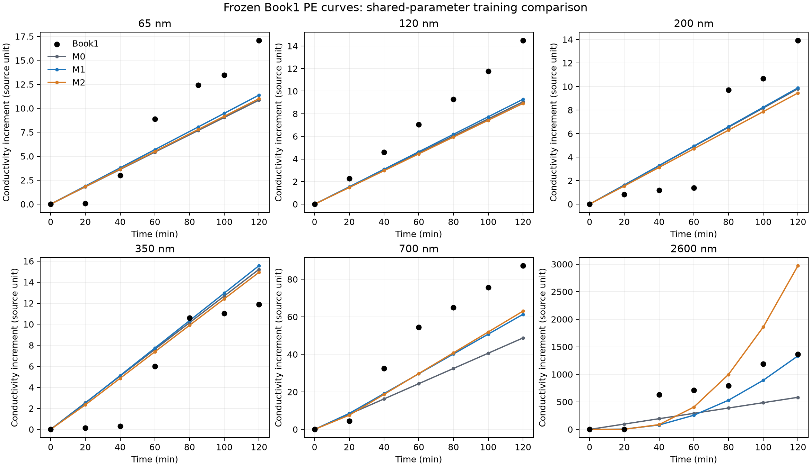

### 第1课：PE 膜是什么，为什么研究盐穿过它？

**一、先用生活故事理解。** 两个小盒子分别装盐水和淡水，中间放一张由塑料细丝织成的筛网。水能接触细丝和空隙，盐会尝试从盐多的一侧走向盐少的一侧。筛网是一幅想象图；真实膜不是整齐直通的洞。

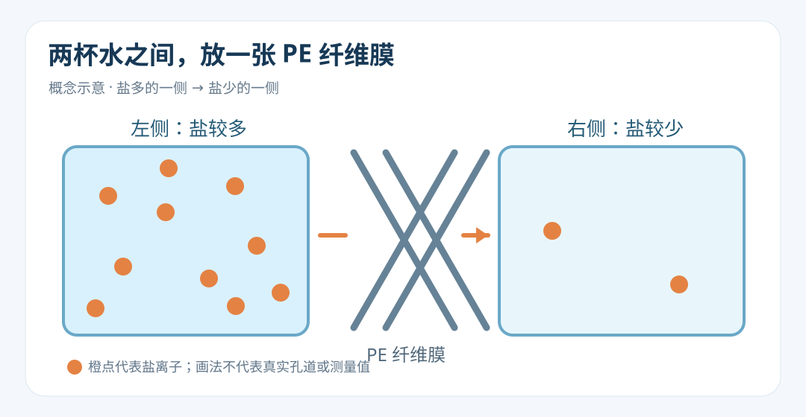

*概念示意，非实验照片。左杯的蓝色小点代表水，橙色的成对小点代表盐中的两类离子；灰色交织带代表 PE 纤维膜。箭头只表示可能的总体移动方向，不表示已测通量。*

**二、和我的科研有什么关系？** 本课研究的是超薄 PE 纤维膜。PE 是聚乙烯，是制成细纤维的塑料材料；“超薄”说的是整个膜厚很小。膜中真正可让水和盐通过的湿态路线，目前没有被完整画出来。

**三、导师为什么要研究？** 因为“薄且有空隙”听起来应当让盐较容易通过，但已有旧记录中，一些薄膜的接收侧读数增加很小。导师想弄清这种现象受什么控制，而不是先认定某一种原因。

**四、实际项目做了什么？** 研究资料记录了不同厚度标签的盐扩散过程；后来又用电脑模型检查纤维间水路与界面的可能作用。这里先只认研究对象，不讲模型细节。

**五、看一个真实结果。** 旧 2 小时盐工程的 Book1 表给 120 nm 标签一个 0–120 min 的接收侧电导变化：从 **2.38** 到 **16.87 μS/cm**。这两个数来自 `data/processed/origin_exports/Polymer_salt_2h/Book1__Sheet1.csv` 的 D 列，是旧实验工程导出值；“增加 14.49”在第2课算。它证明仪器读数改变了，尚不能单靠这两个数说穿过了多少克盐。

**六、得到什么结论？** PE 膜是研究对象，盐穿膜是要解释的问题。图中的直通小箭头是概念，不是已恢复的真实孔道。

**七、对论文有什么用？** 论文开头要让读者先明白“研究对象—观察到的问题—为什么值得解释”。本课给出这三件事的最初版本。

**八、今天只记住三句话。** PE 是膜的材料。盐从浓的一侧有向淡的一侧移动的趋势。真正的湿态通路还需要证据。

**九、小测试。** 在两杯水的故事里，中间的 PE 膜最像什么？A. 一张由细丝形成的障碍与通路；B. 让盐凭空消失的机器。你已学过本课；正确理解是 A。

### 第2课：导师是怎么知道盐可能穿过膜的？

**一、先用生活故事理解。** 想象在右边小盒子放一只“看水里有多少带电小颗粒”的仪表。若左边盐水中的离子逐渐到达右边，仪表读数可能升高。仪表并不会直接告诉我们“来了几克盐”。

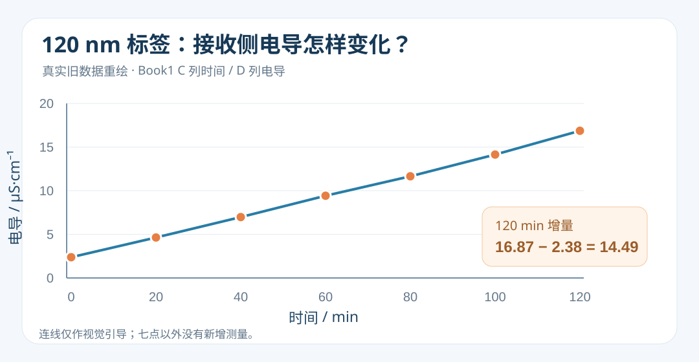

*真实旧数据重绘。横轴是 Book1 C 列时间 `min`，纵轴是 D 列接收侧电导 `μS/cm`；七个点来自 `data/processed/origin_exports/Polymer_salt_2h/Book1__Sheet1.csv`。连线仅便于看顺序，没有在两点之间增加实测值。*

**二、和我的科研有什么关系？** 右侧仪器实际保存的是**电导**：水让电流通过的容易程度。含盐离子可以改变电导，所以它给我们盐移动的线索。但温度、盐的种类和测量设置也会影响读数。

**三、导师为什么要研究这个量？** 因为它可以随时间重复读取，使我们看到“右边读数如何变化”，再比较不同膜厚标签。若只有最后一张照片，我们看不到变化过程。

**四、实际做了什么？** 旧 Origin 工程保存了时间和电导列。本仓库把原表只读导出，并核对了图线实际使用的时间列；这属于整理旧数据，不是 Codex 新做实验。

**五、动手读一个真数。** 120 nm 标签在 0 min 为 **2.38 μS/cm**，120 min 为 **16.87 μS/cm**。终点减起点：`16.87−2.38=14.49 μS/cm`，叫**电导增量**。图上七个点依次为 0、20、40、60、80、100、120 min；读数为 2.38、4.64、6.98、9.42、11.65、14.14、16.87 μS/cm。来源仍是旧 Book1 C/D 列；计算链保存在 `data/processed/salt_transport/book1_120nm_calculation_chain.json`，属 Codex 对旧读数的分步整理。它**不能**直接证明盐的质量或通量，因为这条曲线的校准、温度、池体积和膜面积等仍有未知项。

**六、得到什么结论？** 接收侧电导在这 120 分钟内上升了 14.49 μS/cm。把它称为“电导变化”最准确；在条件未核实前，不称“进入了 14.49 单位盐”。

**七、对论文有什么用？** 这条时间曲线可展示原始观察，也提醒论文必须交代仪器量怎样换成研究者想谈的盐转移量。

**八、今天只记住三句话。** 仪器给的是电导读数。终点减起点得到电导增量。电导增量不自动等于盐的质量。

**九、小测试。** 从 2.38 到 16.87 μS/cm，14.49 的单位应是什么？A. μS/cm；B. 克。你已学过本课；正确理解是 A。

### 第3课：为什么 PE 膜越薄，盐却不一定越容易通过？

**一、先用生活故事理解。** 两条隧道：一条很短，却有狭窄入口和收费站；另一条长一些，入口宽、通行顺畅。只比较“隧道长短”，不能判断哪条路更快。

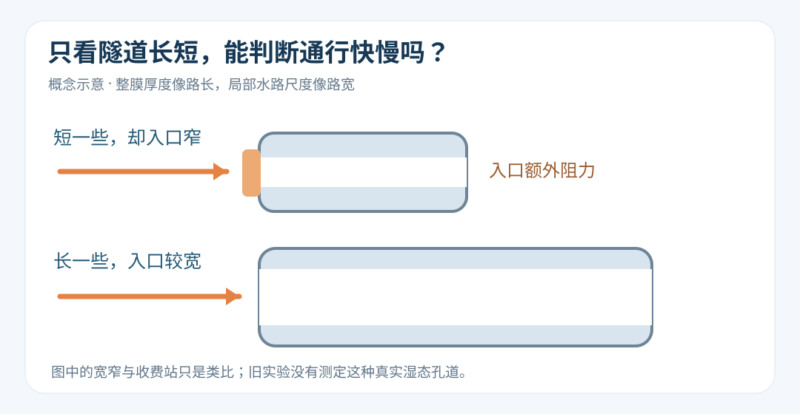

*概念示意，非膜孔照片。图中横向长度比喻整张膜厚，入口宽窄比喻局部可走水路尺度；收费站比喻进入膜时可能遇到的额外阻力。真实 PE 是否具有图示形状或能垒，仍需证据。*

**二、和我的科研有什么关系？** **膜厚**像穿过整片膜要走多远；**局部通路尺度**像途中某段有多宽。膜厚标签和湿态最窄处并不是同一个量。隧道收费站只是解释“进入本身可能困难”，还不是对本样品测出的能量值。

**三、导师为什么要研究？** 如果只有“越厚路越长”一个因素，盐转移通常会随着厚度增加而变难。旧数据却提示更复杂的走势，值得检查入口、通路和界面作用是否参与。

**四、实际做了什么？** 导师先用简单扩散与后来的有效模型作条件对照；本课不用公式，只记住它们像电脑里的虚拟隧道。我们会在第23–25课学习这些计算怎样写。

**五、看一个真实对照。** 旧 Book1 的 350 nm 与 700 nm 标签，0–120 min 接收侧电导增量分别为 **11.89** 与 **87.27**，源于同一导出表的 F/G 列起终值。这说明旧表里更厚的 700 nm 标签有更大的**电导变化**，没有证明它的真实孔一定更宽，也没有证明单位、校准、面积和两池条件完全可比。数据属于导师使用的既有实验；Codex 后来核对了来源。

**六、得到什么结论？** 仅知道膜厚还不够；至少要检查局部水路、入口和实验条件。我们的隧道图展示问题，不替实验回答原因。

**七、对论文有什么用？** 它说明为什么论文不能只画一条“膜厚越大，盐越慢”的直线；需要把可能的竞争因素和可证边界说清。

**八、今天只记住三句话。** 厚度是路长。局部水路是路宽。旧数据并不能只用路长直觉解释。

**九、小测试。** 两张膜厚度不同，能只凭厚度断定哪张转盐更快吗？A. 能；B. 不能，还要看通路与条件。你已学过本课；正确理解是 B。

### 第4课：PE 本身通常没有固定电荷，为什么还要研究它的表面电荷？

**一、先用生活故事理解。** 一块干净的塑料尺，未必像电池那样自带稳定的正负极。但尺子放进水里，表面会接触水、盐离子以及可能残留的其他物质。就像一件原本没有固定气味的衣服，接触环境后表面可能留下“别人能闻到的线索”。**这只是比喻**：我们不能靠闻到味道就断定是哪一种物质留下的。

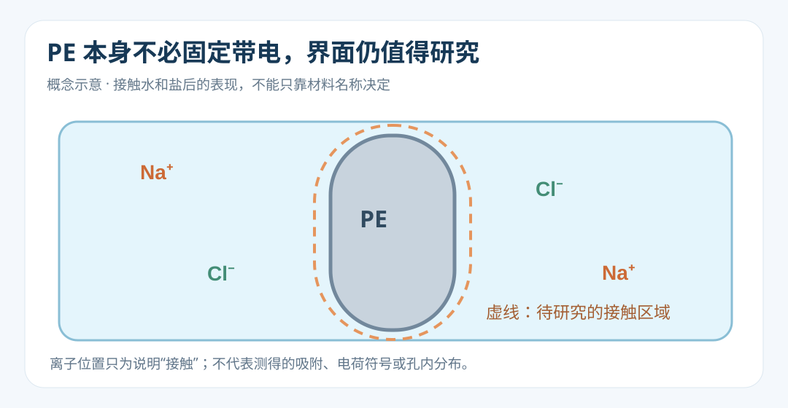

*概念示意，非真实膜的电荷分布。浅灰纤维代表 PE，蓝色水域中的橙色 `Na⁺`、绿色 `Cl⁻` 代表两类盐离子；虚线圈出需要研究的接触区域。图不宣称 PE 主链已经带负电，也不指定吸附或添加剂为已证实来源。*

**二、和我的科研有什么关系？** 我们关心的是**表面在水中表现出的电学作用**，即接触区域是否使正负离子行为不同。这里先学一个词：**表面电荷**，可简单理解为“界面是否表现出偏向正或负的电学作用”。它的真实来源可能不止一种，目前不能指定为 PE 分子链本身。

**三、导师为什么要研究？** 因为盐由带正号的 Na⁺ 和带负号的 Cl⁻ 组成。如果表面确实对两者的行为有不同影响，穿膜过程可能随之改变。导师需要检验这个可能性，也需要防止把任何电学读数直接说成“PE 自己带电且阻盐”。

**四、实际项目做了什么？** 旧资料保存了膜样品在不同 pH 条件下的电学读数，后来导师又做了带电/不带电的虚拟计算。本课只看旧读数，不提前讲复杂计算。原始来源是 `原始资料/赵珈绮/01_研究框架与资料_v2/05_真实数据_v1核查/` 的 182/357/604 XLS 审计；Codex 从已审计汇总重绘了 `data/processed/figures/zeta_trends.png`。

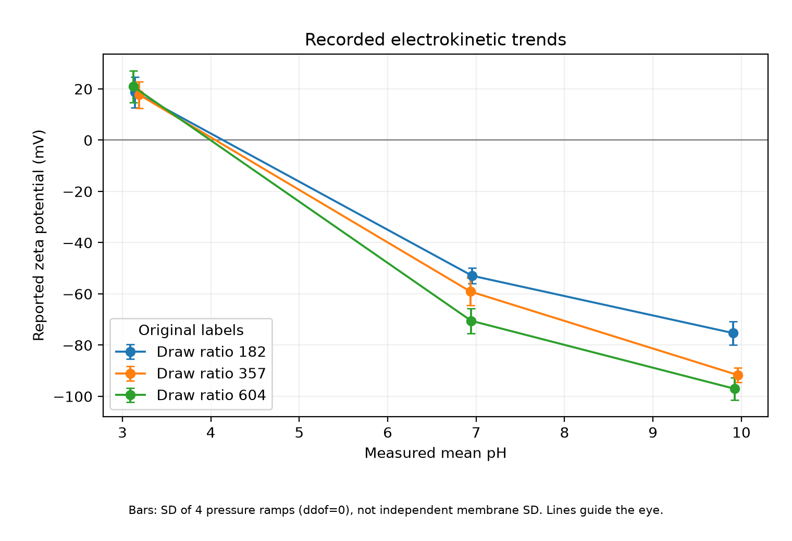

*真实旧读数的重绘图。横轴是原表各条件的平均 pH，纵轴是 zeta 电位，单位 mV；三色对应拉伸比标签 182、357、604。误差棒只表示同条件四次压力扫描的离散程度，不是四张独立膜。曲线连接只帮助看趋势。*

**五、看一个真数。** 在约 pH 7 的旧条件下，拉伸比标签 357 的平均读数为 **−59.06 mV**，见 `data/processed/zeta_trends.csv` 的 `draw_ratio_label=357`、`pH_mean≈6.934`、`zeta_mean_mV≈−59.056`。`mV` 是千分之一伏。**zeta 电位**在本课先当作“水流经过表面时得到的电学指纹”，不是直接数出孔壁上有多少电荷。这个数是旧实验读数的派生汇总；图是 Codex 的展示。仪器的具体 cell、装样方向、背景液及独立膜数仍是 `unknown`。

**六、得到什么结论？** 旧条件下确实有一个负的电学读数，所以“界面可能发生了什么”值得问。**不能**由 −59.06 mV 推出 PE 主链一定带固定负电，也不能推出它就是低盐转移的原因。

**七、对论文有什么用？** 它为论文提供一个研究动机和需要解释的电学现象。要写成材料机制结论，还需弄清测量方法、真实水路与离子输运之间的联系。

**八、今天只记住三句话。** PE 主链通常不被当成已经证实的固定带电体。接触水和盐之后，界面仍可能出现电学响应。一个负的 zeta 读数只是线索，不是荷电来源或阻盐机理的证明。

**九、小测试。** 看到旧数据中的 −59.06 mV，哪句话最稳妥？A. PE 主链已被证明带固定负电，且一定挡盐；B. 旧条件下出现负的界面电学读数，原因和输运作用还要核实。你回答 **B**，判断正确：读数是线索，电荷来源和输运作用仍须核实。

### 第5课：盐在水里是什么样？

**一、先用生活故事理解。** 想象一块由两色小积木交错堆成的方糖。它落入水后，“积木”不再作为完整方块漂来漂去，而是被水包围、分散开。食盐晶体也不是许多独立的“小 NaCl 夫妻”手牵手排列；晶体里的正负粒子共同排成结构，溶入水后各自在水中活动。**积木只是比喻**，它没有描述真实的原子和水怎样作用。

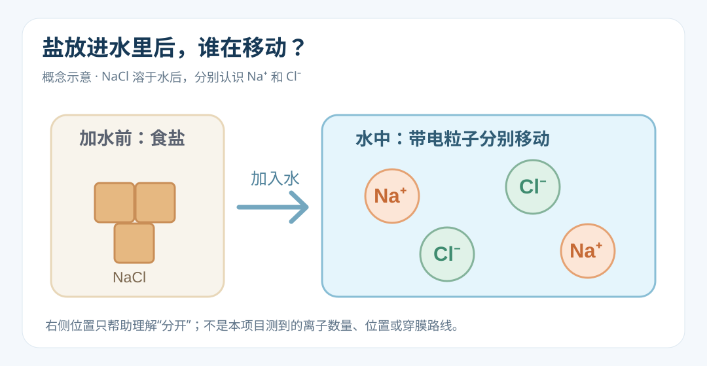

*为什么看这张图：先分清“盐粒”和“水中能移动的带电粒子”。左边画一粒盐；中间是加水；右边橙色 `Na⁺` 与绿色 `Cl⁻` 分开散在水里。箭头只表示溶入水后的变化，不是膜中实际轨迹。此图为概念示意，不是本项目的显微照片或实验数据。*

**二、和我的 PE 科研有什么关系？** 食盐叫氯化钠，写作 `NaCl`。它溶在水里时，钠和氯主要以能分别移动的带电粒子存在，分别写成 `Na⁺`、`Cl⁻`。这种带电粒子叫**离子**。符号右上角的 `+`、`−` 表示带电方向，不表示两粒盐。我们研究盐水穿过 PE 膜时，需要想到这两种粒子可能受到不同的影响，而不是想象一整颗盐粒钻孔。

**三、导师为什么要研究？** 第4课发现界面可能有电学作用。如果水里的两种粒子一个带正电、一个带负电，界面对它们的影响就可能不同。要弄清这件事，先得认清“谁在水里移动”。

**四、实际项目做了什么？** 导师后续的理论计算把 `Na⁺` 和 `Cl⁻` 作为两种对象分别处理；例如 `原始资料/赵珈绮/02_荷电与选择性实算_v3/00_实算说明.txt` 给出的是氯化钠的虚拟计算条件。这是**模型设定**，不能倒过来证明每一条旧实验曲线的盐种。旧 120 nm 曲线的整理见 `data/processed/salt_transport/book1_120nm_calculation_chain.json`，它明确把该曲线的盐种及浓度换算状态记为 `unknown`。

**五、看一个真实结果。** 导师旧实验的 `Polymer_salt_2h`、`Book1`、120 nm 标签曲线，原始导出文件 `data/processed/origin_exports/Polymer_salt_2h/Book1__Sheet1.csv` 的 C 列是时间、D 列是接收侧电导。0 分钟为 **2.38 μS/cm**，120 分钟为 **16.87 μS/cm**；Codex 的上述计算链据两端相减得 **14.49 μS/cm**。这说明接收侧导电能力在增加，符合有带电粒子进入接收液的观察；**仅凭电导还不能知道是哪一种离子各来了多少，也不能确认这条曲线用的就是 NaCl**。同资料中的实验计划写了 NaCl，但计划不等于曲线逐次执行记录。

**六、得到什么结论？** 对“氯化钠盐水”这个明确条件，可以把水中的对象先理解为分别活动的 `Na⁺` 和 `Cl⁻`。旧 120 nm 曲线只提供电导变化的事实；把它指定为某一种盐的两种离子变化，还缺曲线对应的配液记录。

**七、对论文有什么用？** 后面讨论离子选择性时，必须分别说正离子和负离子；写旧曲线时，必须把已测电导和未确认盐种分开。这能防止把模型假设误写成实验事实。

**八、今天只记住三句话。** 一粒盐溶入水后，不能继续当作整颗盐粒看。若盐是 NaCl，水里主要讨论能分别移动的 `Na⁺` 和 `Cl⁻`。本项目旧 120 nm 电导曲线的具体盐种仍未确认。

**九、小测试。** 如果只知道旧曲线的电导从 2.38 增到 16.87 μS/cm，哪句话稳妥？A. 已知道各有多少 `Na⁺`、`Cl⁻` 穿膜；B. 接收侧导电能力变强，但还不能仅由此认定每种离子的数量和这条曲线的盐种。你回答 **B**，判断正确：电导表像一个合计读数，不能单独认出每种离子及其数量。

### 第6课：Na⁺ 和 Cl⁻ 能各走各的，为什么还要一起看？

**一、先用生活故事理解。** 想象有一座窄桥。桥左边站着穿橙衣和绿衣的两队人，他们都想往右边走。橙衣的人跑得快，先过去许多；绿衣的人慢一些。你若只数橙衣队，会以为“大家过桥很快”。但桥两头很快出现人数失衡，后面的人要面对一个被改变的局面。盐水里的两类离子比这个故事更特别：它们分别带正、负电。若一类先跑远，两边暂时多出的电荷会形成**电场**，可以把它想成一种会影响带电粒子下一步运动的“无形推拉”。两类离子不必每一瞬间并排走，但也不能在没有其他条件参与时无限地只让一类跑走。**桥和衣服只是概念示意，不是真实膜孔或粒子轨迹。**

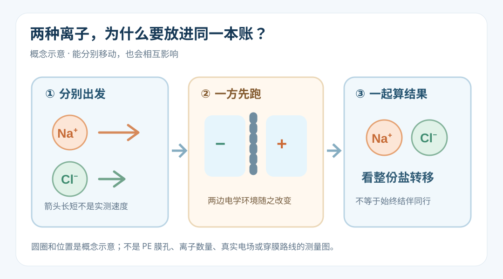

*为什么看这张图：左边提醒“Na⁺、Cl⁻ 可以分别移动”，中间提醒“一方先跑会改变两边电学环境”，右边提醒“看盐的整体转移要同时算两种离子”。橙、绿圆圈不是实测位置，箭头不是本项目测得的速度；右侧的“共同转移”也不等于两者始终贴在一起。*

**二、和我的 PE 科研有什么关系？** 研究膜有没有“偏爱”某种离子，要分别观察正、负离子；研究一份 NaCl 盐水整体转移多少，又必须把两者放在同一个账本里。好比一家商店同时看“橙队过了多少”“绿队过了多少”和“完整的一组货过了多少”，三种问题不是同一个数字。

**三、导师为什么要研究？** 第4课的旧电学读数让人怀疑膜附近对正、负离子的影响可能不同。但“更偏向 Na⁺”不自动等于“NaCl 盐水整体更难过去”。导师必须同时追踪两类离子，才能检查这个直觉。

**四、实际项目做了什么？** 导师 v3 把膜外水域、纤维间水路和入口一起放进电脑里的虚拟膜；分别计算 Na⁺ 与 Cl⁻ 的运动，并计算两者合起来的盐转移。一个例子设定左侧 **30 mM**、右侧 **1 mM** 的 NaCl；`mM` 是浓度单位，此处只需读成“左边较咸、右边较淡”。计算还比较了**假设界面会带电**与**不设界面电荷**的相同虚拟几何。这里的几何和电荷化学是假设条件，不是实测 PE 膜的内部地图。

**五、看一个真实计算结果。** 见导师交付的 `原始资料/赵珈绮/02_荷电与选择性实算_v3/finite_pnp/计算说明.txt` 第 23 行，主五排虚拟几何在 30→1 mM、无外接电路、达到稳定计算状态时，不设界面电荷的共同盐流量为 **0.1006554252 mol/(m²·s)**；采用假设的界面化学后为 **0.1034308084 mol/(m²·s)**，两者之比 **1.02757311**。先不记复杂单位：把前一个结果想成“每秒、每平方米过 100 份”，后一个约为 **102.76 份**。这是导师模型算出的、约 **2.76%** 的增加，**不是实测 PE 膜盐量，也不是 Codex 新发明的实验数据**。详细的“每秒每面积”含义留到第9课学。

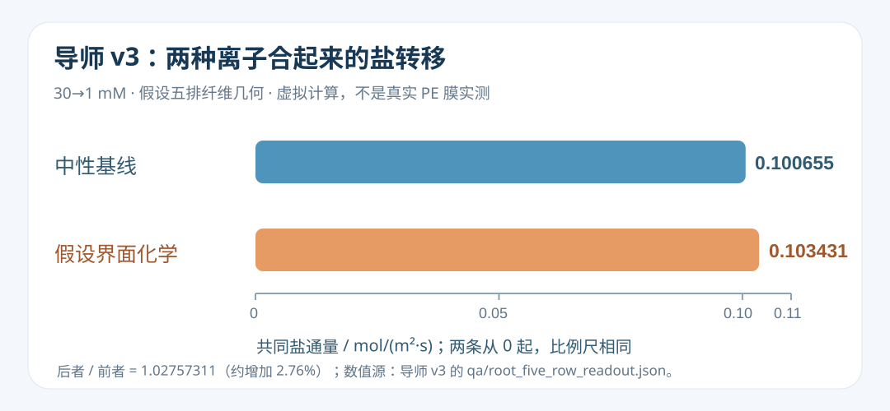

*直接看真实计算结果：两条横条从同一个零点起画，橙色的假设界面化学结果仅比蓝色中性结果长一点。数字来自导师 v3 的 `qa/root_five_row_readout.json` 中 `summary_from_actual_outputs[*].salt_flux_mol_m2_s`，本教材只将原数值可视化；不是新求解、独立预测或真实膜实验。图的条件是 30→1 mM 的假设几何，不能外推成所有 PE 膜。*

**六、得到什么结论？** 在这个**特定的虚拟条件**下，假设界面带电并未使两种离子合起来的盐转移减少，反而略增。这说明不能只凭“表面负电”就断言整份盐会被挡住；要把正、负离子和它们相互影响后的结果一起算。模型不证明真实 PE 膜一定如此。

**七、对论文有什么用？** 它给论文一个很重要的判断规则：讨论“挑选哪种离子”和讨论“总共转移多少盐”时，必须拿出各自的证据。导师的虚拟结果提供了检验简单直觉的例子；真实膜的结论仍需要与测量条件、真实水路和实验数据对照。

**八、今天只记住三句话。** Na⁺ 和 Cl⁻ 能分别移动，也会通过电学环境影响彼此。偏向一种离子，不自动代表整份盐更难穿过。导师 v3 的 **1.02757 倍**是有明确假设的虚拟结果，不是 PE 实测值。

**九、小测试。** 某个虚拟膜更偏向 Na⁺，能马上说它让整份 NaCl 盐水通过得更少吗？A. 能，只要偏向 Na⁺ 就一定挡盐；B. 不能，还要把 Na⁺、Cl⁻ 的共同转移一起计算。你回答 **B**，判断正确：偏向某一类离子与两类离子合起来的盐转移是两个问题。

### 第7课：电导表的数字究竟在告诉我什么？

**一、先用生活故事理解。** 想象你隔着墙听一条走廊：脚步声越来越响，说明走廊里“活动得更热闹”，但你听不出究竟来了几个人，也不一定能分清他们穿的是皮鞋还是运动鞋。电导表像一个观察液体“让电流通过有多容易”的仪器。读数变大，好比声音变响；它不是逐个离子的签到表。脚步声只是比喻，真实电导是电学测量，不是声音。

**二、和我的 PE 科研有什么关系？** 两杯水被 PE 膜隔开，导师记录接收侧液体随时间的**电导率**。你可以先把它理解为“单位尺度下液体导电有多容易”；表中单位 `μS/cm` 读作“微西门子每厘米”。它不是盐的克数，也不是 Na⁺、Cl⁻ 各自的数量。旧表标题常写“电导”，我们读数值时要按实际纵轴单位 `μS/cm` 看待。

**三、导师为什么要测？** 如果盐水中的带电粒子逐渐进入接收侧，接收侧导电能力通常会改变。连续记录仪器读数，便能观察有没有变化、变化发生在什么时候。这比只在开始和结束看一眼更有信息；但仪器没有自动替我们认出盐种和粒子数量。

**四、实际项目做了什么？** 导师留下了 Origin 盐实验工程；Codex 只读导出工作表，并生成 `data/processed/figures/salt_transport_origin_qc.png`，把旧表里的时间—电导点重新画出来作核查。完整图左边是 2 小时项目的多条旧曲线，右边是另一份未润湿/干态记录；两边不是同一组实验条件。本课**只看左图下方 `Book1: 120 nm` 那条蓝线**。它来源于 `data/processed/origin_exports/Polymer_salt_2h/Book1__Sheet1.csv` 的 C（时间）与 D（电导）列。

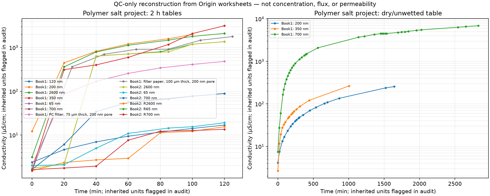

*为什么直接看这张真实结果图：横轴是原表时间，单位 min；纵轴是电导率，单位 μS/cm。左图每一种颜色是旧工作表中的一个曲线/样品标签，并非颜色代表不同离子。先只追踪左图蓝色 `Book1: 120 nm`：它从靠下的约 2.38 升到约 16.87 μS/cm。纵轴采用对数刻度，越往上表示数值越大，但相同的图上高度不代表相同的数值增量；其他曲线与右图留待后续课逐一解读。图是 Codex 从导师旧 Origin 表重绘的**数据核查图**，不是新实验，也不是浓度、盐通量或渗透率图。*

**五、再把一条线放大。** 同一条 120 nm 曲线共有 7 个原表点：0、20、40、60、80、100、120 min，对应 **2.38、4.64、6.98、9.42、11.65、14.14、16.87 μS/cm**。为了让你不用在拥挤的大图里找蓝线，第2课已经从同一 C/D 列生成了下面这张放大图；它没有添加新测量点。

*观察方法：从左到右是时间过去，从下到上是接收侧电导率增加；这 7 点都来自导师旧表，连线只帮助眼睛追踪。最后与最初相减，`16.87 − 2.38 = 14.49 μS/cm`。这是 Codex 对旧实验读数的整理计算，不是 14.49 克盐。该曲线的具体盐种、温度及电导到浓度的校准仍未确认。*

**六、得到什么结论？** 在这条旧曲线中，接收侧电导率随时间上升，是**实验读数的变化事实**。合理的下一步是核实导致导电变化的液体和实验条件；不能只凭电导曲线宣布“准确穿过了多少盐”或“是哪种表面电荷造成的”。

**七、对论文有什么用？** 论文可以诚实展示“旧实验观察到接收侧导电能力随时间增加”，并把真正要解释的问题提出来。要写成盐浓度、盐量或膜通量，还需要第8–9课要学的对应校准和实验记录；目前 `data/processed/salt_transport/book1_120nm_calculation_chain.json` 已把这些缺口记为 `unknown`。

**八、今天只记住三句话。** 电导率读数告诉我们液体导电有多容易，不是离子计数。120 nm 旧曲线在 120 min 内从 **2.38** 升到 **16.87 μS/cm**。图直接展示了读数变化，但没有直接给出盐的克数或穿膜机理。

**九、小测试。** 看到 120 nm 曲线的电导率增加 **14.49 μS/cm**，哪句话正确？A. 接收侧液体更容易导电了；B. 已测得有 14.49 克盐穿过膜。你回答 **A**，判断正确：增加的是液体导电读数，不是称出的盐质量。

### 第8课：电导率怎样才能变成盐浓度？

**一、先用生活故事理解。** 想象一个新买的厨房秤只显示“40 格”，却没有写每一格等于几克。你可以看出放上东西后数字变大，却不能宣布“它重 40 克”。怎么给秤配上刻度？先放几个**重量已经知道**的砝码：10 克显示多少格、20 克显示多少格，再把“格数”和“克数”一一对应。电导率换算盐浓度，也需要这样的**已知样品对照**。砝码故事只是帮助理解；真实电导率还受盐种、温度等影响，不保证是一条直线。

**二、和我的 PE 科研有什么关系？** **盐浓度**可以先理解为“一定体积水里有多少盐”，像“每杯水放了多少盐”。仪器给我们的是 `μS/cm`；想知道浓度，就得用同一种盐、匹配的温度和测量条件，配制几杯**浓度已知的标准液**，逐杯测电导率，建立“电导率 ↔ 浓度”的对照表或曲线。这个对照过程叫**校准**。校准是把两种不同的量接起来，不是凭经验把单位改写。

**三、导师为什么需要这一步？** 第7课只知道接收侧导电读数增加了。如果论文要进一步说“接收侧盐浓度增加了多少”，必须先跨过电导率到浓度这一关。否则 `14.49 μS/cm` 仍只是电学读数，不能写成 `14.49 g/L` 或别的浓度。

**四、实际项目做了什么？** Codex 已准备 `src/data_ingest/conductivity_calibration_template.csv`，规定记录标准液身份、浓度、电导率、温度及来源；`src/data_ingest/conductivity_calibration.py` 能检查填入的标准点是否合理，并只在**已知标准点覆盖的读数范围内**换算。可把它想成一把刻度尺的空框和检查器。**模板目前只有表头，没有这条旧曲线对应的真实标准液数据**；有程序不等于有校准结果。`data/processed/salt_transport/salt_transport_record_tracker.csv` 中 120 nm 行的 `conductivity_calibration_id` 和 `temperature_record_id` 仍为 `unknown`。

**五、直接看真图和缺口。** 下图仍是导师旧 `Polymer_salt_2h` 的 `Book1`、120 nm 标签，C 列为时间、D 列为接收侧电导。七个点从 **2.38** 升到 **16.87 μS/cm**，端点差 **14.49 μS/cm**，是**真实旧读数与 Codex 的减法整理**；蓝线是视觉引导，不添加测量。

*这张图的横轴是时间 min，纵轴是电导率 μS/cm；它回答“读数如何变化”。图没有浓度轴，因此不能从曲线高度直接读出 g/L。原始数据来自 `data/processed/origin_exports/Polymer_salt_2h/Book1__Sheet1.csv` 的 C/D 列。*

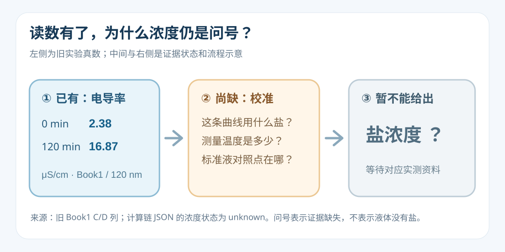

*这张是“真数＋流程概念示意”：左框的 2.38、16.87 μS/cm 来自上述旧表；中框空着不是忘了算，而是该曲线的实测盐种、配液和温度匹配校准仍未确认；右框“浓度未知”是目前的数据状态，见 `data/processed/salt_transport/book1_120nm_calculation_chain.json` 的 `stages.concentration.status=unknown`。图中空框不代表真实盐水没有浓度。*

用一个**虚构的小秤练习**想换算步骤：若已知 10 克砝码显示 20 格、20 克砝码显示 40 格，那么显示 30 格时，在这两点之间可以先估算 15 克。这里的“格”和“克”只是教学数字，**绝不能拿来换算 PE 项目的 μS/cm**。真实电导校准还必须检查中间关系是否适用，不能任意向已测范围外延伸。

**六、得到什么结论？** 我们已经有旧曲线的**电导率变化**，尚没有足够的曲线级校准依据把它可靠换成**盐浓度变化**。这是一条明确的证据边界，不是“程序算得不够努力”。

**七、对论文有什么用？** 现在可以写“接收侧电导率从 2.38 升至 16.87 μS/cm”。若以后获得曲线对应的盐种、温度和标准液校准记录，才有机会把每个时间点转换为浓度，再进一步讨论盐量和通量。即使校准齐全，下一关仍需要接收池体积、取样/补液与膜有效面积，第9课再学。

**八、今天只记住三句话。** 电导率和浓度不是同一种量。换算需要同盐种、匹配温度的真实标准液校准。我们的 120 nm 旧曲线目前没有已确认的校准，所以浓度仍是**未知**。

**九、小测试。** 项目已有电导率曲线和一份只有表头的校准模板，现在能把 16.87 μS/cm 直接写成某个盐浓度吗？A. 能，程序和模板已经在；B. 不能，还缺这条曲线适用的真实校准点及实验条件。你回答 **B**，判断正确：空模板和程序不能代替匹配的实测标准液。

### 第9课：同样咸的一杯水与一桶水，盐转移一样多吗？

**一、先用生活故事理解。** 一杯水和一桶水，尝起来可以**一样咸**。但桶里的水更多，桶里盐的**总量**通常也更多。再假设有两个同样大的门：一扇门花一分钟送来一桶盐水，另一扇门花一小时才送来；“送得多快”显然也不同。这一课只分清三个问题：**每份水有多咸、总共有多少盐、穿过一块膜有多快**。杯、桶、门只是比喻，真实膜要按实测液量、膜面积与时间结算。

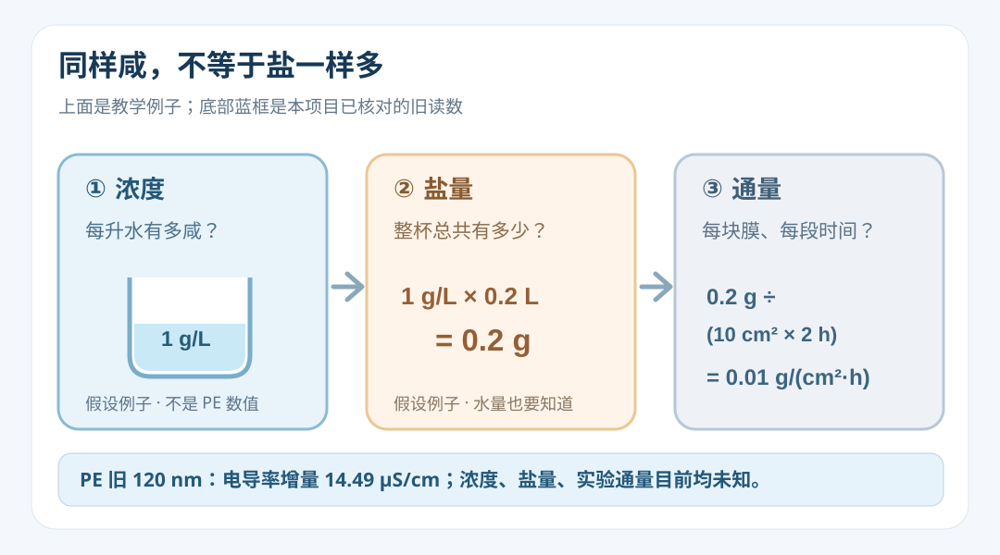

*图上左框“浓度”问每升水里有多少盐，中框“盐量”问整个容器中盐的总数，右框“通量”再问每单位面积、每单位时间穿膜多少。图中杯桶和数字是教学示例，不能冒充 PE 实验结果；底部蓝色旧数 **14.49 μS/cm** 才来自本项目真实旧曲线。*

**二、和我的 PE 科研有什么关系？** 第8课学了“浓度”：如果盐的身份和单位都明确，它可用 `g/L`（每升水含多少克）表示。今天新学两个词。**盐量**是某份液体中盐的总数，可用 `g` 表示；**通量**是平均每单位膜面积、每单位时间转移的盐量，例如 `g/(cm²·h)`。它们三者的单位不同，所以不能把一个数字直接改名成另一个。

**三、导师为什么要区分？** 论文若问“膜让盐通过得快不快”，光看接收杯“有多咸”还不够。一个大杯即使和小杯一样咸，也装着更多盐；同样转移总盐量，如果膜面积或等待时间不同，通过能力也不能直接比较。我们需要这三个层次，才能把实验读数逐步变成可比较的输运结果。

**四、怎样用最简单的数字算？** **以下全部是假设例子，不是 PE 数据。** 两杯盐水都为 `1 g/L`：A 杯有 `0.2 L`，盐量为 `1×0.2=0.2 g`；B 桶有 `1 L`，盐量为 `1×1=1 g`。它们“每升一样咸”，盐总量却差五倍。再假设开始时接收杯没有盐，经过 `2 h`，确实有 `0.2 g` 盐穿过面积 `10 cm²` 的膜，且没有取样、补液和其他损失。平均通量为 `0.2÷(10×2)=0.01 g/(cm²·h)`。这个算式把**总量**再除以**面积**和**时间**；如果取样或液量改变，就要先重新做盐量收支，不能照搬这个简化式。

**五、先看项目真正测到哪一层。** 导师旧 `Polymer_salt_2h` 的 `Book1`、120 nm 标签，原始导出 C/D 列经 Codex 重绘为下图：0–120 min 电导率从 **2.38** 到 **16.87 μS/cm**，差 **14.49 μS/cm**。这仍在“仪器读数”一层，**尚未跨到浓度**；对应 `data/processed/salt_transport/book1_120nm_calculation_chain.json` 依次把浓度、通量标为 `unknown`，需要校准、接收侧体积和取样/补液记录、膜有效面积。时间 **120 min** 虽已知，不能单凭时间填满其他空格。

*图上横轴是时间 min，纵轴是接收侧电导率 μS/cm；它不是浓度 `g/L`、盐量 `g` 或通量 `g/(cm²·h)` 图。橙点来自旧 Book1 C/D 列；线只连接这七个点。此时不能将纵轴数值换成盐量或通量。*

**六、项目中有没有“通量”数字？** 有，但来自**导师的虚拟模型**，不是上面的旧实验。导师 v3 假设一个五排纤维网络，让左侧 30 mM、右侧 1 mM；在该条件下计算的共同盐通量，中性情景约 **0.100655**、假设界面化学情景约 **0.103431 mol/(m²·s)**，来自 `原始资料/赵珈绮/02_荷电与选择性实算_v3/qa/root_five_row_readout.json`。这里 `mol` 是化学里数粒子的大计数单位；本课只看 `m²·s` 表示“每平方米、每秒”。图上两条同零点横条显示模型后者稍大约 **2.76%**。**这组理论通量不可塞进旧实验数据表，不能说成 120 nm 膜实测通量。**

*蓝条、橙条均为导师 v3 的数值计算输出；颜色代表两套假设条件，不代表 Na⁺/Cl⁻。横轴从零开始，单位 `mol/(m²·s)`；后者略大只说明该虚拟几何中的计算结果。图由原 JSON 数值重绘，不是独立新实验或真实膜的测量。*

**七、得到什么结论，对论文有什么用？** **实验事实：** 旧接收侧电导率增加了 **14.49 μS/cm**。**尚未获得：** 这条曲线可信的浓度变化、盐量变化和实验通量。**模型推论：** 假设五排几何中有上面两组通量值。论文不能把三类话混写；后续若想从旧曲线得到实验通量，至少先补曲线级校准、接收液体积/取样收支和有效面积。

**八、今天只记住三句话。** 浓度问“每升有多咸”。盐量问“这杯水总共有多少盐”。通量再问“每块膜、每段时间穿过多少”；旧 120 nm 曲线目前只给了电导率，实验通量仍**未知**。

**九、小测试。** 两个杯子的盐浓度同为 `1 g/L`，A 杯 `0.2 L`，B 杯 `1 L`。在这个假设练习中，哪句话正确？A. 两杯一样咸，但 B 杯盐的总量更多；B. 两杯盐的总量一定相同。你回答 **A**，判断正确：浓度相同，液量越大，整杯盐的总量越多。

### 第10课：为什么不能只看120分钟的终点？

**一、先用生活故事理解。** 两位同学从宿舍到教室，都用 **20 分钟**。你只看抵达时间，会说“他们一样快”。但第一位一直均匀走；第二位前 15 分钟几乎没动，最后 5 分钟冲刺。**同样的终点，过程可以完全不同。** 把路上每隔几分钟的位置记录下来，连成一条**时间曲线**，就能看见这种区别。行走故事只帮助观察，不表示盐真的会“停下再冲刺”。

**二、和我的 PE 科研有什么关系？** 旧盐实验不只有 120 min 这一个数字，还保留了 0、20、40、60、80、100、120 min 的接收侧电导率读数。以前我们算了每条曲线的终点增量；今天要看**中途的点**。这样才能问：不同膜标签的读数是在整个过程中平缓上升，还是某一段变化特别大？

**三、导师为什么需要整个过程？** 如果某个理论只保证“120 min 终点对”，却把 20、60 或 80 min 的变化讲错，它尚未解释完整实验。时间曲线能让我们发现单看终点时被遮住的问题，并帮助决定下一步需要检查实验记录，还是研究随时间改变的条件。

**四、实际项目做了什么？** 导师交付的旧 `Polymer_salt_2h` Origin 工作表经 Codex 只读导出为 `data/processed/origin_exports/Polymer_salt_2h/Book1__Sheet1.csv`。本课只取同表 C 列的共同时间、D 列的 **120 nm 标签**和 E 列的 **200 nm 标签**；`src/build_pe_teaching_html.cjs` 从这三列生成下面的图。Codex 此前已在 `阶段总结/20261017_旧时间曲线内部检验.md` 用 200 nm 原值做过前后半程对照；本课是原有证据的可视化教学，不是新测量或重新拟合模型。

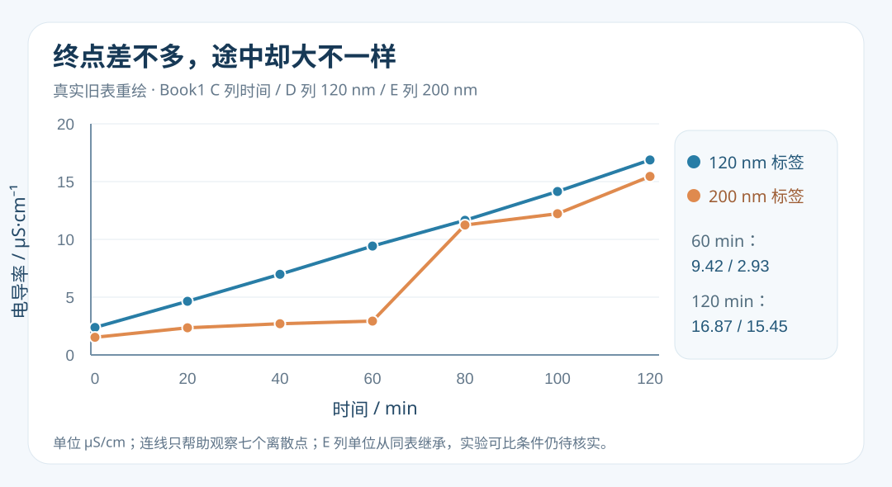

*这张图是**真实旧表读数重绘**。横轴时间 min，纵轴接收侧电导率 μS/cm；蓝色代表 120 nm 的 D 列，橙色代表 200 nm 的 E 列，颜色不是 Na⁺/Cl⁻。每种颜色各七个原表点，线段只是视觉连接。E 列的单位从同工作表显式标注列继承，尚待曲线级实验记录确认；两条曲线的独立膜身份、温度、校准和池条件也没有闭合。因此先观察**各自的时间形状**，不要把两线高度差直接当成已验证的盐量差。*

**五、看真数：终点相近，中途不同。** 120 nm 从 **2.38** 到 **16.87 μS/cm**，总增量 **14.49**；200 nm 从 **1.53** 到 **15.45 μS/cm**，总增量 **13.92**。只看这两个终点增量，会觉得差不多。但在 **60 min**，120 nm 已到 **9.42**，比起点增加 **7.04 μS/cm**；200 nm 只到 **2.93**，比起点增加 **1.40 μS/cm**。后一个数远小于前一个，说明两条旧曲线中途的**读数走势**不同。

再只看 200 nm 自己：前 60 min 增量 `2.93−1.53=1.40 μS/cm`；后 60 min 增量 `15.45−2.93=12.52 μS/cm`。后半段约为前半段的 `12.52÷1.40≈8.94 倍`。这就是已记录在旧时间曲线内部检验中的 Codex 派生对比。它**不是**“盐通量增加 8.94 倍”，因为我们尚没有把电导率换成盐量或通量；也没有误差条证明差异的统计稳定性。

**六、得到什么结论？** **实验读数事实：** 200 nm 标签的接收侧电导率在 60 min 之后增加得明显更多；120 nm 的七点走势与它不同。**可得的研究判断：** 一个只比对 120 min 终点的模型会漏掉这类时间形状。**不能得出的机制结论：** 不能仅凭这张图说膜在 60 min 突然润湿、孔道打开或界面电荷改变；温度、混合、取样、记录和其他因素也需要核查。图上 60–80 min 的线段不是连续实测过程。

**七、对论文有什么用？** 论文若提出解释，就应该同时面对终点和中途读数，不能仅靠“终点拟合得近”宣布模型成功。200 nm 曲线为后续模型提供一项具体挑战：解释为何旧表前半程仅增 **1.40**、后半程却增 **12.52 μS/cm**，并先查清测量条件与重复情况。这个问题有科研价值，但**还不是已证明的新机理**。

**八、今天只记住三句话。** 两条曲线终点接近，不代表经过的过程相同。200 nm 旧曲线后半程电导增量约为前半程的 **8.94 倍**。这只是电导时间形状的线索，不是已证实的盐通量突增或膜孔开启。

**九、小测试。** 两张膜在 120 min 的电导增量差不多，能因此认定它们在 0–120 min 的变化过程也一样吗？A. 能，终点相近就够了；B. 不能，还要看中途的时间点。你回答 **B**，判断正确：终点相近不能代替中途形状。

### 第11课：表面“带多少电”到底是什么意思？

**一、先用生活故事理解。** 想象两面同样大的墙，一面贴了许多带“−”号的小纸片，另一面一张也没有。只说“墙有负号”还不够；如果墙的面积不同，也要问“每一块墙面上平均有多少”。这节课的新问题不是 PE 为什么出现电学读数（第4课已学），而是**在模型里怎样给纤维表面一个可计算的电荷数值**。纸片是概念比喻；真正的电荷不是纸片，也不表示真实膜上有可见负号。

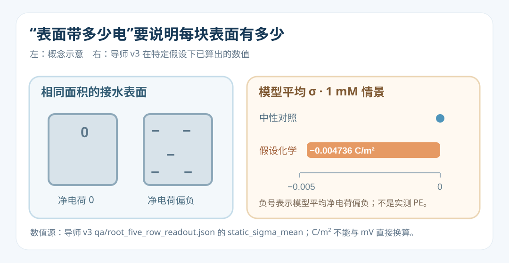

*这张图上，左半边是“同样面积的墙面”概念示意；右半边是**导师 v3 已有数值计算结果**，零点为中性对照，向左的橙条为假设界面化学下的平均负值。横轴单位 `C/m²`，表示单位表面面积的电荷；条长只比较这两个同条件模型情景。右图不是 PE 膜的实测表面电荷，也不是前面旧 zeta 图的 mV 读数。*

**二、和我的 PE 科研有什么关系？** 我们把“表面平均带多少电”写成**表面电荷密度**，常用希腊字母 `σ`（读作 sigma）。先把它当成一个“每块接触水的纤维表面分到多少净电荷”的账本：`σ = 表面净电荷 ÷ 表面面积`。`C`（库仑）是电荷量单位，`m²` 是平方米，所以单位是 `C/m²`。例如同样的净负电荷若分布在两倍大的表面上，平均每平方米分到的负电荷就减半。**这里的面积是模型中纤维接触水的表面，不是膜正面看过去的投影面积。**

**三、导师为什么要给它一个数字？** 电脑模型需要明确边界条件，才能计算膜附近的水中离子怎样分布和移动。只告诉电脑“这面墙可能带负电”，它不知道负得有多强；给 `σ` 和单位，才可以比较“中性”和“某一种假设的带电情景”。这个数字的来源必须单独说明：是人工指定、由假设化学计算出来，还是实验独立测得。

**四、实际项目做了什么？** 导师 v3 为五排虚拟纤维网络设置了同一几何的**中性对照**，并另算“假设局部 Cl⁻ 吸附”的界面化学情景。在两侧同为 **1 mM** 的虚拟盐水条件下，该化学情景的平均 `σ` 由模型计算得到；这不是实验人员把真实 PE 膜表面电荷测出来。结果可在 `原始资料/赵珈绮/02_荷电与选择性实算_v3/qa/root_five_row_readout.json` 的 `summary_from_actual_outputs` 中追溯，中性行 `static_sigma_mean=0.0`，化学情景行 `static_sigma_mean=−0.004736040481486473`；导师 `finite_pnp/计算说明.txt` 第22行也明确标为“等1mM的假设化学”。

**五、怎样读这个真数？** 图中的 **0 C/m²** 是“中性对照”这个模型设置。**−0.004736 C/m²** 里的负号表示在该假设条件下，模型平均表面净电荷偏负；数值的绝对大小描述“每平方米模型接触面”的平均电荷量。它不是 `−0.004736 mV`，不能与旧电位读数直接换单位。该值也不是固定不变的 PE 材料常数：导师在另一组 **30→1 mM** 条件下得到的是另一数值，本节不把两组条件混用。

**六、得到什么结论？** **模型事实：** 导师 v3 在明示的化学假设和 1 mM 条件下，算出了一个平均负的 `σ`。**尚未证实：** 真实 PE 纤维湿态表面的电荷来源、数值及空间分布；旧 zeta 读数也不能直接充当这个 `σ`。本课学会的是模型参数如何定义与阅读，不是宣布材料已经被证明固定带电。

**七、对论文有什么用？** 将来论文可以诚实比较“如果纤维表面平均电荷是某个值，计算预测会怎样变化”，并列明这个值是**假设模型的计算结果**。若要宣称真实 PE 表面确有该 `σ`，必须有独立的材料和界面证据支持；模型自己算出的值不能代替实测。

**八、今天只记住三句话。** `σ` 记录的是**每单位表面面积的净电荷**，单位 `C/m²`。导师 v3 的 **−0.004736 C/m²** 是在假设界面化学和 1 mM 虚拟条件下算得的平均值。它不是已测 PE 膜的固定电荷，也不能与 mV 电位直接换算。

**九、小测试。** 看到导师 v3 的 `σ≈−0.004736 C/m²`，哪句话稳妥？A. 这是特定假设和 1 mM 条件下的模型表面平均负电荷数值；B. 这已证明所有真实 PE 膜表面都固定带同样的负电。你回答 **A**，判断正确：模型条件数值不是普遍的材料实测值。

### 第12课：水中的 Na⁺、Cl⁻ 到了负表面附近会怎样？

**一、先用生活故事理解。** 想象一个广场旁边有一排座位。不同的人对这排座位的偏好不同：一类人更愿意坐近些，另一类更愿意待远些。你若在靠墙和远处各拍一张照片，会发现两类人的**平均分布**不同。但照片不能证明谁被牢牢锁在座位上；人仍能来回走。离子在水里也不会因为一处表面带电就排成永远不动的队伍。**座位只是比喻**，真实作用来自电荷与水中的热运动。

**二、和我的 PE 科研有什么关系？** 如果模型纤维表面表现出负电，带正电的 Na⁺ 在附近可能更常出现，带负电的 Cl⁻ 则可能更少出现。这里新学的是**空间分布**：同一杯盐水，离纤维表面近与远的位置，离子浓度不一定相同。它回答“在哪里比较多”，尚未回答“整份盐穿膜有多快”。

**三、导师为什么要算？** 第11课已经学会给模型表面一个电荷数值；下一步就要检查这个数值是否会改变周围水里两种离子的站位。如果不算空间分布，只凭“负电吸引正离子”这句话，我们不知道影响延伸多远，也不能看见两类离子怎样共同调整。

**四、实际项目做了什么？** 导师 v3 用电脑建立一个**理想化圆柱纤维外的水域**，不是把真实 PE 湿态孔全部拍出来。在一套**假设的 H/OH 结合化学**、`1 mM` 盐、`pH 7` 条件下，计算从纤维附近到外侧水域的 Na⁺、Cl⁻ 浓度。计算输出在 `原始资料/赵珈绮/02_荷电与选择性实算_v3/outputs/surface_radial_profiles.csv`；导师原结果图为同目录 `surface_regulation_and_selectivity.png`。**这套 H/OH 候选与第11课的“假设局部 Cl⁻ 吸附”是两种不同模型化学，不能把两课的表面电荷数值拼成同一工况。**

**五、直接看真结果图。** 先看下面这张只摘出同一模型曲线两端数值的图：在离纤维最近的模型网格点，Na⁺ 约 **10.56 mol/m³**、Cl⁻ 约 **0.095 mol/m³**；到外侧最后一个网格点，分别约 **1.22** 与 **0.823 mol/m³**。`mol/m³` 是浓度单位；此处只需比较同一种离子“近”和“远”。左右两栏是在比较两个位置，不表示离子真的从左向右行走。

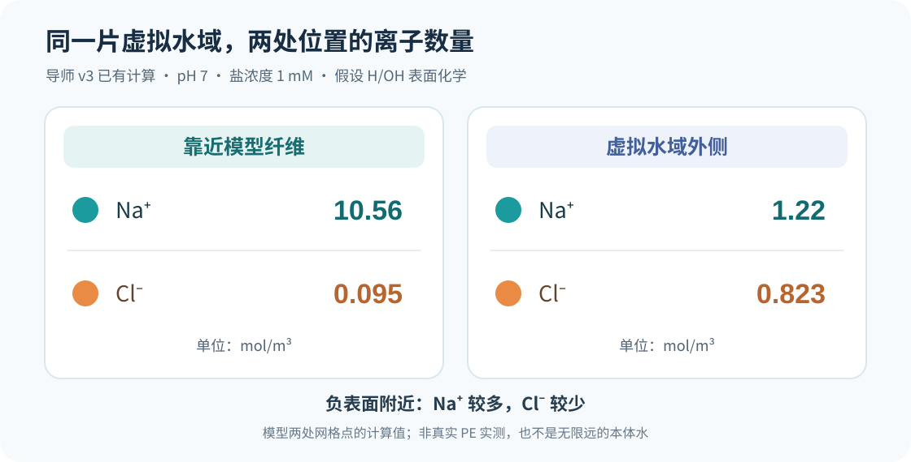

*本图的四个数字直接摘自导师 `surface_radial_profiles.csv` 的 `pH=7, salt_mM=1` 组首/末行，分别读取 `Na_mol_m3` 和 `Cl_mol_m3`。它是**导师既有模型数值的教学重绘**，不是本轮新求解，也不是 PE 实测离子位置。近壁与外侧是有限虚拟水域的两处网格点，不是无限远的“纯本体水”。*

再看导师交付的原结果图，**本节只看中间的 B 图**：横轴是离虚拟纤维表面的距离，越往右越远；纵轴是该位置的离子浓度与设定储液浓度之比。青蓝 Na⁺ 曲线在近表面较高、往外降低；橙色 Cl⁻ 曲线在近表面较低、往外升高。纵轴用对数刻度以同时显示相差较大的值；不用靠图高直接做减法。左右 A、C 图分别涉及电位与电流份额，后续相应课节再学。

*这是导师原有的三联计算图，页首已标明假设几何与假设结合能。B 图说明这套**虚拟 H/OH 候选**能产生靠近负表面时 Na⁺ 较多、Cl⁻ 较少的空间分布。它没有测出真实 PE 孔内的离子云，也不能独自证明膜只让 Na⁺ 通过。*

**六、得到什么结论？** **模型结果：** 这套明示假设下，水中可移动 Na⁺ 在模拟表面附近较富集，Cl⁻ 较少；离得远一些，两条曲线逐渐接近各自的外侧值。**不能得出：** 真实 PE 一定具有相同化学位点或完全相同的离子分布；更不能把“Na⁺ 附近较多”直接改写成“整份盐通量变小”。

**七、对论文有什么用？** 它提供一条**可能的物理链**：假设界面电荷 → 水中两种离子重新分布 → 可能改变后续输运计算。论文若要把这条链写成真实 PE 机制，还须独立确认界面化学、湿态水路和对应的离子输运证据。这里的图支持“该机制在模型中可发生”，不支持“真实膜已经被证明如此”。

**八、今天只记住三句话。** 负表面附近，模型中的 Na⁺ 可以比远处更常出现，Cl⁻ 则更少。这样的“富集/减少”说的是**平均空间分布**，不是离子被永远粘住。导师原图 B 是虚拟计算，不是 PE 孔内的实测照片。

**九、小测试。** 看导师原图 B 和近远数值，哪句话稳妥？A. 在这套假设模型中，近表面 Na⁺ 较多、Cl⁻ 较少，但尚不能认定真实 PE 一定如此；B. 这是一张真实 PE 孔内离子的显微照片。你回答 **A**，判断正确：模型中的空间分布不等于真实 PE 的显微实测。

### 第13课：旧实验的 zeta 读数究竟告诉了我们什么？

**一、先用生活故事理解。** 一阵风吹过草地，你看到草叶偏向一边，就知道“风和草之间发生了作用”；但草叶的倾斜角度，不能直接告诉你每片草叶上有多少电荷。旧 zeta 读数也像一种**间接线索**：研究者推动液体，记录随之出现的电学响应，再得到以 mV 为单位的 zeta 数值。风吹草只是比喻；真实过程涉及流动液体与界面附近的电荷。

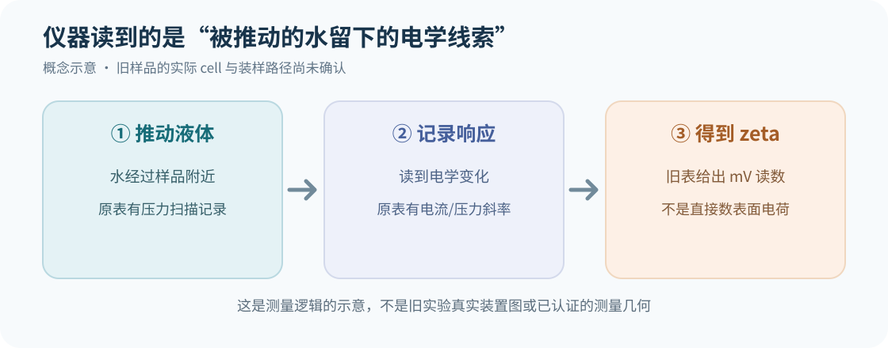

*这幅图是测量逻辑的概念示意，不是旧实验的真实装置照片。旧表确有压力扫描和电流/压力斜率字段，但对应样品实际使用的仪器 cell、流道与安装方式尚无可认证记录。*

**二、和我的 PE 科研有什么关系？** 第11课的 `σ` 是每单位表面积的净电荷，单位 C/m²；本课的 **zeta 电位**是旧实验整理出的**电动响应指标**，单位 mV。先把它理解为“液体被推动时，样品与水接触界面留下的电学指纹”。两者不是同一把尺子：zeta 的负号不能直接换成真实 PE 孔壁的 `σ`，也不告诉我们带电的是 PE 主链、吸附物还是其他界面成分。

**三、导师为什么要保留这些旧读数？** 它们让我们知道：旧样品在当时测量条件下确实给出了不同的电学响应，值得把界面效应列入候选问题。但若要解释“为什么会这样”，必须知道样品怎样装进仪器、水从哪里经过、用了什么背景液以及温度等。没有这些条件，同一个 mV 数字不能定位到膜内哪一个表面。

**四、实际项目做了什么？** 导师原始资料中的 182、357、604 三份 XLS 保存了压力扫描记录。Codex 对源行做身份审计：共 **36 次压力扫描**，每个拉伸比标签各有三个 pH 条件，每个条件四次扫描，汇成 **9 个条件均值**；又用 `src/data_ingest/plot_zeta_trends.py` 从导师资料中的 `zeta_summary.csv` 整理出 `data/processed/zeta_trends.csv` 和下方趋势图。这是**原数据审计与重绘**，不是新增 zeta 实验或理论模型的独立预测。审计见 `阶段总结/20261015_P1_B10_zeta源数据审计.md`。

**五、看真实结果图。** 先只看图中**接近 pH 7 的三个点**；pH 改变时为何整体移动，留到第14课。横轴是原表的平均 pH，纵轴是 zeta（mV）；蓝、橙、绿分别表示旧样品的拉伸比标签 182、357、604。约 pH 7 时，三组均值依次是 **−52.91、−59.06、−70.50 mV**；确切的 pH 平均值分别约 **6.954、6.934、6.945**。三个点下方的负号说明旧测量报告的是负向电动响应，不表示已经数出了真实孔壁电荷。

*数字来自 `data/processed/zeta_trends.csv` 的 `draw_ratio_label`、`pH_mean`、`zeta_mean_mV`。图由 Codex 从导师旧 XLS 的已审计汇总重绘。每个点的小竖线是同条件**四次压力扫描**的总体标准差，读取列 `zeta_sd_four_ramps_ddof0_mV`；例如 357 标签约 pH 7 为 **5.42 mV**。它不是四张独立膜之间的误差。连接线只帮助看三个条件点，不代表中间 pH 都测过。*

**六、究竟得到了什么结论？** **旧实验记录支持：** 这批样品在各自旧条件下给出可追溯的 zeta 电动读数，且约 pH 7 的三组均值都为负。**尚不能证明：** 三个标签之间的差异必然由拉伸比本身造成，真实膜内贯通孔壁就是这个电位，或者 PE 主链固定带负电。四次扫描可能来自同一膜片；独立膜数量仍为 `unknown`。旧资料未恢复这批测量对应的实际仪器 method/cell、背景液、温度与装样方向，详见 `阶段总结/20261016_P1_B12_zeta方法信息追索.md`。

**七、对论文有什么用？** 可以把这张图作为**旧条件下界面电动响应的描述性证据**，明确原表、重绘程序、九个均值与四次扫描的含义。它帮助提出“界面值得研究”的问题。若要进一步写成具体荷电来源或膜内输运机制，需要能对应这批样品的方法记录和独立证据；不能用这张图直接给第11课模型里的 `σ` 定值。

**八、今天只记住三句话。** zeta 是由液体流动相关电学响应整理出的读数，不是直接数表面电荷。旧样品约 pH 7 的三个均值是 **−52.91、−59.06、−70.50 mV**。一个点上的四次压力扫描，不等于四张独立膜。

**九、小测试。** 图中 357 标签约 pH 7 的读数是 −59.06 mV。哪句话稳妥？A. 这证明真实 PE 孔壁的表面电荷密度就是 −59.06 C/m²；B. 这是旧条件下的 zeta 电动读数，不能直接当成真实孔壁电荷密度。你回答 **B**，判断正确：旧 zeta 的 mV 读数不能直接充当真实孔壁的 C/m² 电荷密度。

### 第14课：改变水的酸碱度，旧 zeta 读数为什么会变？

**一、先用生活故事理解。** 想象同一扇门装着能随环境改变状态的小挂钩。改变周围条件，挂钩可能更容易挂上或松开东西；门还是那扇门，门边的情况却变了。水也有**酸碱度**，常用 `pH` 这把刻度尺表示：数值较低偏酸，较高偏碱。改变 pH 可能改变表面附近哪些带电粒子容易停留、哪些化学位置容易带电。**挂钩只是比喻，旧数据尚未认出真实 PE 上是否有这样的特定位点。**

**二、和我的 PE 科研有什么关系？** 我们已经会读一次 zeta 的 mV 数字。这一课只问：**同一旧样品标签 357，在不同 pH 条件下，电动读数是否仍保持同一方向？** 若连符号都变化，就不能把某一 pH 下的负值写成“材料永远固定带负电”。这说的是旧实验条件依赖，不是下一课要讲的干态电势。

**三、导师为什么测不同 pH？** 单看一个水环境，只知道那个条件的读数。把酸碱条件改变，再看读数如何响应，就像给同一问题换三个明确的提问条件：能发现界面电学响应是否随环境改变，也能提出可检验的荷电来源候选。一个**可能的解释**是：酸性条件下较多的 H⁺（氢离子）可能与某些界面位置结合，改变附近的电荷状态；pH 升高时结合状态或其他离子的吸附也可能改变。**旧数据没有鉴定这些位置与反应**，因此不能把这个例子写成 PE 的已证实化学机制。

**四、实际项目做了什么？** 导师交付的旧 357 XLS 有名义 pH 3、7、10 三组压力扫描；每组四次。Codex 已审计源行，并在 `data/processed/zeta_trends.csv` 保存三组实际平均 `pH_mean`、`zeta_mean_mV` 和四次扫描的离散程度。本课只从该 CSV **摘取旧均值重绘**，没有做新的 zeta 实验，也没有用理论模型去“预测”这三个点。来源审计与方法缺口分别见 `阶段总结/20261015_P1_B10_zeta源数据审计.md`、`阶段总结/20261016_P1_B12_zeta方法信息追索.md`。

**五、看三个真实测量条件。** 下图只放旧标签 357 的三个点。横向从左到右，实测平均 pH 分别约 **3.19、6.93、9.96**；纵向读 zeta，分别是 **+17.67、−59.06、−91.69 mV**。灰色横线是零：橙点在零以上，后两个蓝点在零以下，而且 pH 9.96 的点比 pH 6.93 更低。**图上没有把点连起来**，因为两点之间并未逐个 pH 实测。

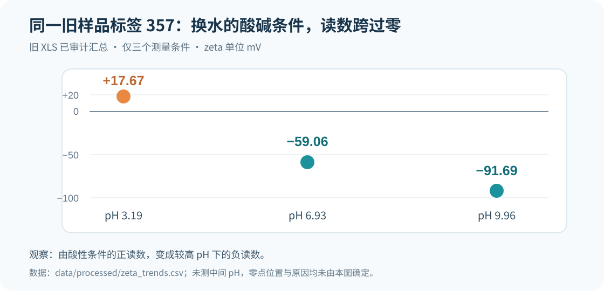

*这张教学重绘图的三个数来自 `data/processed/zeta_trends.csv` 中 `draw_ratio_label=357` 的三行，读取 `pH_mean` 与 `zeta_mean_mV`；它属于**导师旧实验资料经 Codex 审计整理**，并非本轮新增测量。标签相同不等于已经确认是同一张膜片依次经历三个条件。每点原本对应四次压力扫描，不是四张独立膜；本图为了突出“符号和方向”，没有画扫描离散度。完整九条件与误差棒见上一课直接嵌入的 `data/processed/figures/zeta_trends.png`。*

**六、究竟得到了什么结论？** **实测旧读数支持：** 357 标签在这三个已测条件下，从正值变成负值，较高 pH 的两个条件中负值进一步增大。182 和 604 标签的旧均值也呈“约 pH 3 为正、约 pH 7/10 为负”的方向，见九条件 CSV。**尚不能确定：** 读数恰好在哪个 pH 变成零、是否存在单一可定义的化学位点、是 PE 主链还是添加剂/吸附离子造成变化。两种环境之间可能还有未测的变化；本课不把三点插值当精确的实测零点。

**七、对论文有什么用？** 它给论文一个比“PE 表面带负电”更准确的问题：**为何旧样品的界面电动响应会随水的酸碱条件变化？** 可把三条件数据作为提出候选界面机制的依据。若要进一步认定某个具体化学来源，需要独立的界面化学证据、这批测量的背景液与装样方法记录，并在相同条件下比较；旧 zeta 趋势本身还不能认证真实孔内表面电荷密度。

**八、今天只记住三句话。** pH 是描述水的酸碱条件的刻度。旧 357 标签在约 pH **3.19/6.93/9.96** 时，zeta 依次为 **+17.67/−59.06/−91.69 mV**。这证明旧读数随条件变化，却没有找出确切变号位置和唯一微观原因。

**九、小测试。** 看这三个真实测量点，哪句话稳妥？A. 已经精确测出 zeta 在 pH 4.00 变号，并证明是 PE 主链放出某一种离子；B. 已测点显示读数由正转负，但精确变号 pH 和具体化学原因仍未确定。你回答 **B**，判断正确：已测点呈由正到负的变化，精确变号位置与具体来源仍未知。

### 第15课：干态 KPFM 电势与水中 zeta，为什么不能看作同一个数？

**一、先用生活故事理解。** 你用温度计量过厨房桌面，又量一锅正在加热的汤。两次都出现数字、都可能用同一个单位，但它们回答的是“桌面怎样”和“汤里怎样”两道题。即使恰好相等，也不能说桌面就是汤。把 PE 膜转移到基底上用探针扫描表面，与在水中推动液体观察电学响应，差别更大。**温度只是比喻**；下面讲的真实量是电势相关读数。

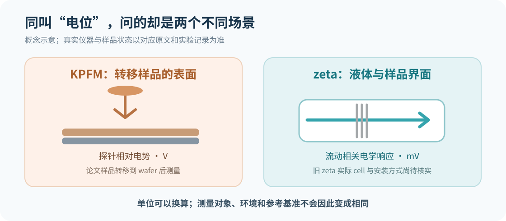

*左图仅示意探针接近转移样品，右图仅示意液体流动关联电学响应；旧 zeta 的实际 cell 和装样路径仍未核实。这不是任一仪器真实结构图。*

**二、和我的 PE 科研有什么关系？** 导师提供的 Polymer 2023 已发表论文同时出现两类容易混淆的“负数”。**KPFM**（开尔文探针力显微镜）像用细探针逐处查看转移到基底上的样品，论文报告相对于探针/仪器参考的表面电势，单位 **V**；旧 **zeta** 是液中压力扫描所报告的电动响应，单位 **mV**。`1 V=1000 mV` 只是单位换算。**换算单位不会把干态探针观察变成液中离子通道测量**，也不会给出第11课的表面电荷密度 C/m²。

**三、导师为什么需要两类信息？** 一种观察可以提示转移样品表面的电势图样，另一种观察提示样品与水接触时的电动响应。把它们分开，才能问“干表面和水中界面是否受相同因素控制”。如果先把两个负号当成同一件事，模型就可能用错误的实验量给真实孔壁定电荷，得出看似精确却没有根据的答案。

**四、实际项目做了什么？** 论文报告把膜转移到 wafer 后进行 AFM/KPFM 表征；原图位于导师资料中的 `原始资料/赵珈绮/04_开题会_20261014/制作与核验/assets/Polymer_Fig15_d.png`，对应论文 Fig.15d。Codex 从导师提供的 `Polymer_KPFM_origin.opju` 只读导出工作表，得到 `data/processed/origin_exports/Polymer_KPFM_origin/Book1__Sheet1.csv` 的四行；它们是**论文原有数值的追溯副本**，不是 Codex 新测量。水中 zeta 的三份旧 XLS、审计表和重绘图属于另一条数据链；没有证据能把同一标签的干态点与某一次液中扫描认定为同一膜片、同一位置和同一处理历史。

**五、逐图看真结果。** 先看论文**原图 Fig.15d**：横轴是拉伸比标签 **81、182、357、604**，纵轴为发表的表面电势 **V**。四个标注值依次约 **−1.2、−1.3、−1.7、−2.8 V**；同样四个数出现在导出 CSV 的 `col_2_B`，`col_1_A` 是行号而非拉伸比，标签对应关系须以原图为准。图上 604 点更低，说明**这张论文图所报告的干态探针指标**随标签变化；连接线仅引导看四点。它没有测水中的 zeta，也没有测整膜穿盐速率。

再看导师资料保存的**返稿补充资料第9页**上半部 Fig.S12。四张棕色地图分别标 81、182、357、604；每张旁边都有自己的**颜色刻度**，单位 V，底下的黑色标尺为 **1.0 μm**。地图深浅表示那张图内部的探针电势变化，不能把不同地图的同一种棕色直接当同一数值。**尤其要注意：**地图色条范围与正文 Fig.15d 的四个单点值并未在现有资料中完成统计口径和参考基准对齐，不能自己从色条反推出“平均值”并替换原图数字。下半部 Fig.S13 则是约 pH 7 的 zeta（mV）柱图；它和上半部即使排在同一页，也仍是**另一种测量**。本地保存的是返稿 SI 页面，尚未认证与出版社最终 SI 完全一致。

做一个小算术：论文 357 标签的 KPFM 点 **−1.7 V = −1700 mV**；旧 357 标签约 pH 7 的 zeta 均值是 **−59.06 mV**。两个数都带负号，也都可以写成 mV，**仍不能相减、相除后解释成同一个孔壁电荷强弱**。它们来自不同环境、不同测量过程和不明确匹配的样品位置。这里的 −59.06 mV 来自 `data/processed/zeta_trends.csv`，并非 Fig.15d 的另一读数。

**六、究竟得到了什么结论？** **有依据的是：** 已发表论文在转移样品上报告四个 KPFM 电势点，旧液中资料另报告 zeta 随样品标签和 pH 改变。**不能证明：** 干态 KPFM 的负值就是水中孔壁表面电荷、两图负号同源、两套数值可一一换算，或干态电势越负就一定越阻盐。正文点、SI 地图和旧 zeta 的基准/样品对应缺口必须保留。

**七、对论文有什么用？** 将来写论文可把 Fig.15d 作为**干态表面电势背景证据**，把 zeta 作为**液中电动响应证据**，分别注明样品状态、单位、来源和限制。如果要提出它们之间的关系，需要明确配对膜片、处理历史与测量条件，不能靠“都为负”来连接。模型中的真实湿态孔壁电荷仍需独立约束。

**八、今天只记住三句话。** KPFM 论文四点是转移样品的探针表面电势，单位 V。zeta 旧读数来自水中电动响应，单位 mV。**单位能换，测量对象和物理意义不能靠换单位变成同一个。**

**九、小测试。** 论文 357 标签约 −1.7 V，旧 zeta 的 357 标签约 −59.06 mV。哪句话稳妥？A. 把 −1.7 V 换成 −1700 mV 后，两者就能直接比较为“真实孔壁带电强弱”；B. 换单位只改变写法，两次测量环境和对象不同，不能直接推断真实孔壁电荷。你回答 **B**，判断正确：单位换算不能使干态探针与水中电动响应成为同一测量。

### 第16课：表面带负电，为什么不一定让盐更难通过？

**一、先用生活故事理解。** 想象一条只让两人结伴通过的窄路。门口更欢迎穿蓝衣的人，也不太欢迎穿橙衣的人。只看到橙衣的人在门边少了，便断言“结伴通过的人一定更少”，还太早：蓝衣的人会更多，路上两人如何配合、走路速度及门口安排也会影响最终通过数。**结伴是比喻，不是说 Na⁺ 与 Cl⁻ 在水中永远绑在一起**；真实机制由浓度、电场与离子迁移共同决定。

**二、和我的 PE 科研有什么关系？** 第12课的虚拟负表面附近 Na⁺ 多、Cl⁻ 少，回答的是**某处有多少离子**。本课换一把尺子：**共同盐通量**是单位面积、单位时间有多少成对的盐从一端走到另一端，模型这里用 `mol/(m²·s)`。本课的新问题是：**局部选择性是否足以决定整条路的盐通量方向？**

**三、导师为什么要做这个对照？** 一种诱人的推理是“负表面排斥 Cl⁻ → NaCl 一定过得更少”。如果这句话真是普遍规律，那么只改通道表面电荷、其余设定相同，负电情景的共同盐通量必须低于中性情景。导师 v2 长管诊断专门用电脑做这个**对照**：像拿同一条虚拟路，分别贴上中性、负电、正电三种标记，看结果是否符合直觉。

**四、实际项目做了什么？** 导师给一个**假设的圆形长水路**：半径 `25 nm`，计算归一长度 `350 nm`；两端虚拟盐浓度设置成 `30→1 mM`，另算 `270→1 mM`。内部表面电荷密度 `σ` 分别指定为 `0`、`−0.01`、`+0.01 C/m²`。PB（先画“离子在截面哪里多”的静态座位图）求分布；NP（再按浓度与电场算移动）求两种离子的通量，正式公式留到第25–26课。本次还假定没有水流，并设外电路不开通，因而净离子电流为零。**“零净电流”不等于没有盐移动**：正、负离子若以匹配的数量向前走，电荷贡献可相互抵消。计算程序与完整前提在导师 `01_研究框架与资料_v2/02_长管PB_NP诊断/诊断说明.txt`，原结果在同目录 `outputs/charge_flux_plotdata.csv`。

**五、先看放大的真数，再看导师原图。** 下图是从导师已有 `30→1 mM` 三行结果直接摘值的教学重绘。纵向的 **1.000** 是中性参照：定义 `R=某情景共同盐通量÷同条件中性通量`。负电 `R=1.056`，即比中性**高约 5.60%**；正电 `R=0.928`，即比中性**低约 7.24%**。图中的电荷都是**人为指定的模型输入**，绝非根据旧 zeta 或 KPFM 推算出的真实 PE 电荷。

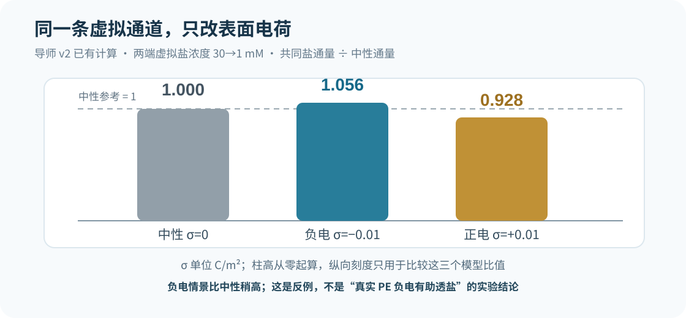

*教学图取导师 `outputs/charge_flux_plotdata.csv` 中 `c_left_virtual_mol_m3=30`、`c_right_virtual_mol_m3=1` 的三行，读取 `sigma_assumed_c_m2` 与 `charged_to_neutral_salt_flux_ratio`；`1 mM=1 mol/m³`。只重绘已有数值，没有重算 PB/NP。*

下面是**导师原结果图**，同时画了 `30→1` 和 `270→1 mM` 两组虚拟浓度。横轴是两端设定，蓝/灰/黄分别是负/中/正电；纵轴 `J/J₀` 仍以各组自己的中性情况为分母。右组负电只比中性高到 **1.01643**，比左组的 **1.05601** 更接近 1。说明这套模型下，电荷的影响还跟两端盐浓度条件有关；不能从一组结果推出普遍数值。

具体算一遍：`30→1 mM` 时，中性长管的内部孔截面盐通量约 **0.133158 mol/(m²·s)**；负电情景约 **0.140617 mol/(m²·s)**。`0.140617÷0.133158≈1.056`。这里的面积是**模型孔内水路截面积**，不是实验中整张膜正面面积；它不能和旧接收池电导增量直接比较。

**六、究竟得到了什么结论？** **受限模型已经给出一个明确反例：** 在这些明示假设下，“负电必定降低共同 NaCl 通量”不成立。原因不是 Cl⁻ 的排斥消失了；Na⁺ 的富集、两种离子的移动能力和内部电场会共同调整最终通量。**不能推出：** 真实 PE 负电会帮助盐通过，或者本模型已经解释了旧膜的低电导增量。虚拟通道没有真实入口、外层阻力、湿态连通性、润湿过程和原实验两池条件。

**七、对论文有什么用？** 它告诉我们，论文不能用“zeta 是负的 → Cl⁻ 少 → 整体阻盐”这条未经检验的捷径。带电和选择性可以作为候选机制，但必须把**共同盐通量**作为单独的检验目标，并结合湿态几何与入口条件。这个反例也为后来 v4/v5 引入“共同进入困难”等候选解释提供动机；它本身不是 PE 的机制证明。

**八、今天只记住三句话。** 局部 Cl⁻ 变少，不保证整条路上的 NaCl 通量一定变小。导师 v2 虚拟 `30→1 mM` 负电长管的通量比是 **1.056**，这是“必然阻盐”推理的反例。它是有前提的模型结果，不是 PE 膜的实测盐通量。

**九、小测试。** 看到虚拟长管负电情景 `J/J₀=1.056`，哪句话稳妥？A. “负电一定阻盐”不具普遍性，但仍需真实 PE 的独立证据才能判断其机制；B. 已经证明真实 PE 膜带负电会让盐通量提高 5.6%。你回答 **A**，判断正确：受限模型反例不能替代真实 PE 的独立证据。

### 第17课：导师给的资料很多，我从哪一份开始读？

**一、先用生活故事理解。** 你要学做一道菜，桌上却同时放着买菜小票、第一版菜谱、改良菜谱、别人照菜谱做出的照片和一份“今天照这个版本做”的便条。照片好看，不能代替小票；旧菜谱有价值，也不一定是今天的做法。科研资料也是如此：必须先辨认**原始记录、解释、程序、结果和当前任务说明**。这叫**溯源**，意思是从一句结论一路找回它用的原料与步骤。

**二、和我的 PE 科研有什么关系？** 项目里的 v2、v3、v4、v5 是导师研究路线的阶段，不是四套相互独立的 PE 膜实验。旧实验工程一直被后来的模型反复使用。若把导师 v5 图中的六个黑点和旧 Origin 表当成两批实验，就会虚增证据；若照 v4.1 旧计划的“第三步尚未做”继续等程序，也会错过导师已经交付的 v5 主模型。**“版本新”说明当前从哪里做起，不表示历史版可以删除。**

**三、导师为什么这样交付？** 科研会先问问题，再用简单模型试错，再交付一个较完整的模型。导师 v2 帮我们提出问题并核对旧数据；v3 计算荷电和选择性的假设情景；v4 用较简单的分配模型过渡；v5 交付当时的主模型、代码、四幅结果图和验证材料。这条线既说明“为什么有 v5”，也让学生能检查 v5 是否真的解释了旧问题。当时的任务入口在 `原始资料/赵珈绮/00_当前任务入口_v5.0.0.txt`；后来的 v6 方案和 WP1–WP6 将在第41–50课学习，现行项目状态以看板第7节为准。

**四、项目中真实文件怎么找？** 按下面四站走；这张图是**文件关系示意**，方框不是新实验数据。

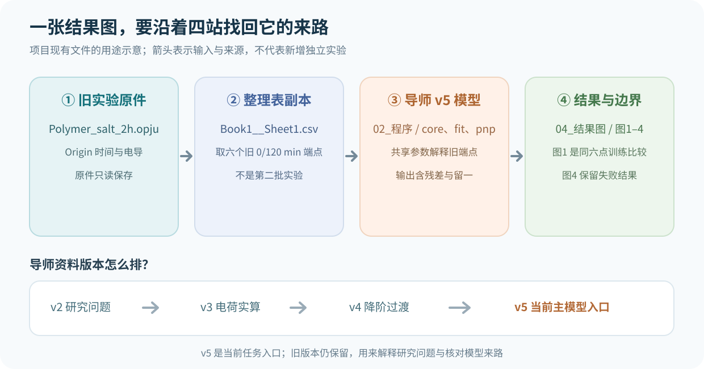

| 先找什么 | 具体文件或目录 | 它回答什么 |
|---|---|---|
| 当前入口 | `原始资料/赵珈绮/00_当前任务入口_v5.0.0.txt` → `原始资料/赵珈绮/08_主模型交接_v5.0.0/00_学生先读_v5.0.0.txt` | 现在做什么；v5 已交付、学生不负责新实验。 |
| 原始旧读数 | `原始资料/赵珈绮/01_研究框架与资料_v2/05_真实数据_v1核查/source_snapshots/Polymer_salt_2h.opju` | 旧时间—电导记录的原工程；只读保存。 |
| 可读取的整理表 | `data/processed/origin_exports/Polymer_salt_2h/Book1__Sheet1.csv` | 原工程 Book1 的导出；导师 v5 使用其中六个 PE 标签的 0/120 min 端点。它是**同一批旧数据的副本**。 |
| 导师现行模型与图 | `原始资料/赵珈绮/08_主模型交接_v5.0.0/01_报告/主模型推导与结果_v5.0.0.txt`；同一 `08_主模型交接_v5.0.0/` 下的 `02_程序/` 和 `04_结果图/` | 解释怎么算、输入什么、算出什么；图1–4必须与报告和输出表一起读。 |

*本仓库 `src/effective_network_model/` 是工作副本和复算入口；`data/processed/` 保存整理/审查后的轻量结果；`阶段总结/` 保存结论与本教材。`03_发送用ZIP/` 是发送归档，`90_历史与工作底稿/` 是历史，不把其重复副本当新证据。*

**五、拿一张导师真图练追溯。** 下面直接放导师 v5 **原图1**。横轴是膜厚**标签**（nm），纵轴是旧表 **120 min 电导增量**（μS/cm，图中为对数刻度）；黑点是旧 Book1 的六个端点，蓝线是导师用**同六点**拟合出的共享模型曲线，灰虚线是简单 `D/h` 参考。现在只读清“黑点来自哪里，蓝线是谁算的”：蓝线贴近六点是**训练比较**，不是后来拿六张新膜做的独立预测。图中还有较浅的紫色虚线；仅凭这张 PNG 无法核准它的身份，本课不靠它作结论。详细逐曲线读图留到第32课。

从入口文件可以核对两句很重要的话：**六点训练最大偏差约 1.69 倍**，而把最厚点先藏起再预测，误差约 **617 倍**。前一句来自拟合过的六点，后一句是留出检验；两种说法的证据分量不同。现在只需知道：**同一张结果图旁边还要保存失败记录**，不要把“曲线能贴点”写成“模型已经会预测真实 PE”。数值推导在后续 v5 与诊断课细讲。

**六、得到了什么结论？** **资料事实：** 当前导师入口是 v5.0.0；v5 图1使用旧 Origin 六端点，交付包有报告、程序、四图和验证；v2/v3/v4 是可追溯的先前阶段。**不能从文件名或漂亮曲线得出：** 多出独立实验、真实湿态孔路已测清、微观机制已认证，或学生本人已复算完成。旧 `07_整体计划与学生任务_v4.1.0` 中“第三步尚未实现”是被 v5 更新覆盖的历史进度句。

**七、对论文有什么用？** 你写任何结果段，都能按“旧原件 → 整理表 → 明确程序和参数 → 输出表/图 → 可说与不可说”走一次。这能让导师和审稿人找回每个结论的来路，也能防止把导师已交付图称为 Codex 新发现、把工作副本称为第二批实验。下一课会真正打开 Origin 导出表，核对“时间列”和“电导列”怎样配对。

**八、今天只记住三句话。** 当前从 `00_当前任务入口_v5.0.0.txt` 和 `08_主模型交接_v5.0.0/` 开始。旧 OPJU、整理 CSV、模型代码、结果 PNG 是同一条**来源链**的不同环节。导师图1的蓝线用了那六个旧黑点训练，不能叫独立预测。

**九、小测试。** 你想弄清“导师 v5 图1的六个黑点从哪来”，哪条路线对？A. 看导师当前入口，再沿旧 `Polymer_salt_2h.opju` → Book1 整理 CSV → v5 报告/程序/图1 追；B. 把图1黑点和 Book1 CSV 当成两批独立实验，不读原工程。你回答 **A**，判断正确：整理表和结果图需沿旧原件追溯，不能虚增独立实验。

### 第18课：旧表里那么多列，怎样知道哪个时间属于哪个电导？

**一、先用生活故事理解。** 医生记录两个人一天中的体温：左页写测量时间，右页写体温。如果把小王的体温配上小李的时间，画出的线也许很顺眼，却讲错了过程。PE 盐实验表也有成对的“时间列”和“电导列”。一条曲线像一个人的体温日记：先要把每个数放回正确的时刻。这里的“配对”是找**同一条记录的横轴与纵轴**，不是给两张膜配婚姻证。

**二、和我的 PE 科研有什么关系？** 第7、10课已经会读电导率随时间变化；本课不重复“电导是什么”，而是核查**曲线有没有画对**。导师旧 Origin 工程 `Polymer_salt_2h.opju` 的 Book1 工作表同时有 A、C、J 等时间列，不能假定整张表都共用 A 列。时间单位是 **min**；图中纵轴按同工作表已标列暂用 **μS/cm**，但 G/H 列自身未单列注明单位，跨列可比仍需原实验记录。另一个新词是**独立重复**：可想成重新取一块膜、独立完成一次测量，而不是同一页数字复印两份。仅凭文件里出现 Book1 和 Book2，不能证明做了两次独立实验。

**三、导师为什么需要核查这些列？** 如果第 5 个电导点原本在 80 min，却被误配到 85 min，0/120 min 的端点差不变，**中途变化的快慢**却会变。更严重的是：若把复写的曲线当成第二张独立膜，就会误以为某个结果已经被重复证实。论文想讨论时间过程和结果可靠性，先得把这两个账核清。

**四、实际项目做了什么？** 导师交付旧 OPJU 原工程；Codex 只读导出 `data/processed/origin_exports/Polymer_salt_2h/Book1__Sheet1.csv` 与 `Book2__Sheet1.csv`，再用 `src/data_ingest/audit_origin_plot_bindings.ps1` 读取 Origin 已保存图的列绑定，记录在 `data/processed/salt_transport/polymer_salt_2h_plot_bindings.json`。`src/data_ingest/normalize_salt_transport.py` 整理每条曲线，并生成 `matching_conductivity_sequences.csv` 和 `exact_duplicate_curves.csv`。这是**旧数据身份审计**，没有新增测量，也没有重跑膜输运模型。Book1 的列配对有 Origin 原图绑定依据；Book2 的 700 nm 配对据表布局与整理审计，不能说同样得到了原图绑定直接认证。

**五、拿真实数字看：第 5 行究竟几点？** 下图直接摘取导师旧表 Book1/Book2 的 700 nm 标签，并放大 60–100 min 这一段。左上方同时告诉你：Book1 的 **65 nm 用 A 时间列配 B 电导列**，第 5 点是 **85 min、14.42 μS/cm**；Book1 的 **700 nm 用 C 时间列配 G 电导列**，第 5 点却是 **80 min、66.5 μS/cm**。所以“第 5 行”只是表格位置，不等于所有曲线都在同一分钟测量。

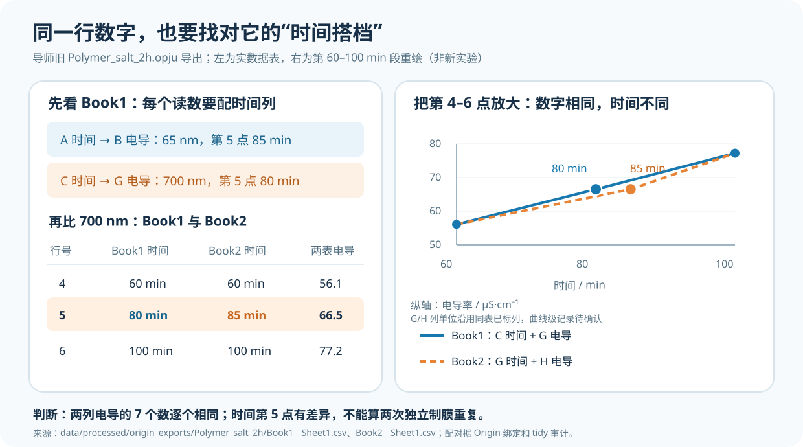

*读图顺序：右侧蓝线是 Book1 的 C/G 列；橙虚线是 Book2 的 G/H 列，颜色表示**工作表来源**，不是不同盐离子。横轴时间 min，纵轴电导率 μS/cm；这里只放大第 4–6 点，线段为视觉连接，不代表中间每分钟都测过。两表这三个电导点依次同为 **56.1、66.5、77.2 μS/cm**；但中间的 **66.5** 在 Book1 对应 **80 min**，在 Book2 对应 **85 min**。图上因此出现左右错开的两个点。完整七点电导序列两表逐个相同：**1.63、6.1、34.2、56.1、66.5、77.2、88.9 μS/cm**。这张图是 Codex 对导师旧读数的教学重绘，绝非两次新实验。*

核对文件 `data/processed/salt_transport/matching_conductivity_sequences.csv` 还列出三对同电导序列：**65、700、2600 nm**。其中只有 65 nm 的一对连七个时间也完全相同，记在 `exact_duplicate_curves.csv`；700 与 2600 nm 的第 5 点时间不一样。我们不能根据这种相同数列宣布“独立重复很一致”，也不能仅凭表格断言当年具体如何复制；要认证独立制膜与测量，还需样品和实验日志。

**六、究竟得到了什么结论？** **能确定的审计事实：** Book1 一张表就用了不同时间列；Book1/Book2 有三对电导数列相同，65 nm 那对时间也完全相同。**合理的使用规则：** 这些表项暂不能作为三次独立膜重复来计算误差条或增强模型证据。**不能确定的历史细节：** 哪张表先录入、为什么第 5 个时间被改动、究竟有几张独立膜；旧表本身没有给出完整答案。

**七、对论文有什么用？** 画时间曲线时应先核对它自己的时间列；报告样本数或误差条时应先找到独立膜身份。这一步不提出新的 PE 机理，却阻止两种严重误读：把 80 与 85 min 混成一个时间，以及把同一数据链数成多次实验。下一课会问：即使每条曲线都画对了，六个膜厚标签之间的实验条件是否足够一致，能否直接比较高低？

**八、今天只记住三句话。** 一条曲线必须用自己的时间列配电导列。旧 700 nm 两表七个电导值一样，但第 5 点是 **80 与 85 min**。相同数列不能自动算两次独立制膜重复。

**九、小测试。** 旧 700 nm 的 Book1/Book2 七个电导值逐个相同，第 5 点时间却是 80/85 min。哪种说法稳妥？A. 它们一定是两次独立制膜的完美重复；B. 先按同源重复数列处理，独立膜身份要等实验记录证明。你回答 **B**，判断正确：相同数列不能替代独立样品和实验日志。

### 第19课：不同膜厚的电导数字，可以直接比谁“更能让盐通过”吗？

**一、先用生活故事理解。** 两条超市通道都开了一小时。A 通道的收银屏多了 14 个计数，B 多了 12 个。你想说“A 的通行能力更强”，先得确认：计数器是不是同一种刻度？通道是不是一样宽？有没有人在中途换了收银机或把顾客带去别处？如果这些条件不同，屏幕增量虽然真实，也不一定能直接代表通道本身的能力。这只是理解比较条件的比喻；真实盐实验测的是液体电导，不是人数。

**二、和我的 PE 科研有什么关系？** 旧 Book1 把 65、120、200、350、700、2600 nm 等膜厚**标签**放在不同电导列。第18课已把每列的时间找对；现在问**跨列可比性**：能否把两列读数当成同一把尺、同一套实验装置条件下的结果？这是把“350 nm 原表增量比 200 nm 低”推进到“350 nm 膜让盐通过得更少”时必须跨过的一关。膜厚标签也不自动等于水中真实通道长度。

**三、导师为什么要问？** 导师 v5 要解释厚度与旧端点的关系；如果旧端点之间的单位、校准或池条件不一致，模型很可能在努力解释实验设置的差别。反过来，缺记录也不等于旧走势一定是错的。正确做法是把结论写成**带条件的比较**，并明确哪一环尚未证实。

**四、项目实际做了什么？** 导师提供旧 Origin 工程；Codex 从 `data/processed/origin_exports/Polymer_salt_2h/Book1__Sheet1.csv` 逐列复核 0/120 min 数值，在 `复现记录_20261017_v5.md` 写下原表增量与假设边界。`data/processed/salt_transport/salt_transport_record_tracker.csv` 逐曲线列出需要补证的校准、温度、面积、池体积、取样补液、润湿、混合和独立膜身份；尚未拿到的记录标为 `unknown`。`data/processed/salt_transport/book1_120nm_calculation_chain.json` 则示范：120 nm 的电导增量已能算，但浓度、盐量和通量的后续换算仍是 `unknown`。这些是旧资料审计，不是新实验。

**五、看真实数字与已经存在的结果图。** Book1 的 200 nm（E 列）从 **1.53** 到 **15.45**，原表数值增量 **13.92**；350 nm（F 列）从 **1.62** 到 **13.51**，增量 **11.89**。两者相除 `11.89÷13.92≈0.854`：**在原表数值口径下**，350 nm 的端点增量约为 200 nm 的 85.4%。E/F 两列未各自单列单位；把它们写成共同 `μS/cm`、进一步写成相对盐转移，都需要同表单位继承和跨列实验条件成立。

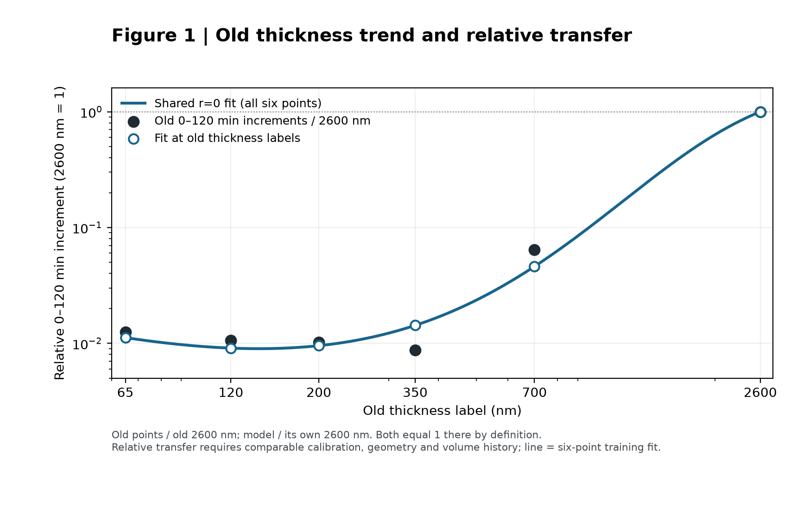

*为什么看这张图：它让我们同时看到旧表厚度走势和模型尝试解释的走势。横轴是旧膜厚标签 nm；纵轴是无量纲的相对端点增量，采用对数刻度。**黑实心点**是六个旧 0–120 min 增量分别除以旧 2600 nm 的 **1363.25**；例如 200 nm 为 `13.92/1363.25≈0.01021`，350 nm 为 `11.89/1363.25≈0.00872`。**蓝线和空心点**来自导师 v5 对同六点的训练拟合，按模型自身的 2600 nm 预测归一化，不能叫独立预测，也不能把模型与旧值的两个分母混为一谈。图由 Codex 的 `src/effective_network_model/plot_report_endpoints.py` 利用导师已有拟合结果重绘，不是新测量或新拟合。横跨不同膜厚的“相对盐转移”解释，仅在共同校准、单位、受液体积和有效面积等条件可比时成立；无误差条，不能声称排序的统计显著性。*

**如何理解“可比条件”？** 可以按四道小门检查。① **同一把尺：** 各列单位与电导—浓度校准是否一致，温度是否可比？② **同样的接收容器：** 水量及取样/补液是否一致，否则同样的盐量可对应不同读数变化。③ **同样宽的膜窗口：** 有效暴露面积、密封和润湿是否一致？④ **真正不同的膜样：** 母膜、膜片和重复身份有没有记录？当前 tracker 对这些曲线级记录多标 `unknown`；**unknown 是“尚未核实”，不是“已知不相同”。**

这里还有一个不改变原数据的敏感性小算术：若未来发现 350/200 比较还需一个**尚未证实**的相对修正 `s`，要把原表 `0.854` 的排序刚翻到大于 1，需 `s>1/0.854≈1.171`，即相对改变超过约 **17.1%**。这只是告诉我们需要多大修正才会改变排序；**没有证据说这种修正真实存在**，不能拿它去改旧表或“修好”模型。

**六、究竟得到了什么结论？** **确定的文件事实：** 200/350 nm 原表端点增量为 13.92/11.89，前者数值更大。**带条件的推论：** 若共同单位、校准、面积、接收体积与液体历史可比，可以讨论它们相对盐转移的大小。**尚不能确定：** 真实盐通量、该差别的统计可靠性、膜厚是唯一原因、或 PE 的某种微观机制已被证明。

**七、对论文有什么用？** 图一可以作为“旧记录提出的厚度难题”，但图注、方法和讨论要写明可比前提。它促使我们同时保存原表数值和实验记录缺口，而不是把一条好看的拟合线当作完整证据。下一课把原始表、程序、结果图和一句可以成立的论文式陈述串成完整链条。

**八、今天只记住三句话。** 350 nm 的旧端点数值 **11.89** 小于 200 nm 的 **13.92**，这是源表算术。要说“350 nm 实际转盐更少”，必须先确认跨列条件可比。缺失记录意味着**暂时保留条件**，不意味着实验一定错，也不意味着机制已经成立。

**九、小测试。** 看到旧 350 nm 增量 11.89 小于 200 nm 的 13.92，哪句话最稳妥？A. 已证明 350 nm 膜的真实盐通量必然更小；B. 这是旧表的数值排序，跨列单位与实验条件核实后才能把它解释为相对盐转移。你回答 **B**，判断正确：原表算术和有条件的物理解释应分开。

### 第20课：我怎样从一张原始表，写出一句有证据的科研结论？

**一、先用生活故事理解。** 你在家做菜后说“今天这锅汤比开始时更咸”。朋友若想核对，不能只看成品照片；他得找到原来的配方、加盐时间、厨房秤记录，最后再看你画的变化图。科研里也一样：一张图是**展示窗口**，一句结论要能逐步退回原始记录。这个过程叫**证据链**，像账本中的每一笔都有对应小票。生活故事只帮助理解查证方式，不表示盐扩散和做菜过程相同。

**二、和我的 PE 科研有什么关系？** 前三课分别学了版本入口、时间/电导配对和跨膜厚可比性。本课把它们组成一条你能亲手走通的路线，不再比较 200/350 nm。选导师旧实验的 **65 nm 标签**：只追它自己的七个时间—电导率点，看看一句“接收侧电导率升高”究竟来自哪张表、哪两列、哪个程序和哪张图。这里的“65 nm”是样品标签，仍不等于已测的湿态通道长度。

**三、导师为什么需要这一步？** 一篇论文中的每句话都可能被问“你的依据在哪里”。若只能指着图片，却找不到原始数值和处理步骤，别人无法复核；若找到表后又把电导增量写成盐通量，结论越过了证据。导师保留 Origin 工程和模型交付，我们再把来源链做成可查的工作文件，就是为了让每个结论经得起这种追问。

**四、项目实际做了什么？** 按下表依次打开。`原始资料/` 中的 OPJU 是**导师交付的旧实验原件**；后面 CSV、长表、核查图是 **Codex 对同一旧数据的导出和整理**，不是第二批实验。

| 查证站点 | 项目文件 | 在这一站查什么 |
|---|---|---|
| 原件 | `原始资料/赵珈绮/01_研究框架与资料_v2/05_真实数据_v1核查/source_snapshots/Polymer_salt_2h.opju` | 旧 Origin 工程的 Book1、Sheet1 和保存图的列绑定；原件只读。 |
| 可读表 | `data/processed/origin_exports/Polymer_salt_2h/Book1__Sheet1.csv` | A 列时间、B 列电导；65 nm 的列注释及明确单位另见同目录的元数据。导出程序是 `src/data_ingest/extract_origin_opju.ps1`。 |
| 整理长表 | `data/processed/salt_transport/salt_transport_tidy.csv` | 用 `curve_id=Polymer_salt_2h:Book1:Sheet1:65 nm` 找七行，核对 `time`、`time_unit`、`conductivity`、`conductivity_unit` 和 `unit_evidence`。整理程序是 `src/data_ingest/normalize_salt_transport.py`。 |
| 核查图 | `data/processed/figures/salt_transport_origin_qc.png` | 图左侧 2 h 表中的 `Book1: 65 nm` 曲线；绘图程序 `src/data_ingest/analyze_salt_transport.py` 读取整理长表。图右侧是另一份干态/未润湿资料，不能拼成同一实验。 |

**五、真实图与真实数字怎么读？** 下图左侧四站是文件关系**教学索引**；右侧七个点直接摘自 Book1 的 A/B 列，单位分别为 **min** 与 **μS/cm**。A/B 的单位有 Origin 明确列标，比上课的 E/F 列更直接。七组数依次是 `0/2.01`、`20/2.09`、`40/5.01`、`60/10.90`、`85/14.42`、`100/15.48`、`120/19.09`。不要把第 5 点误写成 80 min：65 nm 用 A 时间列，确实是 **85 min**。

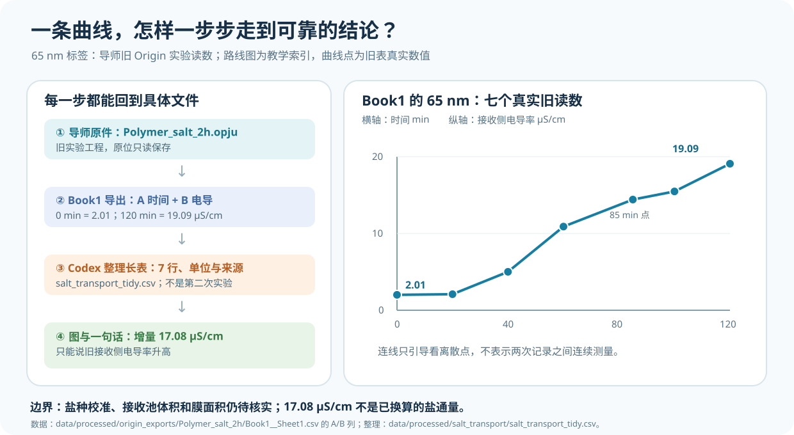

*为什么看这张图：它把“数据在哪里”与“图上是什么”放在一处。右图横轴是时间 min，纵轴是旧接收侧电导率 μS/cm；圆点是导师旧实验记录，线段只帮助眼睛追踪，并非持续测量。第一个点 **2.01**，最后一个点 **19.09**；Codex 的端点算术是 `19.09−2.01=17.08 μS/cm`。这个数字在导师 v5 六端点图中也作为旧 65 nm 输入，但引用两张图仍只是一份旧数据。*

为了看它在全项目中的位置，再直接看 Codex 从旧 Origin 整理长表生成的核查总图：

*总图左侧是 `Polymer_salt_2h` 多条曲线，图例中的 `Book1: 65 nm` 是本课对象；右侧是另一份 dry/unwetted 表，测量时间跨度、样品状态不同。纵轴是对数刻度，便于把很大和很小的读数放在同一页；位置高度不能直接读作线性增量。总图拥挤，故先用上方七点放大图找准对象。核查图属于数据审计，不提供盐浓度、通量或渗透率。*

**六、究竟得到了什么结论？** 可以写：**“在导师保留的旧 `Polymer_salt_2h` Book1 记录中，65 nm 标签曲线的接收侧电导率从 0 min 的 2.01 增至 120 min 的 19.09 μS/cm，端点增量 17.08 μS/cm。”** 这句话的每个数字都能回到 A/B 列和七行长表。还不能写：**“已测得 17.08 单位的盐穿过膜”**、真实盐通量是多少，或升高完全由膜表面电荷造成；对应盐种校准、池体积、有效面积及实验历史仍未闭合。

**七、对论文有什么用？** 将来写结果段，可以先给“在什么旧条件、哪一个标签、测了什么、变了多少”，图作视觉证据，原表和程序作复核入口；讨论段再问原因和限制。这是最小而完整的**科研陈述**。本课也标出研究逻辑的转折：已有读数能够提出问题，但要回答“为什么这样”，下一阶段才需要数学模型这间“虚拟实验室”。

**八、今天只记住三句话。** 图上的点要能退回原始表的具体行和列。`17.08 μS/cm` 是旧 65 nm 接收侧电导率的端点增量。它能支持“读数升高”，不能单独给出盐量、通量或电荷机理。

**九、小测试。** 如果论文写“旧 65 nm 接收侧电导率在 0–120 min 从 2.01 升到 19.09 μS/cm”，你应该怎样核查？A. 沿旧 OPJU → Book1 A/B 列 → 同曲线七行长表 → 核查图逐站找数；B. 只要有一张漂亮曲线图，就不用检查原表与单位。你回答 **A**，判断正确：一句结果要能逐站回到原表行、列和单位。

### 第21课：为什么要建数学模型？先让盐走一条“只有长度不同”的路

**一、先用生活故事理解。** 想象两间厨房之间有条走廊，一端刚烤好面包、香味很浓，另一端香味很淡。若走廊宽度和空气流动条件完全一样，短走廊里的香味差会在较短的路上变化完；把走廊拉长，这种变化被摊在更长的距离里，每小段的“推动”就更弱。我们先在脑中搭一间**虚拟实验室**：只改变走廊长度，其他按钮锁住，再看结果会如何。这是生活类比；盐在真实膜中会受孔路、入口、水流和电场影响，并不是香味分子在直走廊里飘。

**二、和我的 PE 科研有什么关系？** 旧表里有 350 nm 和 2600 nm 两个**膜厚标签**。只凭“路长”，会以为后者更难让盐通过；但导师旧 Book1 的接收侧电导端点数值却向相反方向变化。数学模型的第一件事不是“宣布真实机理”，而是把**如果只改一个因素，应该出现什么**写得清清楚楚。这样我们才知道直觉与旧记录究竟在哪里分叉。标签 `h=350/2600 nm` 在本课模型中暂当路长；它们尚未被证实就是湿态盐通道的真实长度。

**三、导师为什么从简单模型开始？** 如果一上来把表面电荷、孔径、润湿、入口和外部水层全塞进电脑，即使算出一条接近旧点的曲线，也难知道是哪一项真正起作用。先设一个**中性、均匀、已经润湿且没有入口额外阻力**的通道，得到“只由浓度差和路长控制”的参照。把它想成跑步时先量空跑道的速度，随后才分别加入上坡、窄门和拥堵。它是检验问题的尺，不是对真实 PE 膜的完整描绘。

**四、最简单模型究竟算什么？** 设左侧盐浓度 `c_L` 高、右侧 `c_R` 低；它们的差 `Δc=c_L−c_R`，单位是 **mol/m³**。像两端水位有落差，盐倾向从高浓度一侧向低浓度一侧移动。若这段膜内浓度沿路近似均匀地下降，走完整段长度 `h` 才下降 `Δc`，则**每走一米的平均下降程度**约是 `Δc/h`。这一步没有复杂数学，只是“总落差 ÷ 路长”。

再给通道一个系数 `D`，叫**扩散系数**：像“在这条路上挪动有多方便”，单位 **m²/s**。单位面积每秒通过的盐量叫**通量** `J`，单位 **mol/(m²·s)**。最简公式就是 `J = D × Δc / h`。检查单位：`(m²/s) × (mol/m³) ÷ m = mol/(m²·s)`。式子告诉我们：若 `D` 与 `Δc` 完全相同，`h` 翻倍，预测的 `J` 就减半。这是课堂先学的**稳态直通道扩散基线**；后面 NP 模型再处理带电离子的移动。

**五、把项目真数放进来，但不混淆两种量。** 先只在虚拟实验室里计算：若 350 与 2600 nm 通道的 `D`、两侧浓度差、宽度等都相同，公式相除时共同因素消掉，得到 `J₂₆₀₀/J₃₅₀ = 350/2600 ≈ 0.135`。意思是**这个假设模型**预计厚者单位面积通量约为薄者的 13.5%。这个比值**无单位**，没有代入真实 PE 的 `D` 或实测通量。

然后打开导师旧 Book1 的 F/H 列：350 nm 从 **1.62** 到 **13.51**，原表端点增量 **11.89**；2600 nm 从 **1.75** 到 **1365**，增量 **1363.25**，所以旧表数值比 `1363.25/11.89≈114.66`。下图**左栏**是“只改变长度”的概念示意与公式结果；**右栏**是旧实验电导数值的整理。两栏故意分开放：**模型的通量比与旧表的电导增量比不是同一个物理量，不能把 0.135 与 114.66 当作已经完成单位转换后的模型误差。** F/H 列单位仅沿用同表显式标注，曲线级与跨列可比性还待旧实验记录核实。

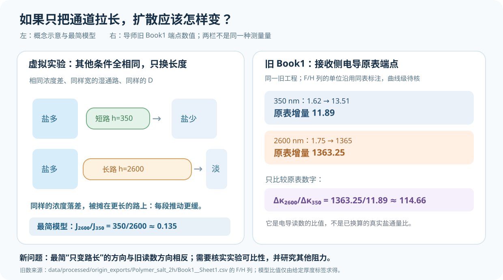

*教学图来源：右栏两组 0/120 min 原值取自 `data/processed/origin_exports/Polymer_salt_2h/Book1__Sheet1.csv` 的 F/H 列；左栏 `350/2600` 是上式在相同 `D` 和 `Δc` 条件下的代数比，不是新求解结果。箱子和通道标“概念示意”，不代表真实膜有两条笔直孔。两种比值方向相反，提出需要解释或核查的问题，**尚不能单凭它断言真实 PE 违反扩散规律**。*

导师 v5 原图1也把简单 `D/h` 作为灰色虚线参照，和六个旧黑点、导师共享模型的蓝线放在一页：

*这次只看**灰虚线**：横轴膜厚标签 nm 增大，灰线下降，表示“其他都不变时，只增加路长”的趋势；黑点是旧 120 min 电导增量，蓝线是导师用同六点训练出的共享模型。图的纵轴按 μS/cm 标注并用对数刻度，但旧 E–H 列单位由同表继承、跨列条件待确认；灰线的绘图比例也不能仅凭 PNG 当作经过独立校准的绝对盐通量。图由导师交付，本课没有重跑或改动 v5。*

**六、得到了什么结论？** **模型的条件结论：** 在同样浓度差、同样有效通道性质和稳态直路前提下，长路的单位面积扩散通量按 `1/h` 变小。**旧表事实：** 在同一旧 Book1 中，2600 nm 标签的 0/120 min 电导数值增量远大于 350 nm 标签。**尚未得到的结论：** 两列的实际盐通量比是多少、两张膜真实湿态路长是多少、究竟是入口、润湿、孔路、电荷还是池体条件造成差异。简单模型的局限与旧资料的可比缺口要分别检查。

**七、对论文有什么用？** 一篇有说服力的机制论文要先给出一个清楚的参照问题：“只改路长应怎样？”再展示旧记录提出的反常趋势，并用独立证据检查额外因素。这个最简模型本身不是创新结果，却让后续“入口阻力、局部限域、界面电场”每增加一项都有明确理由；导师 v5 的灰线正担任这种参照。下一课只学其中一个新困难：盐还可能在**进入膜之前**遇到阻力。

**八、今天只记住三句话。** 虚拟实验室先锁住其他条件，才能看清一个因素的作用。最简稳态扩散给 `J ∝ 1/h`，350→2600 nm 的假设通量比约 **0.135**。旧表端点数值比约 **114.66**，它是电导增量比而非已测通量比；二者相反提出科研问题，还不能单独认证机制。

**九、小测试。** 在“`D`、两侧浓度差和通道条件都相同，只把长度加倍”的最简模型里，单位面积扩散通量会怎样？A. 约减半；B. 约加倍。**请回答 A 或 B；答题前不讲第22课。**

# 第二部分：完整科研理论与成果详解

## 第0章：用一个故事讲清楚我的整个 PE 科研

想象两杯水之间放了一张由塑料细丝织成、很薄的“篱笆”。左杯盐多，右杯盐少。盐通常会从左向右扩散，好比人群从拥挤的广场往空旷的广场散开。PE 是聚乙烯；这里的膜由超高分子量聚乙烯纤维组成，能自支撑，厚度标签从几十纳米到数千纳米。**纳米**是十亿分之一米。它看起来薄且有空隙，直觉上盐应容易通过，但已有盐扩散记录显示若干薄膜的接收侧电导增加很小。

**电导**可想成“水让电流通过的方便程度”，盐离子多通常使它升高，但电导表盘不是盐分子计数器。旧 Origin 表在 120 分钟时，65、120、200、350、700、2600 nm 六个厚度标签的电导增量依次为 **17.08、14.49、13.92、11.89、87.27、1363.25**；其中 120 nm 从 2.38 升至 16.87 μS/cm。厚度标签不是已确认的湿态通道长度，六列也未证实为可直接比较的独立膜重复。若校准、池体积、暴露面积和液体历史相同，这些增量的比值才可当成“相对转盐量”代理；现有记录尚未闭合这些条件。

另一个线索是 **zeta 电位**，可先把它想成“水在表面附近被推动时留下的电学指纹”。在旧条件下，三种拉伸比样品约 pH 7 时的均值为 −52.91、−59.06、−70.50 mV。这个指纹与水中界面有关，却不等于膜贯通水路内壁的真实电荷，更不能单凭它断言“负电把盐挡住”。盐由 Na⁺ 和 Cl⁻ 一起构成；负表面可能偏好 Na⁺、排斥 Cl⁻，但共同盐的净通量还受到孔路、进入代价、外水层、润湿和电场共同影响。早期长管模型里给定 −0.01 C/m² 后，共同盐通量甚至是中性情况的 **1.056 倍**：这是“带负电必然挡盐”的计算反例，不是实测 PE 性质。

于是导师先用 PB/NP/PNP 模型检查电荷和离子选择性，再交付 v5 **有效网络模型**。把它想成两侧篱笆入口都存在一层“看不见的通行费”：薄膜时两面的影响叠加；膜变厚，一方面路变长，一方面两侧通行费不再强烈重叠。v5 用同一组场强、影响距离和总倍率拟合六个旧端点，得到场强 **7.03979 kBT**、影响距离 **893.954 nm**，训练最大偏差 **1.686 倍**。这表明一个明确的数学机制可以覆盖主要量级，却不等于证明 PE 中真有这种微观场。350 nm 旧值 11.89，模型为 20.04；把 2600 nm 点藏起来，只用其余五点求参数再预测它，会高估 **616.54 倍**。旧时间曲线也不符合一个静态传输能力的简单过程。

因此，这项研究目前最诚实、也最有价值的故事是：**真实旧读数提出难题；单独电荷无法自动解释；共享双面场提供一条可计算的候选解释；留一和时间曲线精确指出其失败；下一步需核实旧数据可比性，并用独立约束挑选机制。** 如果以后能让一个预先限定的模型同时解释厚度排序、时间形状、选择性和湿态通路，论文才可能从“拟合曲线”提升为“有证据的机制研究”。当前本科生任务是理解和复算已有纯理论成果，不承担新实验。

## 第1章：导师给我的原始资料到底是什么

**为什么读原件？** 结果图像像一张菜的照片，看不出原料数量、步骤和误差；科研必须找到表格、程序和适用条件。`原始资料/赵珈绮/00_当前任务入口_v5.0.0.txt` 指定最新路线。`08_主模型交接_v5.0.0/00_学生先读_v5.0.0.txt`、`01_报告/主模型推导与结果_v5.0.0.txt`、同名 `.pdf`、`02_程序/`、`04_结果图/` 和 `06_学生接续任务_v5.0.0.txt` 是当前最重要的导师交付。本文逐式核读可编辑文字版，并目视核对了交付的四张 PNG；同名 PDF 文件存在，本轮未另做 PDF 逐页版式审查。

`01_研究框架与资料_v2/` 包含完整研究报告、通俗说明、XLS/OPJU 来源审计、训练模型与长管诊断；它解释问题从何而来。`02_荷电与选择性实算_v3/` 是较早的 PB、有限二维 PNP、结果与 QA。`06_纯计算课题_v4.0.0/` 是降阶 Donnan 加共同进入能的过渡版本。`07_整体计划与学生任务_v4.1.0/` 保留八周纯计算路线，但“第三步尚未实现”的旧描述被 v5 覆盖。`03_发送用ZIP/`、`90_历史与工作底稿/` 是归档与追溯，不是当前优先结果；`05_资料查验_20261016/` 的新增实验建议也已被现行纯计算范围替代。文献 PDF 和开题会材料提供背景，不能把不同论文的样品条件合成一张“同一膜”的数据表。

**导师已经做了什么？** v2 给出研究问题和训练，v3 给出有边界的电荷/输运数值例，v4 给出均匀分配情景，v5 给出自由能推导、三共享参数拟合、有限二维能场实现、四张结果图和测试。**本仓库后来做了什么？** 将只读工作副本放在 `src/`，核对/复现部分运行，并从旧数据做时间形状、厚度阻力、参数作用、比例取舍及图表口径审查。交付包里已有的曲线、拟合参数和图不能算作 Codex 后来独立发现；本机复跑也不能算独立样品验证。

**衔接与限制。** 下一章先读真实旧记录，再决定模型究竟在解释哪一种量。导师 v5 的“旧六端点”取自同一 `Polymer_salt_2h.opju` 的 Book1 导出，不是第二套独立数据；`src/effective_network_model/core/inputs/` 与 `fit/inputs/` 的 CSV 双份也是程序入口副本，不是两组实验。

## 第2章：真实实验观察到了什么

**为什么先问实验？** 模型可以通过调参数画出许多曲线；只有清楚原仪器测了什么，才能限制模型的语言。

### 2.1 盐时间曲线：记录的是电导，不是通量

Origin 原工程快照在 `原始资料/赵珈绮/01_研究框架与资料_v2/05_真实数据_v1核查/source_snapshots/`。`src/data_ingest/extract_origin_opju.ps1` 只读解码五个 OPJU；整理程序 `normalize_salt_transport.py` 把盐工程建立为 **17 条曲线、167 个有效时间—电导点**，写入 `data/processed/salt_transport/salt_transport_tidy.csv`。17 条中 2 h 工程 14 条、dry/unwetted 工程 3 条。`Polymer_salt_dry_6h.opju` 最长表内时间 **2831 min = 47.18 h**，故文件名的“6h”不能当每条曲线时长。dry 表一处 700 nm 原值从 1493 min 的 4520 降到 1520 min 的 4500，原值保留；无误差记录，不能当机制突变。

Book1 的 120 nm 样品注释对应 C 时间列、D 电导列，七点时间 **0/20/40/60/80/100/120 min**，电导 **2.38/4.64/6.98/9.42/11.65/14.14/16.87 μS/cm**。端点差 **14.49 μS/cm = 0.001449 S/m**，平均端点增量率 **0.12075 μS/(cm·min)**。这些只是电导算术。要变成浓度，需要对应盐种、温度和该曲线适用的电导—浓度校准；要变成通量，还需接收池体积及其变化、取样/补液和暴露面积；要谈 PE 机理，还需润湿、搅拌、密封和膜片身份。`data/processed/salt_transport/book1_120nm_calculation_chain.json` 逐步把缺项标为 `unknown`。一份方案中写 NaCl **8.75 g/250 mL = 35 g/L**，不能据此认定本曲线实际采用该方案，也不能把 35 g/L 直接写成 3.5 wt%。

原 Origin 保存的图线绑定显示 Book1 的 65 nm B 列用 A 时间列，其余 PE 的 D/E/F/G/H 列和 PC 的 I 列用 C 时间列；所以有些第 5 点为 **85 min**，有些为 **80 min**。这影响按时间计算的斜率，却不改变 0/120 min 六端点或共用的 20/40/60/100 min 内部检验。Book1 与 Book2 的 65/700/2600 nm 三对**电导数列相同**；严格时间、电导都相同的只有 65 nm 一对，另两对第 5 点时间不一。它们都不能当三次独立制膜重复。`matching_conductivity_sequences.csv`、`exact_duplicate_curves.csv` 和 `polymer_salt_2h_plot_bindings.json` 是核对入口。

### 2.2 zeta：电学线索与来源缺口

旧 XLS 的 182/357/604 拉伸比记录有 **36 次压力 ramp、9 个 pH 条件均值**。pH 约 3 时三组均值为 **+18.73/+17.67/+20.91 mV**；约 pH 7 为 **−52.91/−59.06/−70.50 mV**；约 pH 10 为 **−75.28/−91.69/−97.04 mV**。`data/processed/zeta_trends.csv` 的 `zeta_mean_mV` 和 `zeta_sd_four_ramps_ddof0_mV` 给出数值；后者是同条件四次压力扫描的总体标准差，**不是四张膜之间的误差条**。pH 变化时符号从正到负，提示界面电动响应随环境变化；不能据此确定 PE 主链、添加剂、吸附离子或仪器哪一个是来源。仪器 cell、装样面/方向、背景电解质、温度、独立母膜数尚未证实，详见 `阶段总结/20261016_P1_B12_zeta方法信息追索.md`。干态 KPFM 的表面电势又是另一种量，不能当水中的 zeta 或孔壁电荷密度。

**结论与下一章。** 实验事实是旧表电导和旧条件电动读数；“低盐通量”“真实表面电荷”还需要换算与方法证据。理论模型的任务先是检查哪些机制在物理上可能，随后检验它们能否同时应对端点、选择性和时间形状。

## 第3章：为什么需要建立理论模型

**科学难题。** 只考虑路程，厚度为两倍时扩散能力大致减半，称作 `D/h` 直觉；旧六端点却从 350 nm 的 11.89 跃升至 2600 nm 的 1363.25，后者的**电导增量**约为前者 **114.66 倍**。它不是已换算的盐通量倍率，而且跨列可比尚待确认。即便如此，这种走势值得提出可反驳的计算解释。

**先排除一个错误推理。** 表面带负电通常会吸引正离子、排斥负离子；这叫**选择性**，像一个门对红蓝两种人放行比例不同。然而盐的净迁移要保持电流条件和两种离子共同输运，不能直接由“Cl⁻ 变少”推出整体盐一定慢。v2 长管诊断在半径 25 nm、长度 350 nm、30→1 mM 虚拟浴液下，`σ=−0.01 C/m²` 得 `J/Jneutral=1.0560`，正电同量级为 `0.9276`；v3 有限五排网络的假设 Cl 吸附也使 Na⁺ 电流份额从 **0.39583** 到 **0.65283**，同时共同盐通量比 **1.02757**。这两个模型的化学和几何假设不同，却共同提醒我们“离子选择性”和“盐阻隔”是两道题。

**模型分工。** PB 问“电荷附近离子如何排布”；NP 问“离子怎样因浓度、电场和进入代价移动”；PNP 把两者联立并处理有限几何；v4 Donnan 把横截面简化成均匀分配，用来快速看电荷和共同进入能；v5 再加入厚度依赖的双面有效场。它们好比从平面地图、道路通行规则到带路口的交通模拟。复杂模型并不自动更真实；关键是输入参数有没有独立证据、失败点有没有保留。

**下一章任务。** 逐式理解程序到底计算什么。凡写作 `a=25 nm`、`σ=−0.005 C/m²`、`w=3`、`30/1 mM` 的例子，先问它是测得的，还是为了检验方程而设定的。

## 第4章：从最简单模型到复杂模型的计算过程

本章的数值小例子用于教算式；凡是教学假设不充当新科研结果。符号首次集中说明：`c` 浓度（mol/m³；1 mM = 1 mol/m³），`J` 单位面积单位时间的物质通量（mol/(m²·s)），`D` 扩散系数（m²/s），`h` 整膜厚度，`a` 假定局部水路半径，`σ` 表面电荷密度（C/m²），`ψ` 电势（V），`zᵢ` 离子价数（Na⁺ 为 +1、Cl⁻ 为 −1），`F` 法拉第常数（C/mol），`R` 气体常数，`T` 绝对温度（K），`kBT` 是单粒子的热能尺度。`w=3` 表示进入自由能为 3 个热能单位，**无量纲**。

### 4.1 中性扩散与两池

把通道想成走廊，浓度差是人群拥挤差，`D` 是自由走动能力。在无电、无能垒、一维稳定情况下，`J=−D dc/dz≈D(c左−c右)/h`。若走廊长一倍，其余相同，`J` 约减半。实际接收池浓度会逐渐上升、供体池会下降，所以驱动力也变；`core/theory_model.py` 的 `finite_bath` 按两池守恒求时间曲线。充分混合、封闭、常有效 `P` 的归一化形状为 `f(t)=[1−e^(−θt/120)]/[1−e^(−θ)]`，`θ≥0`；直线 `t/120` 是 `θ→0` 的下界。若中途点低于直线，这组前提至少有一项不合；不能立刻指定“润湿慢”。

### 4.2 PB：电荷附近的离子排队

PB（Poisson–Boltzmann）把电势与平衡离子分布联立。平衡时某离子的浓度常写 `cᵢ=c浴 exp[−zᵢFψ/(RT)]`；Poisson 方程是 `−∇·(ε∇ψ)=FΣzᵢcᵢ`，`ε` 是介电响应（F/m）。负电附近 Na⁺ 多、Cl⁻ 少，如同门口的吸引/排斥标识改变两队排布。输入为给定几何、浴液浓度、扩散/介电参数和表面荷电边界，输出为 `ψ`、`cᵢ` 的空间分布。它求的是局部平衡，不单独给出穿膜稳态通量；其连续水、平均场、给定表面化学等前提需记住。`src/surface_pb/fibre_pb.py` 对**实心纤维外水域**求 PB，并尝试固定电荷、H/OH 与候选吸附边界。圆柱 H/OH 和二维 Na/Cl 吸附是不同候选，不可混用参数。

### 4.3 Donnan、NP 与选择性

**Donnan 分配**像一道入口安检：要同时满足电中性和离子进出的化学势平衡。v4 均匀孔中把壁电荷换成固定电荷浓度 `X`（mol/m³，符号按代码约定），写 `c₊−c₋+X=0`；共同进入能 `w` 使 `c₊c₋=c浴²e^(−2w)`。令 `d=−X`、`p=c浴²e^(−2w)`，由和差平方关系得 `c₊=(√(d²+4p)+d)/2`、`c₋=(√(d²+4p)−d)/2`。例如 `X=0,w=2` 时 `c₊=c₋=c浴 e^(−2)≈0.1353c浴`：两种离子一起少，才可能直接压低共同盐。v4 在指定 `a=25 nm,σ=−0.01 C/m²,270/1 mM` 虚拟条件下，`w=0/4/6` 的 `J/J₀` 为 **1.002017/0.0102868/0.000251611**，见导师 `results/reduced_partition_scenarios.csv`。`w=0` 略高于中性分母，不能说电荷单独阻盐。宽孔、高盐的均匀横截面近似需要空间模型核查。

NP（Nernst–Planck）再把移动写为 `Jᵢ=−Dᵢ[∇cᵢ+cᵢ∇(zᵢFψ/RT+w)]`。括号三项分别是浓度坡、电势坡和共同进入能坡；单位各为 mol/m⁴，乘 `D` 得 mol/(m²·s)。开路时 `ΣzᵢJᵢ=0`，意为外电路未提供持续净电流，不是 Na⁺ 与 Cl⁻ 各自不动。v2 长管 PB–NP 诊断假设径向局部平衡、无流、无限长式近似；它用于反例，不包含真实膜入口。

### 4.4 PNP：让电场与通量互相配合

PNP（Poisson–Nernst–Planck）联立刚才的 Poisson 和两个 NP 方程，再令 `∇·Jᵢ=0`。可把它想成交通模拟：人流改变路口电势，路口电势又改变人流，必须反复求到一致。`src/finite_pnp/solver.py` 有入口、外水、纤维间隙和五排交错几何；v5 `src/effective_network_model/pnp/solver.py` 把共同 `w` 也加入离散边通量。输入是**假定**纤维 26.6 nm、网络跨度 239.4 nm、浴液 30/1 mM、给定荷电/能场及数值网格；输出有 Na/Cl 通量、理论开路液相电位、残差/守恒。网格细化、零场回归和守恒检查说明代码按所写方程工作，不能认证湿态三维 PE 结构、真实电极电压或绝对实验通量。v5 参考强场移入虚拟五排网格所得 `J/J₀=5.8468×10⁻⁶` 是空间实现校核；`30/1 mM` 不是旧去离子水实验的确定边界。

### 4.5 v5 有效网络场：从自由能到双面影响

为解释厚度效应，导师引入结构扰动 `q(z)`，像一条被两端拉动的弹性带：偏离自然状态要付代价，弯曲得太快也要付代价。每单位面积自由能是 `Fq/A=∫₀ʰ[Aq q²/2+Bq(q′)²/2]dz+Σ表面[Cq q_s²/2−Hq q_s]`。`Aq>0` 惩罚幅度，`Bq>0` 惩罚空间变化，`Cq≥0` 与 `Hq` 描述两表面耦合；其具体物理量纲取决于 `q` 的定义，报告未给独立实验标定，不能把它们换算为实测 PE 常数。

对体项做小变化 `q→q+δq`：`δF` 中有 `Aq q δq+Bq q′δq′`；将第二项分部积分，体内系数变为 `Aq q−Bq q″`，令它为零得 `ell²q″=q`，`ell=√(Bq/Aq)`（长度）。分部积分留下的两端项与表面自由能合并，分别给 `−Bq q′(0)+Cq q(0)=Hq`、`Bq q′(h)+Cq q(h)=Hq`。这叫 Robin 边界：既管边界值也管斜率。对称解可整理为

`w(z;h,a)=ws(a)[e^(−z/ell)+e^(−(h−z)/ell)]/[1+r e^(−h/ell)]`。

前一指数从左表面衰减，后一指数从右表面衰减；`r` 代表选定边界型。参考计算 **r=0**，相当于 `Cq=Bq/ell`；它是模型选择，不是测定事实。`ell≈894 nm` 是六端点拟合的**有效响应距离**，不是德拜长度或已看见的纤维间隔。薄膜中两指数重叠，中间 `w` 可接近 `2ws`；65 nm 算得中心 `w=13.5769`，2600 nm 为 `3.2888`，源于导师 `endpoint_fit.csv` 的 `w_center`。

图二还假定 `ws(a)=ws(25 nm)×25 nm/a`，灵感是圆柱表面积/体积 `2/a`：水路越窄，单位水体积接触表面越多。**这是额外闭合假设**，没有测到真实湿态孔喉或这条函数。固定 `ws` 只改入口几何，与连同 `ws∝1/a` 改变场强是两个不同实验思想；教材和图解必须分开。

### 4.6 从能场到空间阻力、拟合与敏感性

电化学势 `μᵢ=RT ln(cᵢ/c_ref)+zᵢFψ+RTw`（J/mol）：第一项是混合驱动，第二项是电驱动，第三项是共同通行费。无固定电荷、两离子扩散相同的校核中令 `s=c e^w`；由 `J=−D[dc/dz+c dw/dz]=−D e^(−w)ds/dz`，积分得到 `s左−s右=(J/D)∫₀ʰe^w dz`，浴液与膜边界按化学势匹配，故 `J=D(c左−c右)/∫₀ʰe^w dz`。如果 `w=2` 在整条均匀路上，积分为 `h e²`，相同浓度差下通量为零能场的 `e⁻²≈0.1353`；这是算式例子，不是 PE 的新读数。

v5 用 `R*=∫e^w dz+πa/2` 加上理想圆孔的入口几何参考长度，`P∝1/R*`。这里 `R*` 的单位是长度（代码为 nm）；它不是直接测得的电阻。膜厚 `h` 增加让积分区间变长，同时降低双面重叠而使 `e^w` 变小。`core/theory_model.py` 用稳定的指数缩放和 Simpson 积分算阻力。再以一个共同幅值把六个 `1/R*` 映射到旧电导增量，拟合 `ws_ref`、`ell`、`log_amplitude` 三共享量；`a_ref=25 nm,r=0` 预先固定。**共享拟合**像用一把尺同时量六点，仍是训练；不能把蓝线称独立预测。

误差用 `log(预测/旧值)` 表示；比值 2 与 1/2 的误差大小对称。`log RMSE=√[Σ log(预测/旧值)²/6]`，v5 训练为 **0.25445**。把每点轮流藏起来、其余五点重新定参数的**留一**为 **2.68345**，其中最厚点独占平方 log 误差的 **95.5191%**。参数敏感性问“固定参考解附近，参数稍动，`P` 按比例怎样动”，用 `∂lnP/∂ln参数`；比如 `E_ws=−11.65` 在 350 nm 表示**局部线性近似**下 `ws` 增 1% 时模型 `P` 约降 11.65%，不是实验测得的因果率。见 `v5_local_effects.csv`。

**章节结论。** PB/NP/PNP 与 v5 方程各有明确用途；数值通过代表程序和方程相符。下一章检查导师主模型对旧数据能解释多少、哪里失手。

## 第5章：导师 v5 主模型与现有复现结果

**输入与程序。** 导师用 `08_主模型交接_v5.0.0/02_程序/fit/inputs/Book1__Sheet1.csv` 的六列 0/120 min 差，`fit_shared_overlap.py` 共享拟合，`core/theory_model.py` 计算阻力，`pnp/solver.py` 检查空间实现。冻结量在仓库工作副本 `src/effective_network_model/core/inputs/model_parameters.json`：`ws_ref=7.039790538`、`ell_nm=893.953884743`、`a_ref_nm=25`、`robin_r=0`、`log_amplitude=20.5084603`。`log_amplitude` 对应电导增量×nm 的有效幅值，吸收未知校准和池条件，**不是绝对渗透率**。

| 厚度标签 nm | 旧 120 min 电导增量 | 导师训练拟合 | 拟合/旧值 |
|---:|---:|---:|---:|
| 65 | 17.08 | 15.7080 | 0.9197 |
| 120 | 14.49 | 12.7487 | 0.8798 |
| 200 | 13.92 | 13.3845 | 0.9615 |
| 350 | 11.89 | 20.0423 | 1.6856 |
| 700 | 87.27 | 64.6445 | 0.7407 |
| 2600 | 1363.25 | 1403.2928 | 1.0294 |

表中旧值来自 `Book1__Sheet1.csv` 起终行，预测及 `prediction_over_observed` 来自导师 `fit/results/endpoint_fit.csv`。若接受跨列同尺度前提，模型抓到低区和厚端量级，但 350/200 旧比 `11.89/13.92=0.85417`，模型比 `20.0423/13.3845=1.49743`，**排序相反**。这不是微小四舍五入误差。模型训练最小点约 141 nm，而旧六点最低标签为 350 nm；连续最低位置是模型计算，不能拿离散旧点当精确物理极小值。

**复现与验证层级。** 原导师交付已记录 core 12/12、PNP 新增 7/7、旧 10/10 检查。本仓库另有 `run_reproduction.ps1` 非原件工作副本入口，`复现记录_20261017_v5.md` 记载本机 core、fit、PNP 与代表例的实际复算；这验证代码移植和数值再现，不是研究者本人在另一设备亲自复算，也不是独立实验。v3 单组中性/固定负电的本机复跑另见 `复现记录_20261018_v3单组对照.md`：`0.3003585/0.3058726 mol/(m²·s)`、比 **1.01836**，只限单排指定 `30/1 mol/m³` 条件。v4 本机标准库复跑见 `复现记录_20261018_v4.md`，162 情景、7 相对目标，积分 2048/4096 最大相对差 `2.53×10⁻⁹`；这是导师算法复现。程序测试的“通过”只证明所检验数学关系与实现，不补足实验条件。

**留一失败。** 导师 `fit/results/leave_one_out.csv` 在藏起 350 nm 时预测 **24.4878/11.89=2.0595**；藏起 700 nm 时 **27.2750/87.27=0.3125**；藏起 2600 nm 时 **840496.74/1363.25=616.54**，且 `ell` 触及预设 10000 nm 上界。和同六折的 `D/h=3.38063`、入口基线 `3.24371`、常正能垒 `3.24371` 比，v5 `2.68345` 较低，但依然很差。固定 `r=0.75` 的训练 log RMSE 可降至 **0.17741**；每折在其余五点内选择预设边界后，留一 log RMSE **1.92503**，最厚点仍高估 **90.88 倍**。好看的训练分数不能替代可靠外推。

**价值与衔接。** v5 提出可推导、可复算的双面场—进入能—盐输运链，能量项也进入有限二维 PNP。这是理论候选成果。下一章讨论仓库后来新增的诊断如何把“哪里不对”变成具体可检验问题；它们未把 v5 的未知微观来源变成事实。

## 第6章：Codex 实际新增了哪些科研成果

以下“新增”指在导师交付之后，本仓库基于旧输入和冻结模型得到的**新分析角度/图表**；不是新增实验。每项按“为何—怎么算—数值—可证/不可证—用途”阅读。

**C1 源数据恢复与审计。** 为避免只凭图像读数，`src/data_ingest/` 从 OPJU 导出 32 张工作表，形成 17 条盐曲线 167 点和重复/时间绑定表；`zeta_trends.csv` 摘出 9 条 pH 条件均值。它证明“这些数字在源工程中怎样存放”，不证明实验校准和样品独立性。论文可用于方法和补充资料的溯源，不能把 17 条都当独立重复。

**C2 旧时间曲线反例。** 为问静态 `P` 是否解释全过程，`time_shape_check.py` 对每列自身 120 min 增量归一化。六列都至少一个共同时间点低于常 `P` 有限池下界。200 nm 的 `f(60)=0.10057`，而直线下界为 0.5，差 **−0.39943**；后 60 min 增量/前 60 min 为 **8.94286**。这排除一组明示前提下的静态模型；未有误差条和池记录，不能指认真实润湿或结构松弛。`v5_common_gate_order.csv` 的 20/40/60/100 min 分别有 **10/1/3/6 对**端点排序反转；放宽跨列绝对标尺、只看列内曲线高低次序，`v5_normalized_curve_crossings.csv` 有 **13/15 对**交叉。一个所有膜共用的简单开启时间函数不足以解释这些读数的条件形状；并不排除每膜不同过程或装置差异。

**C3 厚度阻力拆分。** 为理解 v5 为何预测 350/200 反向，`thickness_balance.py` 在冻结参数上求 `dlnP/dlnh=路径项+场减弱项`。200 nm 是 **−1.000+1.358=+0.358**，350 nm 是 **−1.000+2.124=+1.124**；即模型内部此区间“减弱的通行费”压过“变长的路”。这精确定位模型排序来源，不证明真实膜场确实这样衰减。`v5_thickness_balance.csv` 六行是局部导数；图二解释和论文理论图可用，须注明条件性。

**C4 局部尺度门槛与四参数作用。** 图二 `ws∝1/a` 若成立，固定 200 nm 的 `a=25 nm`，让 350 nm 降至 **24.16295 nm** 时两者模型 `P` 相等，降至 **23.85118 nm** 时模型比等于旧 `0.85417`；若保持 `ws` 只动入口几何，比例仍约 **1.49743**。`v5_local_scale_threshold.csv` 的数值是为匹配旧比反求的**条件门槛**，不是测得孔喉。`v5_local_effects.csv` 显示 `E_ws` 从 −13.58 到 −6.17，`E_ell` 从 −0.49 到 −3.24，`a` 的明显作用几乎全由假定的 `ws∝1/a` 带来；纯入口几何斜率仅约 −7.6×10⁻⁷ 至 −6.8×10⁻⁵。论文可提出“需要独立湿态尺度约束”的具体要求，不能宣称发现 23.85 nm 实际孔径。

**C5 共享模型的比例取舍与边界。** 只用 350/200 与 2600/700 两个旧比求同一 `ws、ell`，得 **11.3289 kBT、4040.28 nm**，两个目标比可复现，但未用于求解的 700/350 仅 **1.2301**，旧比 **7.3398**，低约 **5.97 倍**。三个相邻比共同折中得 `ws=7.15089,ell=704.269 nm`，350/200 的模型/旧比反而 **2.1671**。`v5_ratio_constraint_check.csv`、`v5_ratio_tradeoff.csv` 说明拟合一处会转移错误；这不是全参数空间不可行性证明，更不是新预测成功。`boundary_refit_check.py` 的预设边界审查显示边界选择敏感。

**C6 参数可辨识与厚端杠杆。** 为解释为何藏起最厚点会崩，`parameter_sensitivity.py` 在冻结参考点求两参数 `ln ws/ln ell` 的局部灵敏度，消去共同幅值。六点矩阵条件数 **4.2407**，去掉 2600 nm 后 **22.9062**；五点最弱方向对留出 2600 nm 的相对影响为五点内部均方根的 **40.022 倍**，见 `v5_parameter_sensitivity.csv`、`v5_heldout_leverage.csv`。这说明最厚点在当前拟合附近提供独特约束；40.022 **不是**实测误差倍数或置信区间。

**C7 虚拟二维补充对照。** `v5_charge_entry_comparison.png`、`pnp_same_sigma_baseline.png` 和 `v5_salinity_sensitivity_24/32.csv` 重新整理导师 PNP 结果或在预设虚拟工况下增算。24 格、同一浓度比 30:1 的 15/0.5、30/1、60/2 mM：中性双面能场相对同 `σ` 零场为 **0.419936/0.419846/0.419756**；给定 `σ=−0.005 C/m²` 为 **0.424888/0.431926/0.430874**，32 格带电排序相同。它提示在这个网格/场设定下盐度效应很小且带电非单调，但 24/32 格仍有约 0.316–0.332% 差；不能当真实 PE 盐度曲线或连续极限结论。

**C8 v4 教学情景图。** `plot_v4_donnan_w_flux.py` 用导师现成 `results/reduced_partition_scenarios.csv` 的六行画 `v4_donnan_w_flux.png`。它是新增可读图，不是新增求解数据；固定 25 nm、负电、270/1 mM 虚拟条件下 `w=0/4/6` 的通量比见第 4 章。v4 本机复跑属于复现，不能归为独立机制发现。

## 第7章：全部关键数据、图片和文件解读

### 7.1 科研成果与证据清单

为避免把同一输入的多份副本算作多项独立发现，下表按证据链分组。程序列给出生成或核查入口；“论文位置”只是候选用途，尚无可直接投稿的完整证据链。

| 编号·阶段·问题 | 输入 → 程序 → 输出（相对路径） | 真数值、可得/不可得结论；论文候选 |
|---|---|---|
| E01·原始观测·电动响应 | 旧 182/357/604 XLS → `src/data_ingest/plot_zeta_trends.py` → `data/processed/zeta_trends.csv`、`data/processed/figures/zeta_trends.png` | 约 pH 7：−52.91/−59.06/−70.50 mV；能说旧条件电动响应随 pH/拉伸比变，不能说真实孔壁 σ 来源。候选背景图/补充图。 |
| E02·原始观测·盐转移 | `原始资料/赵珈绮/01_研究框架与资料_v2/05_真实数据_v1核查/source_snapshots/Polymer_salt_2h.opju` → `src/data_ingest/extract_origin_opju.ps1`、`normalize_salt_transport.py` → `data/processed/origin_exports/Polymer_salt_2h/Book1__Sheet1.csv`、`data/processed/salt_transport/salt_transport_tidy.csv` | 17 曲线、167 点；六个 120 min 旧增量 17.08/14.49/13.92/11.89/87.27/1363.25；能描述电导，不可直接写通量。候选实验现象图，需元数据。 |
| E03·来源审计·重复与时间 | 同一 OPJU → `audit_origin_plot_bindings.ps1`、`normalize_salt_transport.py` → `data/processed/salt_transport/polymer_salt_2h_plot_bindings.json`、`matching_conductivity_sequences.csv`、`exact_duplicate_curves.csv` | 3 对电导序列相同，1 对连时间也相同；80/85 min 绑定纠正。能防止伪重复，不能推测独立膜数。方法补充。 |
| E04·v2 理论反例·电荷 | 导师虚拟 30/1 mM、25 nm、350 nm → `src/long_tube_diagnostic/long_tube_np.py` → `原始资料/赵珈绮/01_研究框架与资料_v2/02_长管PB_NP诊断/outputs/scenario_summary.csv` | −0.01 C/m² 时 `J/Jneutral=1.0560`；只能否定“所有条件负电必然挡盐”的直觉，不能代表真实膜。理论背景。 |
| E05·v3 机制演示·选择性 | 假定五排几何/Cl 吸附参数 → `src/surface_pb/`、`src/finite_pnp/` → `原始资料/赵珈绮/02_荷电与选择性实算_v3/finite_pnp/outputs/multilayer_summary.csv`、`linear_G_tplus_static_charge.csv` | `tNa=0.39583→0.65283`；共同盐 `J/J0=1.02757`；说明选择性可变而盐不必下降，不可认证吸附化学。机制对照图。 |
| E06·v4 降阶·共同进入能 | 导师 v4 `inputs/Book1__Sheet1.csv` 与虚拟参数 → `原始资料/赵珈绮/06_纯计算课题_v4.0.0/calculate.py` → 同包 `results/reduced_partition_scenarios.csv`、`relative_targets.csv`；本机 `data/processed/v4_summary.json` | 162 情景；指定负电情景 `w=0/4/6` 得 1.0020/0.01029/0.0002516；说明共同能垒能强抑制，但没有实测能垒。理论补充。 |
| E07·导师 v5·六点拟合 | 旧 Book1 六端点 → `src/effective_network_model/fit/fit_shared_overlap.py`、`core/theory_model.py` → `原始资料/赵珈绮/08_主模型交接_v5.0.0/02_程序/fit/results/endpoint_fit.csv`、`fit_results.json` | `ws=7.03979,ell=893.954 nm`，训练 log RMSE 0.25445，350 nm 比 1.68565；能说共享模型解释量级，不能说独立预测或已识别微观机制。候选理论主图。 |
| E08·导师 v5·留一与边界 | 同六端点 → 同 fit 与本仓库 `boundary_refit_check.py` → 导师 `fit/results/leave_one_out.csv`、`data/processed/figures/v5_report_limits.png` | 留一 log RMSE 2.68345，2600 nm 高估 616.54；嵌套选边界仍 90.88。能说明模型脆弱，不能隐藏失败。论文限制/补充图。 |
| E09·导师 v5·二维能场 | 虚拟 239.4 nm 五排、30/1 mM、给定 `σ,w` → `src/effective_network_model/pnp/solver.py`、`run_energy_examples.py` → 导师 `02_程序/pnp/outputs/representative_energy_transport.csv`、`root_fitted_energy_spatial_check.json` | 24 格中性双面 `ws=3,ell=26.6 nm` 得 `J/J同σ零场=0.419846`；共享强场另一例约 `5.8468×10⁻⁶`。能检查空间实现，不是旧膜拟合。理论验证补充。 |
| E10·新增·厚度与尺度机制 | 冻结 `model_parameters.json` → `src/effective_network_model/thickness_balance.py`、`parameter_sensitivity.py` → `data/processed/v5_thickness_balance.csv`、`v5_local_scale_threshold.csv`、`v5_local_effects.csv` | 200/350 nm 厚度斜率 +0.358/+1.124；反算 `a350=23.851 nm` 才匹配旧比。能定位假设所需条件，不能叫实测孔径。候选机制分解图。 |
| E11·新增·比例与参数辨识 | 同冻结模型和旧端点 → `ratio_constraint_check.py`、`parameter_sensitivity.py` → `data/processed/v5_ratio_constraint_check.csv`、`v5_ratio_tradeoff.csv`、`v5_parameter_sensitivity.csv`、`v5_heldout_leverage.csv` | 两比条件解遗漏 700/350 约 5.97 倍；去厚点条件数 4.24→22.91；能说明取舍/局部不稳，不能宣称全局机制不可能。限制分析。 |
| E12·新增·时间反例 | 旧 Book1 共同时点 → `src/effective_network_model/time_shape_check.py` → `data/processed/v5_common_gate_order.csv`、`v5_normalized_curve_crossings.csv`、`figures/v5_time_curve_crossings.png` | 200 nm 前后半程比 8.94286；13/15 对列内归一化曲线交叉；能反驳明示的简单时间模型，不能定因。候选论文反证图。 |

### 7.2 导师四张原图，逐图读

**图1 `原始资料/赵珈绮/08_主模型交接_v5.0.0/04_结果图/图1_已有数据与共享模型.png`。** 横轴厚度标签 nm，纵轴 120 min 电导增量（图按 μS/cm 标注、对数刻度）。黑点是六个旧端点；蓝实线是全六点训练出的共享场，不是独立预测；灰虚线 `D/h` 是普通路长基线。视觉上黑点从 350 到 700 nm 陡升、2600 nm 更高，蓝线抓到大走势，却在 350 nm 高估 1.686 倍。图中另见一条紫色点线而图例未解释其身份；本次仅凭 PNG 不给它指定模型含义，正式使用须追原绘图源或交付说明。图可放论文结果起点，但现阶段宜用仓库替代 `data/processed/figures/v5_report_endpoints.png`：它把旧六点各除以旧 2600 nm 增量、模型各除以自身 2600 nm 预测，且仍明确相对代理前提。

**图2 `.../04_结果图/图2_厚度与局部限域的分工.png`。** 左图横轴相对膜内位置 `z/h`（0/1 为两面），纵轴共同进入能 `w/kBT`；颜色按图中文字对应 65/350/700/2600 nm。65 nm 几乎全程约 13.6，2600 nm 中间约 3.29 且两边高，说明**模型**里的双面影响厚度变大后中部重叠减弱。右图横轴厚度、纵轴相对 `a=25 nm,h=2600 nm` 的模型 `P`（对数）；红/蓝/绿为假定 `a=20/25/30 nm`。曲线先降后升，是路长与能垒减弱竞争；颜色间巨大差异主要由**预设 `ws∝1/a`**，不是测得孔径效应。仓库 `v5_report_h_a.png` 保持这一左右分工；`v5_report_structure.png` 是额外闭合规则补充，不可冒作导师原图逐像素复刻。适合理论机制候选图，需与失败点并列。

**图3 `.../04_结果图/图3_有限二维输运空间校核.png`。** 横轴 0 零场、1 矩形 `w=3`、2 双面 `ws=3`、3 共享拟合强场，是**类别**而非连续变量；纵轴 `J/同σ零能场` 为对数。蓝色 `σ=0`，红色给定 `σ=−0.005 C/m²`，紫色共享拟合场中性点。0→1 下降约到 0.0654（中性 24 格），0→2 到 0.41985；类别连接线只是眼睛的引导，不可在 1.5 处插值。红蓝各自以其**相同荷电状态的零场**为 1，不能直接把红点高于蓝点解释为绝对通量高低。紫点约 `5.85×10⁻⁶` 是另一强场算例，不是旧膜观测。仓库 `pnp_same_sigma_baseline.png` 将分母写清，可用作数值实现补充图；`v5_charge_entry_comparison.png` 统一中性零场分母展示另一对照，但图号是补充，不是当前导师图2。

**图4 `.../04_结果图/图4_适用边界与未解释细节.png`。** 左图横轴留出的厚度，纵轴重新用其余五点拟合后“预测/旧值”（对数）；虚线 1 是完美一致。2600 nm 红点约 617，700 nm 约 0.313，故训练曲线不能当预测能力。右图横轴 0–120 min、纵轴各自累计增量除以各自 120 min 终点；黑点为 200 nm 旧表，灰/蓝为常 `P` 条件参考。黑点 60 min 仅完成约 0.1006，低于直线 0.5；曲线晚段猛增。它支持“此静态过程未解释时间形状”，不能证明哪一种动态机理。仓库 `v5_report_limits.png` 对应这两个主题，`v5_time_curve_crossings.png` 另把六条曲线交叉展示，可作补充。

### 7.3 其余图表如何读、先读哪个字段

`data/processed/figures/zeta_trends.png`：横轴原条件均值 pH，纵轴 zeta mV，三色对应 182/357/604；点旁误差棒是四 ramp 的 ddof=0 SD，连线仅引导阅读。零线附近正负转换是旧条件电动响应，不是精确等电点或独立制膜统计。`salt_transport_origin_qc.png`：时间—电导源表重建，查转录、重复和异常；若纵轴按对数显示，只说明读数跨度大，不能读作浓度、通量。`v4_donnan_w_flux.png`：横轴共同能量 `w/kBT`，纵轴相对于无电荷零能场的共同盐通量比（对数）；25 nm、负电、270/1 mM 六个离散情景，`w=0` 不低于 1，`w=4/6` 急降；是虚拟条件，不是 PE 实测。`v5_report_structure.png`：看局部尺度闭合改变结果，不与湿态显微图等同。`v5_time_curve_crossings.png`：六条自身归一化旧读数随共同时间点变化，120 与 2600 nm 的次序在 20–40 min 反转；线段只是离散点连接，交叉的确切时刻未测得。

读表优先顺序：`salt_transport_curve_summary.csv` 看 `curve_id/n_points/conductivity_delta/unit_evidence/eligible_for_mechanistic_fit`；`zeta_trends.csv` 看 `pH_mean/zeta_mean_mV/ramp_n/independent_membrane_n`；导师 `endpoint_fit.csv` 看 `observed_delta_kappa/predicted_delta_kappa/prediction_over_observed`；导师 `leave_one_out.csv` 看 `predicted/prediction_over_observed/ws/ell_nm`；`v5_thickness_balance.csv` 看三项斜率；`v5_local_effects.csv` 看闭合与纯几何的两列 `a` 斜率；`v5_normalized_curve_crossings.csv` 看各时点 `f_gap` 和 `rank_crossing`。字段名比图片颜色更适合复核数字。

### 7.4 从文件走完整证据路径

旧盐路径：原 `source_snapshots/Polymer_salt_2h.opju` → `extract_origin_opju.ps1` → `data/processed/origin_exports/Polymer_salt_2h/Book1__Sheet1.csv`（每列起终行）→ `normalize_salt_transport.py` 与 `salt_transport_curve_summary.csv` → 导师 `fit/fit_shared_overlap.py` 与 `endpoint_fit.csv` → 图1/`v5_report_endpoints.png` → “条件相对厚度趋势、训练拟合及 350 nm 失败”。zeta 路径：原 182/357/604 XLS → `observations.csv/zeta_summary.csv`（v2 核查目录）→ `plot_zeta_trends.py` → `zeta_trends.csv/png` → “旧条件电动趋势，未证电荷来源”。v5 附加机制路径：`core/inputs/model_parameters.json` + 原六端点 → `thickness_balance.py` → `v5_thickness_balance.csv` → 图2机制说明 → “模型自身场减弱与路长竞争”。时间路径：Book1 原列 → `time_shape_check.py` → 时间检验总结、`v5_normalized_curve_crossings.csv` → 图4/交叉补图 → “静态与共同开启简化式受反例约束”。

## 第8章：目前得到了什么科学结论

**已观察事实。** 旧表有六个厚度标签的电导增量及若干不同时间形状；旧 zeta 在所记 pH 条件下有符号和大小变化。它们是源表读数，尚无完整校准、独立膜误差和湿态路径对应。AM2022 已发表的 350 nm 膜 `P≈1.196×10⁻⁸ m/s` 可作另一文献/样品背景，不能与本旧 Book1 六列拼成同一组绝对渗透率。

**计算上可靠的条件命题。** 负电不保证共同盐下降；v3 指定吸附能提高阳离子电流份额却未降低共同盐；v4 均匀共同进入能可大幅压低两离子分配；v5 双面有效场在一组共享参数下覆盖旧端点的主要量级，且有限 PNP 能按方程实现共同能场。这些陈述都须附对应假设与虚拟条件。`ell≈0.894 μm` 是拟合参数，`a=25 nm` 是参考局部尺度，`σ` 在相应算例是给定或假设化学自洽输出，均非独立测得 PE 微观机制。

**失败也是结果。** 旧 350/200 排序与 v5 参考场相反；最厚点留一外推严重失败；六条时间曲线各有点低于常 `P` 有限池下界，13/15 对列内归一化形状交叉；边界型和局部尺度闭合明显影响结论。这些比“拟合得还不错”更具体地约束下一代模型。不能把观察差异简单归于电荷、介电、孔径或润湿中的任何一项，因为实验方法与独立通路数据还不够。

**当前能对导师说的核心结论。** 我们获得一套结构清楚、可计算、可被旧数据反驳的**条件理论解释**；它尚未成为经独立样品验证的 PE 真实机制。论文若现在写，只能是方法/假说与限制明确的理论分析稿，不能声称材料机理被证实或新型脱盐性能已完整评估。

## 第9章：离最终论文还差什么

论文要把“观察—可证模型—独立约束—反例处理—预测”接成闭环。现有成果接近的是**可复算的条件理论候选与内部反例**，离经验证的材料机理还隔着数据身份、独立参数和预测检验。纯理论本科路线允许先只用现有记录推进；下表的实验记录是向原记录持有人追索已有信息或未来研究需要，不意味着本轮要求学生新增实验。

| 目标结论 | 现有证据 | 缺少的证据 | 下一步行动与论文作用 |
|---|---|---|---|
| 六厚度确有可比较的非单调盐转移 | Book1 六个 0/120 min 电导增量、原图绑定 | 列级盐种/单位、校准/温度、同 A/V 与补液、独立膜身份/误差 | 追索旧日志并做同口径/误差审计；决定图1能否写为稳健相对现象。 |
| 界面荷电影响选择性 | zeta 趋势、v3 受限 PNP 假设例 | 同一批膜的 zeta 方法、真实电导/电位端点、湿态几何及化学约束 | 先闭合旧方法记录；若无独立离子选择性测量，只写条件可能性。 |
| 共同进入能解释低转移 | v4 情景、v5 共享拟合、二维实现 | 能场来源与幅值独立约束、湿态通路、非盐曲线数据 | 把 `ws(a)` 和 `ell` 的可替代机制列成竞争模型，预先限定参数；避免逐点补能垒。 |
| 同一机制解释厚度族全部细节 | v5 大走势，350/200 和 700/350 取舍，厚端留一失败 | 旧列可比性与误差、时间过程约束 | 用同一目标函数和留出规则比较静态场、共享动态与非场机制；失败如实报告。 |
| 有外推/预测能力 | 内部留一优于简单基线但 2600 nm 高估 616.54 倍 | 真正未参与调参的独立标签/数据，预冻结判据 | 有旧独立数据可先留出；无则不能声称预测通过。 |
| 时间变化来自具体材料过程 | 200 nm `R60=8.94`、13/15 对交叉 | 采样时刻/误差、池事件、温度、润湿与动态状态证据 | 先检验数据处理和装置，再比较低自由度动态模型；不能把交叉直接命名为润湿。 |

当前最可能形成论文创新点的是**厚度双面场与局部进入能竞争的可推导模型，加上严格的失败诊断和可检验条件**。若旧数据和独立约束进一步闭合，图1（端点）、图2（场与尺度）、图3（空间校核）、图4（限制）可构成论证骨架；zeta/QC、v4 情景、时间交叉和参数敏感性适合作补充。现在不能支持“PE 固有负电是低盐输运唯一原因”“已测得 894 nm 真实相关长度/23.85 nm 孔喉”“二维虚拟算例预测了旧绝对通量”或“留一验证通过”。

## 第10章：后续科研路线图

**优先 1：旧输入的可比性审计。** 为什么：图1、350/200 反例与相对量拟合都依赖同尺度。输入：`origin_exports/Polymer_salt_2h`、`salt_transport_record_tracker.csv` 及可找到的原实验日志。交付：逐列单位、校准、温度、池体积、有效面积、取样/补液、膜身份与不确定度对照表，归档现有 `data/processed/salt_transport/`，结论写现有 `阶段总结/` 对应记录。成功是每个比较有可定位依据或明确判为不可比；失败是关键字段继续 unknown，此时保留条件图而不做绝对机制声称。

**优先 2：学生本人复算与手推。** 为什么：能亲自指出三共享参数、能量分配与留一失败，才真正理解论文。输入：`src/effective_network_model/core/`、导师报告文字版；按导师 `06_学生接续任务_v5.0.0.txt` 在本人设备保存运行记录。产出：六点比较、扫描、自由能到阻力的一页推导，以及“350/200 与最厚点失败”解释，记录到现有 `复现记录_*.md` 和阶段总结。成功是数值与交付一致并能独立解释单位/前提；不一致则先定位输入或环境，不改参数凑值。

**优先 3：独立约束与竞争模型的预先限定。** 为什么：仅凭六端点不能区分能垒、湿态连通面积、外阻和时间变化。输入：已核实的旧 zeta/几何/时间资料、v5 和中性/荷电基线；先看现有资料有没有可定位的湿态通路或选择性证据。产出：共同输入和自由参数来源表、简洁的机制对照图与同规则留出误差，代码/结果放现有 `src/effective_network_model/` 与 `data/processed/`，科研判断放 `阶段总结/`。成功是至少一个机制以较少且受约束的参数同时改善 350/200、700/350、厚端留一和时间形状；失败也应写明哪个约束冲突。没有独立输入时先停在必要条件分析，不扩自由参数扫描。

**可选：** 在现有 PNP 模块内对候选能场、给定表面电荷和浓度比做聚焦网格/边界敏感性；只有具体跨尺度结论依赖它时再算。可选的模型阅读包括独立文献核读，但不能把别的 PE 或其他材料的表面化学常数回填到本样品。**暂不必要：** 重跑所有已验收算例、扩大无约束多参数搜索、开发完整分子模拟或把历史 O/S/W 草案当当前本科任务。当前纯理论范围内若未取得新的独立约束，应先完成理解与诚实归档。

## 附录 A：零基础专业术语词典

| 词 | 生活比喻；本项目中的准确作用 |
|---|---|
| PE/UHMWPE/超薄纤维膜 | 塑料细丝组成的薄篱笆；研究其水中盐转移，不假定真实湿态孔道已看见。 |
| 扩散/通量 `J` | 人群从拥挤处向空处走；`J` 是单位面积、单位时间过多少 mol 盐，旧电导尚未换成它。 |
| 电导 `κ` | 水给电流开路的方便程度；依赖离子、温度和仪器，不是 NaCl 浓度的同义词。 |
| zeta 电位 | 水沿表面流动所读到的电学指纹；不等于孔壁 `σ` 或干态 KPFM 电势。 |
| 表面电荷密度 `σ` | 每平方米表面有多少净电荷，C/m²；v2/v5 许多值是给定假设。 |
| 选择性、`tNa` | 同一门更偏向 Na⁺ 还是 Cl⁻；`tNa` 是小偏压阳离子电流份额，非脱盐截留率。 |
| PB/NP/PNP | 先算门口两队怎样排、再算怎样走、最后电场和人流互相影响；分别是平衡分布、通量方程及联立有限空间求解。 |
| Donnan 分配 | 入门安检同时遵守电中性与化学势；v4 将复杂横截面降为均匀分配。 |
| `w/kBT` 进入能 | 每个离子需付的无量纲通行费；v4/v5 为共同作用，未实测其微观来源。 |
| `h/a/ell` | 整张篱笆厚度/假定局部水路宽度尺度/拟合的双面影响距离；不能互相代替。 |
| Robin 边界 | 门口既约束状态也约束变化速度；`r=0` 是参考数学选项，不是样品测定。 |
| 共享拟合/训练/留一 | 一把尺同时量所有点/这些点参与调参/藏一个点再估它；留一仍是旧数据内部检验。 |
| 局部灵敏度/可辨识 | 稍调旋钮时输出改变多大/两个旋钮效果是否容易混淆；不等于参数误差条。 |
| 虚拟工况/网格收敛 | 电脑里规定的浴液和几何/把计算格子细化；前者不是实验，后者只检验数值离散。 |
| 独立重复 | 重新制备的母膜等真实独立样品；同一列四 ramp、复制工作簿都不是。 |

## 附录 B：关键文件与科研阶段对应表

| 顺序与功能 | 先看什么 | 输入输出关系及身份 |
|---|---|---|
| ① 当前入口 | `AGENTS.md`、`项目进展计划与任务看板.md` 第7节、`资料分类索引.md` | 工作规则/现行 v6 正式状态/原件分类；看板第6节是前阶段路线。 |
| ② 科学背景 | `原始资料/赵珈绮/01_研究框架与资料_v2/01_研究报告/第二课题_完整研究报告_v2.txt`、`项目说明与行动清单.md` | 导师/早期框架与竞争假说，旧实验工作计划非当前学生关卡。 |
| ③ 原始实验 | `.../05_真实数据_v1核查/source_snapshots/*.opju`、同核查目录 zeta XLS | 原始仪器/工程快照只读；优先看注释、单位、原图绑定和重复身份。 |
| ④ 整理输入 | `data/processed/origin_exports/Polymer_salt_2h/Book1__Sheet1.csv`、`data/processed/salt_transport/`、`data/processed/zeta_trends.csv` | `src/data_ingest/` 生成；读 `curve_id`、时间/电导列、`unit_evidence`、`independent_membrane_n`。 |
| ⑤ 早期模型 | `src/v2_training/`、`src/long_tube_diagnostic/`、`src/surface_pb/`、`src/finite_pnp/` | v2 教学合成数据、长管反例、纤维外 PB、v3 有限二维；程序副本对应 `原始资料` 旧交付。 |
| ⑥ v4 过渡 | `原始资料/赵珈绮/06_纯计算课题_v4.0.0/calculate.py` 与 `results/`、`data/processed/v4_summary.json` | 导师 162 情景/本机复现摘要；`v4_donnan_w_flux.png` 是用既有表重画。 |
| ⑦ v5 主模型 | `原始资料/赵珈绮/08_主模型交接_v5.0.0/01_报告/主模型推导与结果_v5.0.0.txt`、`src/effective_network_model/core/theory_model.py`、`core/inputs/model_parameters.json` | 导师原件与可运行仓库工作副本；先读方程、参数身份，再看 `fit/results/endpoint_fit.csv` 和 `leave_one_out.csv`。 |
| ⑧ 空间/新增诊断 | `src/effective_network_model/pnp/`、`thickness_balance.py`、`time_shape_check.py`、`parameter_sensitivity.py`；`data/processed/v5_*.csv` | PNP 虚拟校核、厚度/时间/比例/灵敏度增量；各 CSV 依赖说明见第6–7章。 |
| ⑨ 图与科研结论 | 导师 `08_主模型交接_v5.0.0/04_结果图/`、`data/processed/figures/`、`复现记录_20261017_v5.md`、`阶段总结/20261017_共享边界离散重拟合.md` | 图用于解释，CSV 与原表用于读数；复现/阶段总结标注条件与失败。`paper/review-traces/` 是独立声明审查轨迹，不是实验输出。 |
| ⑩ 过程与中间物 | `.planning/2026-10-15-pe-research/`、`src/**/outputs/`、`.venv/` | 规划检查点/可重生产物/本机环境；科研正式状态优先看板，结果不能只留在缓存。 |
| ⑪ v6 问题与模型 | 导师 `原始资料/赵珈绮/12_论文导向研究总方案_v6.0.0/` → `WP1/` → `WP2/src/transport.py`、`WP2/02_数值验证表.csv` → `WP3/` | 导师交付方案；本仓库冻结旧数据身份、构建 M0/M1/M2、做合成数值与条件容量检查。 |
| ⑫ v6 比较与交接 | `WP4/02_全部观测与预测.csv` → `WP5/02_早段预测后段结果.csv`、`WP5/figures/时间与厚度留出逐膜误差.png` → `WP6/03_论文主张与证据对应表.csv`、`WP6/04_投稿准备度判断.md`、`13_导师第三次审阅材料_20261022/` | 六膜旧曲线训练、留出预测、主张边界与本地待送审包；后者尚无导师第三次结论。 |

## 附录 C：关键数据、图像、模型结论的证据索引

| 要说的数或结论 | 原表字段/图；证据身份 |
|---|---|
| 六厚度 0–120 min 增量 | 导师 `08_主模型交接_v5.0.0/02_程序/fit/results/endpoint_fit.csv` 的 `observed_delta_kappa`；上游 Book1 起终行，旧电导读数。 |
| zeta 九条件与四 ramp | `data/processed/zeta_trends.csv` 的 `pH_mean/zeta_mean_mV/zeta_sd_four_ramps_ddof0_mV`；旧 XLS 派生，不是独立膜误差。 |
| v3 选择性与共同盐 | `原始资料/赵珈绮/02_荷电与选择性实算_v3/finite_pnp/outputs/multilayer_summary.csv` 的 `t_plus/salt_flux_ratio/voltage_mv`；假设化学虚拟输出。 |
| v4 共同能垒 | `原始资料/赵珈绮/06_纯计算课题_v4.0.0/results/reduced_partition_scenarios.csv` 的 `common_transfer_energy_kBT/J_over_uncharged_w0`；降阶情景。 |
| v5 三参数与训练 | `src/effective_network_model/core/inputs/model_parameters.json`、导师 `fit/results/fit_results.json` 与 `endpoint_fit.csv`；六旧点解释性拟合。 |
| v6 旧点身份与共享训练 | `WP1/03_数据与参数清单.csv`、`WP4/02_全部观测与预测.csv`、`WP6/figures/02_六厚度全曲线共同拟合.png`；六 PE 曲线 42 点，36 个非零点进入训练；图中线是拟合，不是独立预测。 |
| v6 程序能否正确算 | `WP2/02_数值验证表.csv`；46 PASS、4 OBSERVED、0 FAIL，均是合成数值/辨识检查，不是 PE 材料机制验证。 |
| v6 藏起数据能否预测 | `WP5/02_早段预测后段结果.csv`、`WP5/figures/时间与厚度留出逐膜误差.png`、`阶段总结/20261022_v6_WP5预测辨识与稳健性.md`；M1 后段相对时间误差优于 M0，但最厚膜整膜留出终点错 40.52 倍。 |
| v6 投稿边界 | `WP6/03_论文主张与证据对应表.csv`、`WP6/04_投稿准备度判断.md`、`13_导师第三次审阅材料_20261022/00_先读.md`；学生端认为不具备投稿条件，本地包未送出，导师第三次审阅待进行。 |
| v5 留一与边界 | 导师 `fit/results/leave_one_out.csv` 的 `held_h_nm/predicted/prediction_over_observed/ell_nm`；`阶段总结/20261017_共享边界离散重拟合.md`；内部检验。 |
| 图1/2/3/4 | 导师 `08_主模型交接_v5.0.0/04_结果图/` 同名四 PNG；仓库 `data/processed/figures/v5_report_endpoints.png`、`v5_report_h_a.png`、`pnp_same_sigma_baseline.png`、`v5_report_limits.png` 为审阅口径替代图。 |
| 厚度竞争和局部尺度 | `data/processed/v5_thickness_balance.csv` 的 `path_length_term/field_relief_term/dlogP_dlogh`；`v5_local_effects.csv` 与 `v5_local_scale_threshold.csv`；冻结模型的条件计算。 |
| 比例取舍和最厚点杠杆 | `data/processed/v5_ratio_constraint_check.csv`、`v5_ratio_tradeoff.csv`、`v5_parameter_sensitivity.csv`、`v5_heldout_leverage.csv`；同旧数据的诊断，不是新样品。 |
| 时间失败 | `阶段总结/20261017_旧时间曲线内部检验.md` 的 `f(t)/R60` 表、`data/processed/v5_common_gate_order.csv` 和 `v5_normalized_curve_crossings.csv`；共同时点旧列内条件检验。 |

## 附录 D：我必须掌握的核心知识清单

1. 能用 120 nm 七点亲手算出 `Δκ=14.49 μS/cm`，并说出缺什么才可得到浓度、盐量、通量。
2. 能区分膜厚 `h`、假定局部尺度 `a`、拟合影响长度 `ell`、界面电荷 `σ`、共同进入能 `w` 的单位和证据身份。
3. 能解释“Na⁺ 更受偏好”为什么不等于“NaCl 净通量下降”，并举 v2/v3 数值反例。
4. 能从 `μᵢ` 写出浓度、电场、能量梯度三项，并在中性一维情形推出 `∫e^w dz` 阻力。
5. 能口述自由能变分为何得 `ell²q″=q` 与两端 Robin 边界，并明确这属于假设的有效结构场。
6. 能重算 v5 六点表中 350/200 旧比和模型比，指出为何训练蓝线不是预测。
7. 能解释留一的实际操作、2600 nm 的 616.54 倍失败与边界敏感性，不把 40.022 的局部杠杆当测量误差。
8. 能读导师图1–4 的横纵轴、颜色、分母和“实测/拟合/虚拟算例”身份，特别是图3 的同 `σ` 分母。
9. 能说出旧时间曲线的 200 nm `f(60)=0.10057`、`R60=8.94286` 与 13/15 对交叉各自限制哪种模型、还不能判定什么。
10. 能用一页纸写“目标结论—现有证据—缺口—下一步”，在没有新独立约束时不自由加参数凑曲线。

## 附录 E：可以向导师口头讲述的完整科研故事

“老师，我先核对了我们究竟测到什么。旧 Origin 工程的六个膜厚标签在 120 分钟的接收侧电导增量是 17.08、14.49、13.92、11.89、87.27、1363.25；这是电导，不是已经校准的通量。zeta 在约 pH 7 为 −52.91 到 −70.50 mV，但旧 cell 和装样等方法未闭合，所以我不能把它直接当孔壁表面电荷。v2 长管和 v3 五排模型说明负电可以改变 Na⁺ 选择性，却不一定压低共同盐通量。导师 v5 用稳定结构自由能导出双面有效场，再把共同进入能放进离子输运，用三共享参数拟合六个旧端点：场强约 7.04 kBT、有效距离约 894 nm，训练最大偏差约 1.69 倍。这给出一种可推导的厚度竞争解释，但 350/200 排序相反，留出最厚点高估约 617 倍。我们后续用厚度阻力拆分发现模型在 200–350 nm 区间把场减弱的效应算得比路长增加更强；旧时间曲线又有 13/15 对归一化交叉，简单静态或共用开启过程都不够。我的结论是：现在有可信的条件理论与清晰的失败边界，没有实证证明 PE 唯一微观机理。下一步先核旧实验各列可比性和时间记录，再用独立湿态/选择性约束限定候选机制，并把留出失败当正式结果报告。”

---

**阅读停止点。** 若能不看答案讲清附录 E 中每个数字从哪一列来、每个模型多用了什么假设、哪一条结果不能写成材料事实，就已经跨过本项目的入门门槛。正式论文写作须等目标声明与独立证据逐项闭合；本文可作为教学地图，不替代原始记录和复现记录。

# 第三部分：科研文件与结果索引

这一部分是阅读导航，详细来源与数值仍以第二部分第7章及附录 B、C 为准。学完第2课，先沿 `原始资料/.../source_snapshots/Polymer_salt_2h.opju` → `data/processed/origin_exports/Polymer_salt_2h/Book1__Sheet1.csv` → `data/processed/salt_transport/book1_120nm_calculation_chain.json` 追 120 nm 七个时间点。学完第4课，沿旧 zeta XLS 审计 → `data/processed/zeta_trends.csv` → `data/processed/figures/zeta_trends.png` 追电学线索。学到模型后，再沿 `src/effective_network_model/core/inputs/model_parameters.json` → 导师 `fit/results/endpoint_fit.csv`、`leave_one_out.csv` → 导师四图与仓库替代图追每个计算结论。原始文件只读，图像不能代替数值表和测量方法。

| 学到哪课再打开 | 先看文件的哪一部分 | 看完应会说什么 |
|---|---|---|
| 第2、7–10课 | `data/processed/origin_exports/Polymer_salt_2h/Book1__Sheet1.csv` 的 `col_3_C/col_4_D` | 时间列和电导列怎样配对，为什么 14.49 的单位还是 μS/cm。 |
| 第4、13–14课 | `data/processed/zeta_trends.csv` 的 `pH_mean/zeta_mean_mV/ramp_n/independent_membrane_n` | 旧电学指纹的真实数值与“独立膜数 unknown”的边界。 |
| 第18–20课 | `data/processed/salt_transport/` 中的图线绑定、重复表和记录台账 | 原图时间绑定、复制曲线、缺失实验条件怎样影响解释。 |
| 第28–32课 | `src/surface_pb/`、`src/finite_pnp/` 与导师 v3 `outputs/multilayer_summary.csv` | 虚拟电荷可改变选择性，却不必降低共同盐。 |
| 第33–39课 | `src/effective_network_model/core/theory_model.py`、`core/inputs/model_parameters.json`、导师 v5 四图 | 哪些是公式、拟合参数、旧观察、虚拟算例和失败。 |
| 第37–40课 | `data/processed/v5_thickness_balance.csv`、`v5_normalized_curve_crossings.csv`、`v5_parameter_sensitivity.csv` | v5 之后新增的诊断怎样限制下一代解释。 |
| 第41–44课 | 导师 v6.0.0 方案、`WP1/04_冻结分析方案.md`、`WP2/02_数值验证表.csv`、`WP3/量级反算_20与60min.csv` | 谁提出问题，哪些是旧读数，哪些只是数值与条件量级检查。 |
| 第45–48课 | `WP4/02_全部观测与预测.csv`、`WP4/01_共享拟合参数表.csv`、`WP5/02_早段预测后段结果.csv`、`WP5/figures/时间与厚度留出逐膜误差.png` | 怎样从训练拟合走到藏起数据后的预测与稳健性。 |
| 第49–50课 | `WP6/03_论文主张与证据对应表.csv`、`WP6/04_投稿准备度判断.md`、`13_导师第三次审阅材料_20261022/00_先读.md` | 哪些结论有证据，哪些仍须导师审阅、学生解释或实验信息。 |

# 第四部分：通往论文的科研路线

这部分告诉你“以后为什么学”，不宣布论文已经成立。原有 v5 论述保留为上一阶段的理论基础；**现行 v6 状态以下表和正式看板第7节为准**。先读旧表与测量条件，再理解简单扩散、电荷模型和导师 v5；之后按 WP1–WP6 学习冻结问题、M0/M1/M2 数值模型、量级和容量、六膜全曲线拟合、藏起数据预测，以及论文主张与证据。v6 的 46 项 PASS、4 项 OBSERVED、0 FAIL 是合成数值检验，不证明真实 PE 机理；三模型在 200/350 nm 排序上均失败，M1 在最厚膜留出上失败，M2 的极端容量未经真实几何验证。学生端判断目前**尚不具备投稿条件**；本地第三次导师审阅包齐备但未发送，不能预写导师结论。校准、面积、体积、独立样品身份、zeta 方法、湿态路径等信息仍待核实；需要证据并不自动授权新增实验。

| 学习里程碑 | 可检查的成果 | 仍要守住的边界 |
|---|---|---|
| 读懂数据 | 独自从 Book1 算出 120 nm 的 `14.49 μS/cm`，指出未知校准等 | 不称盐质量或通量。 |
| 读懂模型 | 能说清 PB/NP/PNP 和 v5 各回答什么问题 | 不把虚拟几何与假设电荷写成实测 PE。 |
| 读懂失败 | 能解释 350/200 排序与 2600 nm 留一的错误 | 不用训练曲线冒充独立预测。 |
| 读懂 v6 新比较 | 能从六膜图指出黑点与 M0/M1/M2 线的差别，并复述 36 个非零点是旧记录 | 训练损失较低不等于材料机制成立；数值程序通过不等于真实 PE 被验证。 |
| 读懂投稿边界 | 能用 WP5 留出结果和 WP6 主张证据表解释为何目前不建议投稿 | 本地送审材料齐备不等于导师第三次审阅已经批准。 |
| 准备论文 | 每项结论有原表、程序、图和限制，缺口有下一步 | 不把条件理论提升为唯一材料机理。 |

# 第五部分：我的学习进度

**更新规则：** 每讲完一课，先保存该课的完整图文和单选题，再更新本表及网页版本。只有你答题或明确说已理解后，才把“已讲待答”改为“已理解”；若说没听懂，换生活场景重讲并在原课位置修订。下一次你说“继续上课”，先读本表，不从头重复。科研任务状态仍以正式看板为准。

| 课次 | 已经讲解 | 已理解 | 尚未确认/难点 | 下一步 |
|---|---|---|---|---|
| 第1课 | 两杯水、PE 纤维膜和盐移动方向；按你提供的已学摘要重整并配概念图 | 你已说明理解研究对象和问题 | 真实湿态路线尚未测得，留待后续课 | 已学，按需复习 |
| 第2课 | 电导、电导增量、120 nm 七点旧读数与 14.49 μS/cm | 你已说明理解电导变化不等于盐质量 | 校准和通量换算留待第8–9课 | 已学，按需复习 |
| 第3课 | 厚度、局部水路、入口阻力的区别 | 你已说明理解“越薄不一定越容易转盐” | 真实孔喉与能垒仍 unknown，留待模型课 | 已学，按需复习 |
| 第4课 | PE 主链、界面电学线索；旧 357 标签约 pH 7 的 −59.06 mV；概念图与真实 zeta 趋势图 | 你选 B，已理解负读数是线索而非固定荷电证明 | 荷电来源和输运作用仍待科研验证 | 已学，按需复习 |
| 第5课 | NaCl 溶入水后有分别移动的 Na⁺、Cl⁻；旧 120 nm 电导 2.38→16.87 μS/cm；该曲线盐种未确认 | 你选 B，已理解电导合计变化不能认出每种离子及盐种 | 具体离子数量仍缺测量；应答你的建议改用更形象的积木故事 | 已学，按需复习 |
| 第6课 | 两种离子分别移动又通过电学环境相互影响；导师 v3 假设条件下共同盐流量比 1.02757311；补入真实计算数值图 | 你选 B，已理解偏向某一离子不等于总盐转移减少 | 模型仍非真实膜实测 | 已学，按需复习 |
| 第7课 | 直接看 `data/processed/figures/salt_transport_origin_qc.png` 和 120 nm 七点放大图；读懂时间、电导率、14.49 μS/cm 增量 | 你选 A，已理解读数增加代表导电能力增强而非盐的克数 | 盐种、校准和条件仍须后续证实 | 已学，按需复习 |
| 第8课 | 校准像给仪器刻度；真实 120 nm 七点图与校准缺口图；模板只有表头，浓度状态 unknown | 你选 B，已理解空模板和程序不能代替适用的真实标准液 | 曲线级盐种、温度和实测校准仍待来源核实 | 已学，按需复习 |
| 第9课 | 一杯与一桶的浓度/盐量/通量区别；旧 120 nm 真实电导图与导师 v3 虚拟通量图同课对照 | 你选 A，已理解同浓度的大水量含更多盐 | 旧实验通量仍 unknown，后续需补实验记录 | 已学，按需复习 |
| 第10课 | 旧 Book1 C/D/E 七点的 120 与 200 nm 时间曲线；200 nm 前后半程电导增量 1.40/12.52 μS/cm | 你选 B，已理解终点相近不代替中途走势 | 8.94 只是旧电导增量比，机制与重复仍待查 | 已学，按需复习 |
| 第11课 | 新学 `σ` 是单位表面面积净电荷；导师 v3 的 1 mM 假设条件中中性 0 与化学情景 −0.004736 C/m² | 你选 A，已理解特定模型数值不等于普遍 PE 实测值 | 真实 PE 的湿态电荷来源仍需独立证据 | 已学，按需复习 |
| 第12课 | 导师 v3 假设 H/OH 化学的虚拟纤维外水域：近壁/外侧 Na⁺ 10.56/1.22、Cl⁻ 0.095/0.823 mol/m³；直接看原三联图 B | 你选 A，已理解模型分布不是 PE 孔内实测 | 不与第11课化学候选混用 | 已学，按需复习 |
| 第13课 | 旧 zeta 读数的测量逻辑、九条件真图和压力扫描误差棒 | 你选 B，已理解 mV 电动读数不等于真实孔壁 C/m² | 独立膜重复仍 unknown | 已学，按需复习 |
| 第14课 | 旧 357 标签在三种 pH 下的真实 zeta 点与跨零变化 | 你选 B，已理解变号趋势不提供精确零点或唯一原因 | 背景液与同片身份仍待核实 | 已学，按需复习 |
| 第15课 | 论文干态 KPFM 图与补充资料地图；对照旧液中 zeta 的测量对象、单位和条件 | 你选 B，已理解单位换算不等于物理量互换 | 配对膜片、探针基准与 SI 统计口径仍待核 | 已学，按需复习 |
| 第16课 | 导师 v2 受限长管中性/正负电荷对照；读共同盐通量比和负电反例 | 你选 A，已理解虚拟反例不能替代真实 PE 证据 | 真实湿态孔路与电荷仍待独立约束 | 已学，按需复习 |
| 第17课 | 导师原始资料、版本与当前 v5 入口；看原件→整理表→程序→结果图 | 你选 A，已理解图1黑点、整理表和旧 OPJU 是同一来源链 | 导师图1的训练与留一差别将在模型课深入 | 已学，按需复习 |
| 第18课 | 旧 Origin 表的时间/电导配对；Book1/Book2 的相同电导数列和独立重复边界 | 你选 B，已理解相同数列不等于独立制膜重复 | Book2 来源与样品日志仍待查 | 已学，按需复习 |
| 第19课 | 跨膜厚旧端点如何在单位、校准、面积与体积条件下比较；200/350 nm 数值排序 | 你选 B，已理解原表排序与有条件的相对盐转移解释不同 | 跨列记录仍待确认 | 已学，按需复习 |
| 第20课 | 沿旧 65 nm 的 OPJU→Book1 A/B→七行长表→核查图写出有边界的一句话 | 你选 A，已理解结果句要逐站返回旧原件的列、行和单位 | 校准与池体条件仍待查 | 已学，按需复习 |
| 第21课 | 最简单稳态扩散 `J=DΔc/h`，区分模型的通量比与旧表电导增量比 | **等待你答题确认** | 能否在“其他条件都一样”时判断只增加路长的方向 | 回答第21课 A/B；确认后才讲第22课 |
| 第22–50课 | 现行后续课题已列入总目录；v6 WP1–WP6 的第41–50课只是目录，尚未逐课讲解 | 未标记 | 随课堂逐项记录；既有 v5 知识不重复重讲 | 第21课答对后按顺序从第22课推进 |
